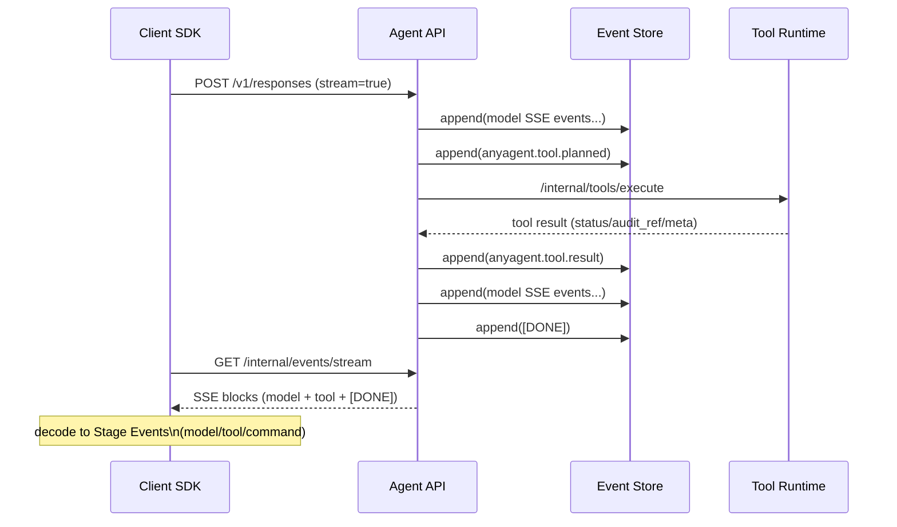

<!--
Single Source of Truth:
- External API contract: requirements.md#req-4 (Responses API) / requirements.md#req-4-4 (SSE)
- Internal events transport: apps/agent-api/src/anyagent_agent_api/internal/events.py
- Tool audit logging fields: docs/security/audit-logging.md
-->

# Agent API Client：阶段性事件（Stage Events）设计（v0）

目标：让内部封装的 `anyagent` Python client SDK 能以“阶段性结果”形式向上层返回更细粒度的运行进度，用于：

- UI/日志：展示“要调用什么工具 + 参数摘要”
- 可观测：展示“工具执行结果摘要 / 审计引用（audit_ref）”
- 便于调试：展示“将要执行的命令 / 命令执行结果摘要”

非目标（v0 明确不做）：

- 不做完整的多层 span 树（只做一层粒度：tool 与 command 作为同层 stage）
- 不在 client 侧发明第二套完整的 agent runtime（仍以 Responses API 为边界）
- 不默认把敏感信息（原始 arguments/output）落盘或对外透传（默认脱敏，见第 6 节）

## 1) 背景：为什么需要 Stage Events

OpenAI Responses API 的 SSE 事件流天然是“模型侧”的增量输出；但 anyagent 的服务端 loop 还会发生：

- tool 可见性计算（manifest）
- tool 执行（Tool Runtime）
- tool 输出回灌后继续推理（next turn）

因此我们希望 client SDK 能提供更“运行时语义”的事件层，至少能表达：

- `tool_planned`: 模型提出一个工具调用
- `tool_result`: 服务端实际执行完该工具，并拿到结果
- `command_planned/command_result`: 对命令类工具（如 `core.shell`/sandbox command）再拆出命令层摘要

## 2) 事件来源（Sources）

Stage Events 可以来自两个渠道：

1. **Responses SSE（外部兼容面）**

- 由 `POST /v1/responses?stream=true` 返回
- 事件本体为 OpenAI SDK typed models：`openai.types.responses.ResponseStreamEvent`
- 优点：标准化、兼容 OpenAI SDK
- 局限：无法稳定表达“工具已被执行并返回结果”的服务端阶段（除非服务端额外注入事件）

2. **anyagent Internal Events SSE（内部观测面）**

- 由 `GET /internal/events/stream?response_id=...&last_seq=...` 返回
- 返回的是持久化的 SSE blocks（`event:` + `data:`），按 `seq` 单调递增，最终以 `[DONE]` 结束
- 优点：天然支持断线补发与 replay；可承载 anyagent 自定义事件（例如 `anyagent.tool.*`）
- 局限：只建议内部使用；默认需要鉴权（同 Agent API key）

结论（推荐）：

- v0 的 client SDK 优先消费 `/internal/events/stream`，并在其中同时承载：
  - 原始 Responses SSE events（与外部兼容面一致）
  - anyagent 自定义 stage events（用于 tool/command 粒度）

## 3) 事件分层（One-Level Granularity）

v0 只做一层 stage：

- `model`：模型增量事件（OpenAI Responses stream events）
- `tool`：工具调用计划与结果（一个 `tool_call_id` 对应一对 begin/done）
- `command`：命令执行计划与结果（仅对“命令类工具”做派生；不再嵌套在 tool 下）

这样做的好处是：

- 上层消费简单（像一条事件流，不需要构建复杂树）
- 仍能满足“工具 + 命令”的可观测诉求

## 4) Stage Event 规范（Schema）

类型单一真源（SSOT）：

- Python typed models：`packages/anyagent/src/anyagent/protocol/stage_events.py`
- command 派生规则（best-effort，单一真源）：`packages/anyagent/src/anyagent/protocol/command_derivation.py`

### 4.1 通用字段（所有事件都应包含）

- `type: str`：事件类型（见下文）
- `response_id: str`：关联一次 `POST /v1/responses` 的执行实例
- `seq?: int`：来自 Event Store 的事件序号（internal events 场景必需）
  - `trace_id?: str`：若有（来自 `metadata.context.trace.trace_id`）
  - `ts_ms?: int`：事件产生时间戳（可选；若缺失由 client 收到时补齐）

实现说明（v0）：

- `/internal/events/stream` 会用 SSE 的 `id:` 字段承载 `seq`（而不是把 `seq` 注入 OpenAI Responses 事件 payload），SDK 解码时会把它填入 `StageEvent.seq`。

### 4.2 事件类型（v0 最小集合）

1. `anyagent.model.stream_event`

- `payload`: OpenAI Responses `ResponseStreamEvent` 的 JSON dict（typed model 可由 client 解码）

2. `anyagent.tool.planned`

- `tool_call_id: str`
- `tool_name: str`
- `arguments`: 默认仅返回摘要（见第 6 节）

3. `anyagent.tool.result`

- `tool_call_id: str`
- `tool_name: str`
- `status: str`：`completed|errored|cancelled|...`（以 Tool Runtime execute response 为准）
- `meta`: 至少包含：
  - `duration_ms?: int`
  - `output_truncated?: bool`
  - `audit_ref?: str`
- `output`: 默认仅返回摘要（见第 6 节）
- `error?`: 若失败则包含 `{type, code, message, retryable}`

4. `anyagent.command.planned`（由 Agent API 从命令类 tool 的 arguments 派生，best-effort）

- `command: StagePayloadSummary`（命令字符串的摘要；默认带安全 preview，必要时会因疑似敏感信息而不返回 preview）
- `workdir?: str`
- `timeout_ms?: int`
- `source_tool_call_id: str`
- `source_tool_name: str`

5. `anyagent.command.result`（由 Agent API 从命令类 tool 的 output 派生，best-effort）

- `exit_code?: int`
- `stdout/stderr`: 默认仅返回摘要（见第 6 节）
- `duration_ms?: int`
- `source_tool_call_id: str`
- `source_tool_name: str`

说明：`command.*` 事件只在满足“可可靠解析”的工具 schema 时生成；否则只产生 `tool.*` 事件。

## 5) 映射规则（Mapping）

### 5.1 从 Responses SSE 推导（best-effort）

当只有 OpenAI Responses stream 时，client 可以在看到“function tool call item”时产生 `anyagent.tool.planned`：

- 输入：`response.output_item.added` / `response.output_item.done`（或最终 `response.completed` 中的 `ResponseFunctionToolCall` item）
- 输出：`anyagent.tool.planned`

注意：在 anyagent 的 server-side tool loop 场景下，“工具执行结果”不一定会作为 Responses 输出返回，因此 `anyagent.tool.result` 无法稳定推导。

### 5.2 从 anyagent Internal Events 获取（推荐）

anyagent Agent API 应在以下时点向 Event Store 追加 stage events（并通过 `/internal/events/stream` 发送给 client）：

1. 在调用 Tool Runtime execute 之前：追加 `anyagent.tool.planned`
2. Tool Runtime 返回后：追加 `anyagent.tool.result`
3. 若 tool 属于命令类工具且可解析：额外追加 `anyagent.command.planned` / `anyagent.command.result`（best-effort）

client 映射：

- `anyagent.tool.planned` -> `anyagent.tool.planned`
- `anyagent.tool.result` -> `anyagent.tool.result`
- `anyagent.command.*` -> 直接透传为 `anyagent.command.*`（无需 client 自行派生）

实现约定（v0）：

- Agent API 判断“命令类工具”的主要依据是 Tool Runtime manifest tools 中的内部标记 `x-anyagent-kind: command`（SSOT：`anyagent.protocol.tool_manifest_extensions`）
- 若该标记不存在，则允许 name-based 规则作为 fallback（仅用于兼容/过渡）

注意（兼容性）：

- `anyagent.*` 属于 internal 观测事件，anyagent 会在对外 `POST /v1/responses` 的 SSE 回放路径中过滤掉它们，避免 OpenAI SDK 收到未知事件类型。

## 6) 安全与脱敏（默认策略）

### 6.1 默认不传输敏感 tool IO

默认情况下，Stage Events **不应**包含：

- 原始 `arguments_json`
- 原始工具输出（stdout/stderr/文件内容等）

默认只提供以下摘要字段（建议）：

- `bytes`: 字符串/JSON 的 UTF-8 字节数
- `sha256`: 对原始字符串/JSON canonical dump 的哈希
- `preview`: 最多 N 字符（例如 256），并明确标记 `preview_truncated=true`

### 6.2 显式 debug 开关（仅限可信环境）

允许在“可信内网/本地开发”场景开启 debug 观测（返回更多原文），但必须满足：

- 请求侧显式开启（例如 `metadata.context.debug.capture_tool_io=true`）
- 服务端仍要有硬性限长（避免 OOM/日志爆炸）
- 明确标记该事件为 `sensitive=true`，便于上层避免落盘或外发

与 v0 审计日志一致：即便在 debug 模式，也优先用 `audit_ref` 做关联，而不是无限制输出原文（见 `docs/security/audit-logging.md`）。

## 7) Mermaid：事件流示意

