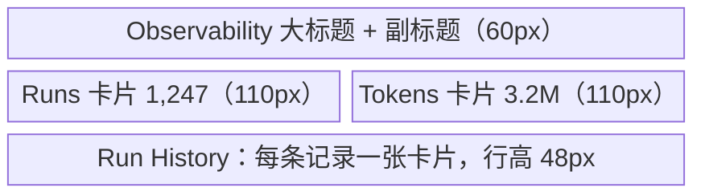
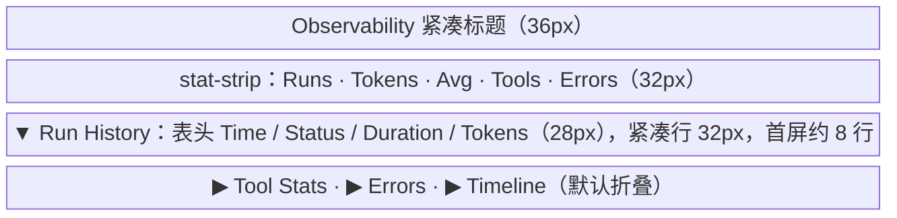

<!--
---
doc_kind: architecture
status: draft
tags: ["studio", "ui", "design-system", "optimization"]
summary: AnyAgent Studio 统一数据控制台设计优化方案
related: ["studio-pages-inventory.md", "studio-control-plane-and-observability.md"]
---
-->

# Studio UI Optimization Plan

本文档定义 AnyAgent Studio 统一数据控制台设计优化方案，将 Studio 从"功能原型"升级为"生产级高密度仪表盘"。

## 1. 设计目标

### 1.1 核心原则

1. **信息密度优先** - 对标 Grafana/Datadog，单屏展示尽可能多的有效信息
2. **扁平化层级** - 减少嵌套，清晰的视觉层级
3. **一致性体验** - 统一的组件、间距、颜色、交互模式
4. **响应式反馈** - 实时数据、乐观更新、明确的 loading/error 状态

### 1.2 量化目标

| 指标 | 当前 | 目标 | 提升 |
|---|---|---|---|
| Observability 首屏信息量 | ~5 条 run | 8-10 条 run + 聚合指标 | 60%+ |
| 页面加载时间 (P95) | ~800ms | <500ms | 37%+ |
| 垂直空间利用率 | ~40% | >65% | 62%+ |
| 组件复用率 | ~30% | >70% | 133%+ |

## 2. 设计系统重构

### 2.1 Layout 层级

| | 层级 | 层数 |
|---|---|---|
| 旧 | Page → Section → Card → Card.Header → Card.Content → Content | 6 |
| 新 | Page → Panel → Content | 3 |

**新层级定义**:

```css
.page-shell {
  padding: 16px;           /* 从 24px 降至 16px */
  gap: 12px;               /* 从 20px 降至 12px */
}

.panel {
  border: 1px solid var(--border);
  border-radius: 6px;      /* 从 12px 降至 6px */
  padding: 10px 12px;      /* 从 14-18px 降至 10-12px */
  background: var(--surface);
}

.panel-header {
  min-height: 36px;        /* 从 52px 降至 36px */
  padding: 8px 12px;       /* 从 14px 18px 降至 8px 12px */
  margin-bottom: 8px;      /* 从 12px 降至 8px */
}

.panel-content {
  padding: 0;              /* 移除额外 padding */
  gap: 6px;                /* 从 12px 降至 6px */
}
```

### 2.2 核心组件库

#### Stat Strip（替代 Metric Card）

```tsx
<div className="stat-strip">
  <div className="stat">
    <span className="stat-label">Total Runs</span>
    <span className="stat-value">1,247</span>
  </div>
  <div className="stat">
    <span className="stat-label">Tokens</span>
    <span className="stat-value">3.2M</span>
  </div>
  <div className="stat">
    <span className="stat-label">Avg Latency</span>
    <span className="stat-value">2.3s</span>
  </div>
  <div className="stat">
    <span className="stat-label">Error Rate</span>
    <span className="stat-value error">4.2%</span>
  </div>
</div>
```

**样式规格**:
```css
.stat-strip {
  display: flex;
  flex-wrap: wrap;
  gap: 2px 16px;
  padding: 8px 12px;
  background: var(--frost);
  border: 1px solid var(--border);
  border-radius: var(--radius-sm);
  font-size: 12px;
}

.stat {
  display: inline-flex;
  gap: 6px;
  align-items: baseline;
}

.stat-label {
  color: var(--ink-tertiary);
  font-weight: 400;
}

.stat-value {
  font-weight: 600;
  font-family: var(--font-mono);
  font-variant-numeric: tabular-nums;
  color: var(--ink);
}

.stat-value.error { color: var(--red); }
.stat-value.warning { color: var(--orange); }
.stat-value.success { color: var(--green); }
```

#### Compact Table

```tsx
<table className="compact-table">
  <thead>
    <tr>
      <th>Time</th>
      <th>Status</th>
      <th align="right">Duration</th>
      <th align="right">Tokens</th>
    </tr>
  </thead>
  <tbody>
    <tr>
      <td>14:23:45</td>
      <td><StatusBadge status="success" /></td>
      <td align="right">2.3s</td>
      <td align="right">1,247</td>
    </tr>
  </tbody>
</table>
```

**样式规格**:
```css
.compact-table {
  width: 100%;
  border-collapse: collapse;
  font-size: 13px;
}

.compact-table th {
  text-align: left;
  padding: 6px 10px;
  border-bottom: 1px solid var(--border);
  color: var(--ink-tertiary);
  font-weight: 500;
  font-size: 12px;
}

.compact-table td {
  padding: 6px 10px;
  border-bottom: 1px solid var(--border-light);
  height: 32px;            /* 从 48px 降至 32px */
}

.compact-table tbody tr:hover {
  background: var(--hover);
}

.compact-table [align="right"] {
  text-align: right;
  font-family: var(--font-mono);
  font-variant-numeric: tabular-nums;
}
```

#### Collapsible Section

```tsx
<details className="collapsible" open>
  <summary>
    <ChevronIcon />
    <span>Timeline Events (12)</span>
  </summary>
  <div className="collapsible-content">
    {/* 内容默认折叠 */}
  </div>
</details>
```

**样式规格**:
```css
.collapsible {
  border: 1px solid var(--border);
  border-radius: 6px;
  margin-bottom: 8px;
}

.collapsible summary {
  padding: 8px 12px;
  cursor: pointer;
  display: flex;
  align-items: center;
  gap: 8px;
  font-weight: 500;
  user-select: none;
}

.collapsible summary:hover {
  background: var(--hover);
}

.collapsible-content {
  padding: 0 12px 12px 12px;
}

.collapsible[open] summary svg {
  transform: rotate(90deg);
}
```

#### Status Badge

```tsx
<span className="status-badge status-success">Success</span>
<span className="status-badge status-error">Error</span>
<span className="status-badge status-warning">Warning</span>
<span className="status-badge status-neutral">Pending</span>
```

**样式规格**:
```css
.status-badge {
  display: inline-flex;
  align-items: center;
  gap: 4px;
  padding: 2px 8px;
  border-radius: 4px;
  font-size: 11px;
  font-weight: 500;
  line-height: 1.4;
}

.status-success {
  background: var(--green-soft);
  color: var(--green-dark);
}

.status-error {
  background: var(--red-soft);
  color: var(--red-dark);
}

.status-warning {
  background: var(--orange-soft);
  color: var(--orange-dark);
}

.status-neutral {
  background: var(--gray-soft);
  color: var(--ink-tertiary);
}
```

### 2.3 颜色系统

```css
:root {
  /* Base Colors */
  --background: #F7F4EF;      /* 温暖奶油背景 */
  --surface: #FFFFFF;
  --surface-frost: #FBF9F5;   /* 浅奶油面板 */
  --border: #E7E1D7;          /* 温暖发丝线 */
  --border-light: #F0EBE2;
  
  /* Text */
  --ink: #1F2421;             /* 主文本 */
  --ink-secondary: #5C635D;   /* 次要文本 */
  --ink-tertiary: #8B918C;    /* 三级文本 */
  
  /* Accent */
  --accent: #C4612F;          /* 赤陶橙 */
  --accent-hover: #A94E22;
  --accent-soft: #F2E3D6;
  
  /* Status */
  --green: #2E7D32;
  --green-soft: #E8F5E9;
  --green-dark: #1B5E20;
  
  --red: #C62828;
  --red-soft: #FFEBEE;
  --red-dark: #B71C1C;
  
  --orange: #EF6C00;
  --orange-soft: #FFF3E0;
  --orange-dark: #E65100;
  
  --gray-soft: #F5F5F5;
  
  /* Interactive */
  --hover: rgba(196, 97, 47, 0.08);
  --focus: rgba(196, 97, 47, 0.24);
  
  /* Elevation */
  --shadow-sm: 0 1px 3px rgba(31, 36, 33, 0.08);
  --shadow-md: 0 3px 8px rgba(31, 36, 33, 0.12);
  
  /* Spacing */
  --radius-sm: 4px;
  --radius-md: 6px;
  --radius-lg: 8px;
  
  /* Typography */
  --font-sans: 'Inter', system-ui, sans-serif;
  --font-serif: 'Fraunces', 'Georgia', serif;
  --font-mono: 'JetBrains Mono', 'Menlo', monospace;
}
```

### 2.4 Typography

```css
/* Headings */
h1, .text-h1 {
  font-family: var(--font-serif);
  font-size: 28px;
  font-weight: 500;
  line-height: 1.2;
  color: var(--ink);
}

h2, .text-h2 {
  font-family: var(--font-serif);
  font-size: 22px;
  font-weight: 500;
  line-height: 1.3;
  color: var(--ink);
}

h3, .text-h3 {
  font-family: var(--font-sans);
  font-size: 16px;
  font-weight: 600;
  line-height: 1.4;
  color: var(--ink);
}

/* Body */
.text-body {
  font-family: var(--font-sans);
  font-size: 14px;
  font-weight: 400;
  line-height: 1.5;
  color: var(--ink);
}

.text-small {
  font-size: 12px;
  color: var(--ink-secondary);
}

.text-tiny {
  font-size: 11px;
  color: var(--ink-tertiary);
}

/* Monospace */
.text-mono {
  font-family: var(--font-mono);
  font-size: 13px;
  font-variant-numeric: tabular-nums;
}

/* Weights */
.text-light { font-weight: 300; }
.text-regular { font-weight: 400; }
.text-medium { font-weight: 500; }
.text-semibold { font-weight: 600; }
```

## 3. 页面级优化

### 3.1 Observability 页面（示例重构）

**优化前** (首屏 ~5 条信息):



**优化后** (首屏 8-10 条 + 聚合):



**改进量化**:
- 垂直空间节省: ~45%
- 首屏信息量: +80%
- 视觉层级: 6层 → 3层

### 3.2 各页面优化要点

| 页面 | 核心优化 |
|---|---|
| **Home** | Chat 输入框固定底部，历史区域紧凑表格，stat-strip 概览 |
| **Agents** | Agent 卡片网格紧凑化，能力标签内联，去除冗余边框 |
| **Sessions** | Session 列表紧凑表格，聚合指标 stat-strip，drill-down 侧边栏 |
| **Observability** | 三级折叠（聚合 → 列表 → 详情），stat-strip 指标条，timeline 默认折叠 |
| **Evaluations** | Dataset 紧凑列表，候选 runs 表格，评测结果内联对比 |
| **Prompts** | 版本列表紧凑，diff 并排显示，preview 折叠 |
| **Configure** | Panels 紧凑网格，表单间距减小，effective config 折叠 |
| **Skills** | Skill 卡片紧凑网格，metadata 折叠，channel 内联选择 |
| **MCP** | MCP server 紧凑列表，draft 编辑器侧边栏，test 结果内联 |
| **Tools** | 双列布局（effective | available），紧凑表格，explain 弹窗 |
| **Credentials** | 紧凑表格，create 表单侧边栏，capability matrix 折叠 |
| **Debug** | Event 紧凑列表，JSON 折叠，sandbox 信息 stat-strip |
| **Audit** | 紧凑表格，时间范围选择器内联，audit_ref 链接高亮 |
| **Files** | 编辑器全屏模式，文件列表侧边栏，status 胶囊紧凑 |
| **Settings** | 表单紧凑垂直布局，health 信息 stat-strip，折叠高级选项 |

## 4. 交互模式统一

### 4.1 Loading 状态

```tsx
// Skeleton
<div className="skeleton skeleton-text" />
<div className="skeleton skeleton-table" />

// Spinner
<div className="spinner" />

// Progress
<div className="progress-bar">
  <div className="progress-fill" style={{width: '60%'}} />
</div>
```

**规则**:
- 首次加载: Skeleton（保持布局稳定）
- 刷新/重新加载: Spinner 或 Progress
- 局部更新: 乐观更新 + 后台刷新
- 长时间操作: Progress bar + 取消按钮

### 4.2 Error 状态

```tsx
// Inline error
<div className="error-banner">
  <AlertIcon />
  <span>Failed to load runs. <button>Retry</button></span>
</div>

// Empty state
<div className="empty-state">
  <EmptyIcon />
  <p>No runs found</p>
  <button>Create first run</button>
</div>
```

**规则**:
- API 错误: inline error banner + retry 按钮
- 网络错误: 自动重试 1 次，失败后 degraded 状态
- 空数据: empty state + 主要操作入口
- 表单验证: 字段下方 error message

### 4.3 成功反馈

```tsx
// Toast notification
<div className="toast toast-success">
  <CheckIcon />
  <span>Credential saved successfully</span>
</div>

// Inline success
<div className="success-banner">
  <CheckIcon />
  <span>Configuration applied</span>
</div>
```

**规则**:
- 创建/删除: Toast notification (3s 自动消失)
- 保存/更新: Inline success banner (5s 淡出)
- 长时间操作完成: Toast + 页面自动刷新

### 4.4 数据刷新策略

| 场景 | 策略 | 频率 |
|---|---|---|
| Chat 运行中 | SSE 实时流 | 实时 |
| Observability runs | 轮询 | 10s (运行中 5s) |
| Agent catalog | 缓存 + 按需刷新 | 30s stale |
| Tool catalog | 缓存 + 按需刷新 | 15s stale |
| Credentials | 缓存 + 乐观更新 | 60s stale |
| Debug events | SSE 或轮询 | 实时 / 5s |

## 5. 响应式布局

### 5.1 断点定义

```css
/* Mobile: < 768px */
/* Tablet: 768px - 1024px */
/* Desktop: 1024px - 1440px */
/* Large: > 1440px */

@media (max-width: 768px) {
  .page-shell { padding: 12px; }
  .stat-strip { flex-direction: column; }
  .compact-table { font-size: 12px; }
}

@media (min-width: 1440px) {
  .page-shell { 
    max-width: 1400px;
    margin: 0 auto;
  }
  .two-column { 
    grid-template-columns: 1fr 1fr;
  }
}
```

### 5.2 自适应规则

- **Sidebar**: Mobile 折叠为 hamburger menu
- **Stat-strip**: Mobile 垂直堆叠，Desktop 水平排列
- **表格**: Mobile 卡片视图，Desktop 表格视图
- **Panel**: Mobile 单列，Desktop 双列或三列网格

## 6. 性能优化

### 6.1 代码优化

```tsx
// 1. 虚拟滚动（大列表）
import { useVirtualizer } from '@tanstack/react-virtual'

function RunsList({ runs }) {
  const virtualizer = useVirtualizer({
    count: runs.length,
    getScrollElement: () => parentRef.current,
    estimateSize: () => 32,
  })
  
  return virtualizer.getVirtualItems().map(item => (
    <RunRow key={item.key} run={runs[item.index]} />
  ))
}

// 2. 防抖搜索
import { useDebouncedValue } from './hooks/useDebouncedValue'

function ToolsFilter({ onChange }) {
  const [text, setText] = useState('')
  const debouncedText = useDebouncedValue(text, 300)
  
  useEffect(() => {
    onChange(debouncedText)
  }, [debouncedText])
  
  return <input value={text} onChange={e => setText(e.target.value)} />
}

// 3. 请求取消
function useObservabilityRuns(agentId) {
  useEffect(() => {
    const controller = new AbortController()
    
    fetch(`/internal/observability/runs?agent_id=${agentId}`, {
      signal: controller.signal
    })
    
    return () => controller.abort()
  }, [agentId])
}

// 4. 懒加载图表
const ChartComponent = lazy(() => import('./ChartComponent'))

function ObservabilityPage() {
  return (
    <Suspense fallback={<Skeleton />}>
      <ChartComponent data={data} />
    </Suspense>
  )
}
```

### 6.2 Bundle 优化

- ✅ 已完成页面级 code splitting
- [ ] 图表库按需加载
- [ ] 编辑器库按需加载
- [ ] 图标库 tree-shaking

### 6.3 渲染优化

- [ ] React.memo 高频更新组件
- [ ] useMemo/useCallback 避免重复计算
- [ ] 虚拟滚动大列表（runs/events/timeline）
- [ ] IntersectionObserver 懒加载图片/图表

## 7. 实施计划

### Phase 1: 设计系统基础（1 周）

**Week 1**
- [ ] 创建 `components/design-system/` 目录
- [ ] 实现核心组件:
  - [ ] StatStrip
  - [ ] CompactTable
  - [ ] CollapsibleSection
  - [ ] StatusBadge
  - [ ] LoadingStates (Skeleton, Spinner, Progress)
  - [ ] ErrorBanner
  - [ ] Toast
- [ ] 更新 `styles.css` 颜色与 typography 系统
- [ ] 创建 Storybook 或组件预览页面

### Phase 2: 核心页面重构（2 周）

**Week 2**
- [ ] Observability 页面完整重构（示范页面）
- [ ] Sessions 页面优化
- [ ] Home 页面优化

**Week 3**
- [ ] Configure 页面优化
- [ ] Tools 页面优化
- [ ] Credentials 页面优化
- [ ] Settings 页面优化

### Phase 3: 次要页面与功能（2 周）

**Week 4**
- [ ] Skills/MCP/Files 页面优化
- [ ] Debug/Audit 页面优化
- [ ] Evaluations/Prompts 页面优化

**Week 5**
- [ ] 实时数据与缓存（SSE + SWR）
- [ ] 虚拟滚动大列表
- [ ] 性能优化与测试

### Phase 4: TypeScript SDK 迁移（1 周）

**Week 6**
- [ ] 迁移到 `@anyagent/sdk`
- [ ] 替换 `anyagentClient.ts` 类型
- [ ] 补充缺失的 SDK 方法
- [ ] 验证类型安全

### Phase 5: 图表与高级功能（2 周）

**Week 7-8**
- [ ] 集成图表库（recharts/chart.js）
- [ ] Observability 图表可视化
- [ ] 数据导出功能
- [ ] 搜索与过滤增强
- [ ] 编辑器语法高亮

## 8. 验收标准

### 8.1 视觉验收

- [ ] 所有页面使用统一颜色系统
- [ ] 所有页面遵循紧凑间距规范
- [ ] 所有指标使用 stat-strip 或 monospace 数字
- [ ] 所有表格行高 32-36px
- [ ] 所有 panel border-radius 6px, padding 10-12px

### 8.2 性能验收

- [ ] Observability 首屏显示 8+ 条 run
- [ ] 页面切换 <300ms（不含 API）
- [ ] 大列表（100+ 行）滚动流畅（60fps）
- [ ] API 请求带 loading 状态
- [ ] 错误自动重试 1 次

### 8.3 功能验收

- [ ] 所有页面支持数据刷新
- [ ] SSE 实时流正常工作
- [ ] 缓存策略正常工作（staleTime）
- [ ] 乐观更新正常工作
- [ ] Toast/Error/Empty 状态正常展示

### 8.4 可访问性验收

- [ ] 键盘导航正常
- [ ] Focus 状态清晰
- [ ] 颜色对比度符合 WCAG AA
- [ ] 屏幕阅读器可读

## 9. 风险与缓解

### 9.1 风险

1. **大规模重构影响稳定性**
   - 缓解: 逐页面增量重构，保持旧组件向后兼容

2. **用户习惯变化**
   - 缓解: 提供 "Classic View" 切换，收集反馈后逐步过渡

3. **性能回退**
   - 缓解: 每个 Phase 后进行性能测试，benchmark 对比

4. **TypeScript SDK 未就绪**
   - 缓解: SDK 迁移作为独立 Phase，可延后

### 9.2 回滚计划

- 保留旧组件在 `components/legacy/`
- 每个 Phase 完成后打 Git tag
- 发现严重问题时可回滚到上一个 tag

## 10. 成功指标

### 10.1 定量指标

| 指标 | 当前 | 目标 | 测量方法 |
|---|---|---|---|
| 首屏信息量 | ~5 条 | 8-10 条 | 手动计数 |
| 页面加载时间 | ~800ms | <500ms | Chrome DevTools |
| Bundle size | ~450KB | <350KB | Webpack bundle analyzer |
| 首屏渲染时间 | ~1.2s | <800ms | Lighthouse |

### 10.2 定性指标

- [ ] 用户反馈: "信息密度明显提升"
- [ ] 用户反馈: "页面响应更快"
- [ ] 用户反馈: "视觉更清晰"
- [ ] 开发反馈: "组件复用更方便"

## 11. 相关文档

- [studio-pages-inventory.md](./studio-pages-inventory.md) - Studio 页面功能清单
- [studio-control-plane-and-observability.md](./studio-control-plane-and-observability.md) - Studio 控制面与观测面
- [sdk-public-surface.md](../api/sdk-public-surface.md) - SDK public surface

## 12. 参考资料

- Grafana Dashboard 设计规范
- Datadog UI 设计系统
- GitHub Dark Mode 颜色系统
- Linear App 紧凑布局
