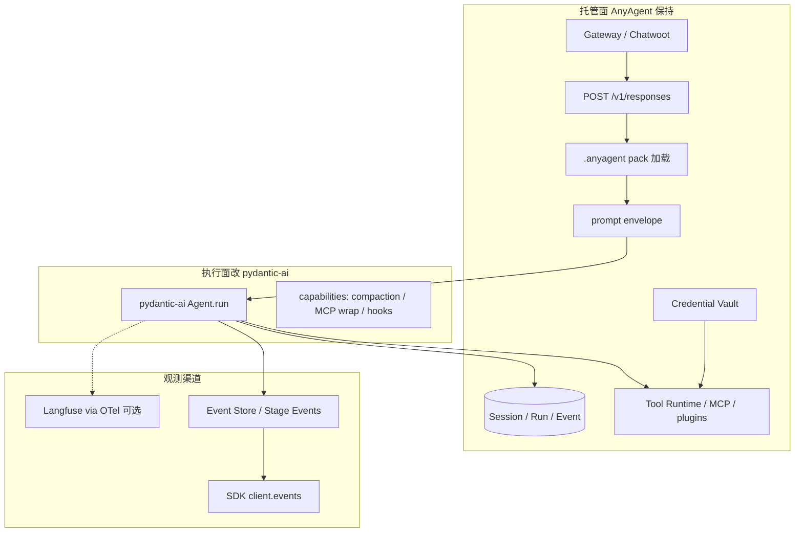

<!--
---
doc_kind: architecture
status: stable
tags: ["pydantic-ai", "agent-loop", "langfuse", "observability", "agent-packs", "hosting"]
summary: 托管面保持 AnyAgent Server；执行面 agent loop 换成 pydantic-ai；SDK 跟踪仍走 Event Store；Langfuse OTLP 为可选附加渠道；业务提示留在消费侧 .anyagent。
req: ["requirements.md#req-4", "requirements.md#req-4-5", "requirements.md#req-4-7", "requirements.md#req-5-13", "requirements.md#req-2-1"]
---
-->

# ADR: pydantic-ai Agent Loop + Langfuse Tracing

Status: Accepted  
Date: 2026-09-06  
Req: `requirements.md#req-4`、`requirements.md#req-4-5`、`requirements.md#req-4-7`、`requirements.md#req-5-13`、`requirements.md#req-2-1`  
Scope: Agent loop 实现、模型适配、agent tracing sink、workspace 提示/配置归属

## 决策结论

AnyAgent 继续做 **Agent Hosting Platform**，不再自研与 pydantic-ai 重叠的 agent loop 与 vendor translator。

| 层 | 继续由 AnyAgent own | 改为依赖 |
| --- | --- | --- |
| 托管面 | Gateway、`POST /v1/responses`、Session/Run/Event、lease、Credential Vault、Tool Runtime contract、Agent Pack 加载、Studio 查询面 | 不变 |
| 执行面 | 把 pack/prompt envelope/manifest 交给 loop 的适配层 | **pydantic-ai** 跑 model → tool → model |
| 跟踪 | Event Store / Stage Events 仍是 SDK 消费渠道（写库） | **Langfuse**（OTLP，可选）看 generation / tool / cost |

消费侧业务仓库的 `.anyagent/` 仍是 agent 行为与策略的配置真源。对业务项目而言，改 `AGENTS.md` / `agent.yaml` / skill **就是改业务逻辑**，不把提示搬进 SDK Python，也不平行引入 pydantic-ai YAML spec。

## 分层边界

对外契约不变：OpenAI Responses 兼容面、Stage Events、Tool Runtime HTTP、Gateway webhook。内部把 `run_tool_loop_nonstream` / `run_tool_loop_stream_live` 换成 pydantic-ai 适配器，调用方（`response_execution`、distributed responses、Chatwoot connector）不改拓扑。

不把 Temporal / DBOS / Prefect 接到 Chatwoot 热路径。那些是长任务引擎，会伤 TTFT。

## 配置与提示

### 业务 workspace `.anyagent` 是提示真源

配置即服务的单位仍是消费侧 workspace，不是 SDK 仓里的 `Agent(...)`。

| 文件 | 职责 | 是否业务逻辑 |
| --- | --- | --- |
| `.anyagent/agents/<id>/AGENTS.md` | 对客语气、guardrails、转化节奏 | 是。运行时注入模型 |
| `.anyagent/agents/<id>/agent.yaml` | 工具披露、skill 选择、sandbox、context_providers | 是。策略，不是散文 |
| `.anyagent/agents/<id>/mcp.json` | MCP 连接与凭证引用 | 是。能力接线 |
| `.anyagent/skills/**/SKILL.md` | **按需**流程与长手册 | 仅当不是每轮都要的程序 |
| `.anyagent/anyagent.yaml` 的 `models` | 模型/provider 目录 | 运行配置，与其他段在同一个文件 |
| `plugins/` + context provider 代码 | 业务工具与受信任上下文 | 代码，不进 markdown |

框架仓只规定 pack schema、注入顺序、来源 hash 审计。不在 `anyagent` 里写某个业务 agent 的 instructions。

workspace 根 `AGENTS.md` 继续只做研发 harness，不注入模型。见 [Agent Packs · AGENTS.md 注入语义](../runtime/agent-packs-and-runtime-config.md#agentsmd-注入语义)。

### 简化口径

要减的是 **双真源和平行 spec**，不是把 `.anyagent` 拆掉。

保留最小集：`AGENTS.md` + `agent.yaml` + 可选 `mcp.json`。没有 skill 的 workspace 必须能启动。

不要做：

1. **pydantic-ai `Agent.from_spec` / YAML agent spec 与 `.anyagent` 并存。** 一个 agent 只能有一套磁盘真源。
2. **把业务提示写进 SDK 的 `instructions=`。** coding agent 改 markdown pack，不改框架包。
3. **用 SKILL.md 再写一遍 persona。** skill 只承载可开关、可按需加载的程序；常开对客规则进 `AGENTS.md`。
4. **用 Langfuse Prompt Management 当运行时提示真源。** git 里的 `AGENTS.md` 仍是编辑与发布单位；Langfuse 只记录本次 run 的 prompt hash / 渲染结果。
5. **把 `.anyagent` 搬进框架仓。** 目录就是给业务配置用的。

`runtime.middlewares` 不再扩展自研 4-hook。压缩、循环检测映射为 pydantic-ai capabilities / hooks；`agent.yaml` 只声明要打开哪些能力名。现有 middleware 适配器可作过渡，不作为新能力入口。

## 跟踪：自研 Event Store 与 Langfuse

跟踪分两条渠道，不是互相替换。

| 渠道 | 数据 | 谁消费 | 原因 |
| --- | --- | --- | --- |
| **Event Store / Stage Events**（现网） | tool planned/result、command、prompt context、SSE `seq` | 本 SDK `client.events`（list/stream/replay），落库 | 消费侧已经走这条；resume、断线补发、业务仓日志也靠它 |
| **Langfuse（OTLP，可选）** | generation / tool span / token / cost | 人类在 Langfuse 里按 session 打开调用树 | pydantic-ai 已是 OTel-native；不绑 SDK 协议 |
| Session / Run Store | 快照、run 终态、idempotency | 服务端恢复与去重 | Langfuse 不能替代 |

Langfuse 通过标准 OTLP 接入，不把 Langfuse SDK 写进 agent loop。未配置 OTLP endpoint 时这条渠道关闭，Event Store 渠道不受影响，服务仍可跑。凭证只进消费侧 env / Infisical，不进 `agent.yaml`。

Studio 时间线不是本轮目标。Unified Observability Sink 仍可给 alert 用。

## 执行面替换范围

第一期适配器必须保持：

- `run_tool_loop_*` 的调用签名与 SSE 字节形态，让 Gateway / Responses 路由不改。
- Tool Runtime `manifest` / `execute` 仍是工具真源。pydantic-ai tools 是对 execute 的包装，不是第二套 handler。
- MCP 第一期继续经现有 MCP manager + Tool Runtime；不平行再拉一套 pydantic-ai MCP 进程。
- prompt envelope（`AGENTS.md`、context providers、skill catalog）在进入 pydantic-ai 之前组好，带 source path/hash。
- `.anyagent/anyagent.yaml` 的 `models` 映射为 pydantic-ai model 字符串；自研 Anthropic/Gemini HTTP translator 已删除。

MCP 第一期仍经现有 MCP manager + Tool Runtime。`tool_loop.py` 保留 `run_tool_loop_*` 入口；execute/manifest 在 `tool_execution.py`；适配器在 `agent_runtime/loop/`。`model_providers/` 只留协议和 OpenAI Responses 默认工厂；kind 目录在 `anyagent.config.models`。

## 明确不做

- 不改 Gateway / Chatwoot connector 拓扑。
- 不把 Session/Run/Event 换成 Langfuse。
- 不把 Temporal 接到 webhook 热路径。
- 不把 Rust 第二 runtime 当本轮 loop 替代。
- 不把业务 workspace 的提示或 skill 迁入本仓。
- 不新增第二套磁盘 agent spec。

## 后果

- 框架仓依赖增加 `pydantic-ai`；vendor 协议跟 pydantic-ai 走，不再跟自研 translator。
- 消费侧 workspace 布局不变，升级 SDK 后行为仍由 `.anyagent` 决定。
- SDK 消费侧继续走 Event Store / Stage Events（写库）。Langfuse 是附加 OTLP 渠道，未配置则关闭。
- `docs/architecture/api/model-provider-translators.md` 与 `runtime/agent-loop-middleware.md` 在替换完成后降为过渡/历史，以本文与 pack 文档为准。

## Evidence

- loop 入口：`packages/anyagent/src/anyagent/agent_runtime/tool_loop.py` 的 `run_tool_loop_*`；实现：`packages/anyagent/src/anyagent/agent_runtime/loop/`
- 分层与类型：`docs/architecture/runtime/agent-loop.md`
- 调用方：`packages/anyagent/src/anyagent/server/responses/response_execution.py`、`packages/anyagent/src/anyagent/server/routes/responses.py`
- pack / `AGENTS.md`：`docs/architecture/runtime/agent-packs-and-runtime-config.md`
- prompt envelope：`packages/anyagent/src/anyagent/agent_runtime/prompt_envelope.py`
- observability sink ADR：`docs/architecture/decisions/observability-replay-sink-and-retention.md`
