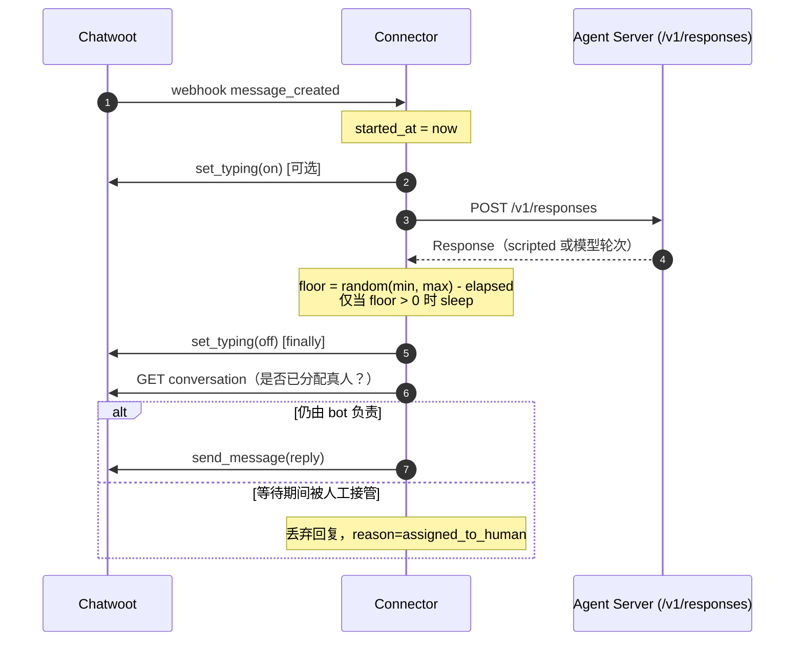

<!--
---
doc_kind: architecture
status: stable
tags: ["plugins", "connectors", "lark", "discord", "telegram"]
summary: Platform connector ownership, official-package policy, and current connector status.
---
-->

# Platform Connectors

AnyAgent Core owns the connector contract, not every platform implementation.

Core truth:

- `anyagent.plugins.PluginManifest`
- `anyagent.plugins.schema_export.export_plugin_manifest_schema`
- `anyagent.plugins.load_plugins_from_roots`
- `anyagent.tool_runtime.plugins.ToolRuntimePluginAPI`
- `anyagent.protocol.plugins.PluginCatalogResponse`
- `anyagent.protocol.plugin_capabilities.PluginCapabilityMatrix`
- Tool Runtime `/admin/plugins/catalog`
- Core / Tool Runtime `/admin/plugins/capabilities`
- SDK `AnyAgent.admin.plugin_catalog()`
- CLI `anyagent plugin catalog`

Contract decision: `docs/architecture/decisions/plugin-connector-contract-v1.md`.

Manifest schema artifact: `docs/schemas/plugin-manifest.schema.json`.

This repo ships only the built-in reference connector. Other connectors live in
business repos or standalone packages. A platform connector can be:

- an official upstream package or CLI integrated through skills
- an optional AnyAgent plugin package loaded with `--plugin-root`
- a gateway connector package for inbound platform events

## Current Status

| Platform | Current Core stance | Package / path | Notes |
|---|---|---|---|
| **Chatwoot** | Built-in reference implementation ✅ | `anyagent.plugins.builtin.chatwoot_connector` | Inbound channel connector with webhook receiver, HMAC signature verification, outbound message delivery, handoff, and conversation lifecycle events. Serves as the reference pattern for all platform connectors. See [Chatwoot Connector README](../../../packages/anyagent/src/anyagent/plugins/builtin/chatwoot_connector/README.md). |
| Lark / Feishu | Use official CLI and skills for outbound actions | `larksuite/cli`, `@larksuite/cli`, `lark-cli` | Outbound actions go through the official CLI and skills; no wrapper lives in this repo. Inbound webhook / gateway connectors are separate plugins or packages loaded through the Core plugin contract. |
| Discord | No in-repo framework implementation | optional connector package | Build it as a package with manifest, docs, schema, tests, and smoke validation. |
| Telegram | No in-repo framework implementation | optional connector package | Build it as a package with manifest, docs, schema, tests, and smoke validation. |
| Intercom | No in-repo framework implementation | optional connector package | Connector contract supports Intercom via `ConnectorWebhookAuth` / `ConnectorOutboundDelivery` / `ConnectorHandoff` interfaces. |

## Connector Contract Interfaces

The Gateway layer defines platform-agnostic connector contracts in
`anyagent.gateway.connector_contracts`. Any platform connector implements
these interfaces to integrate with the anyagent framework:

| Interface | Purpose | Required |
|---|---|---|
| `ConnectorWebhookAuth` | Inbound webhook signature/payload verification | Yes (for inbound channels) |
| `ConnectorOutboundDelivery` | Send agent replies back to the platform | Yes (for messaging channels) |
| `ConnectorHandoff` | Execute platform-side human handoff | Optional |
| `PlatformConversationEvent` | Inject platform conversation lifecycle events into anyagent event store | Optional |
| `HandoffOutputItem` | Agent-level structured signal to trigger handoff | Optional |
| `gateway.handoff` | Tool-based human handoff signal executed through active connector context | Optional |

Key design principles:
- **Platform-agnostic**: Contracts work for Chatwoot, Intercom, Zendesk, Telegram, etc.
- **Credential-safe**: Secrets go through Credential Vault (`credential_id` refs), never hardcoded.
- **Plugin-native**: Connectors are loaded as `--plugin-root` plugins with `plugin.json` manifests.

### Typing Indicator 与回复节奏

回复节奏是渠道呈现问题，不是生成问题，所以放在 connector，不放在 Agent Server。两个可选能力：

- `ConnectorOutboundDelivery.set_typing(platform_conversation_id, *, typing)`：可选能力。基类默认抛 `NotImplementedError`，调用方必须降级为 no-op，且 `typing=True` 必须与 `finally` 中的 `typing=False` 成对出现，避免指示器卡在 on。Chatwoot 通过 `toggle_typing_status` 实现，复用同一个 Agent Bot access token。
- **节奏下限（floor），不是 delay**：`/v1/responses` 返回后，connector 只把本轮补足到 `[min, max]` 秒内的随机值再发送。慢的模型轮次不会被拉长；瞬时轮次（例如 scripted reply，见 [agent-packs-and-runtime-config.md](../runtime/agent-packs-and-runtime-config.md#runtimescripted_reply_providers)）不再暴露“预设”。等待发生在**第二次人工接管检查之前**，等待期间被人工接管的会话不会被 bot 插话。

一次入站消息内的执行顺序（Chatwoot `_process_incoming_message`）：



typing 指示覆盖第 3–6 步，慢的模型轮次同样受益。floor（第 5 步）只补足提前结束的轮次；耗时 10 秒的模型轮次立即发送。人工接管二次检查（第 7 步）在等待之后执行。

Chatwoot 接线与环境变量（`CHATWOOT_TYPING_INDICATOR`、`CHATWOOT_REPLY_PACING_MIN_S` / `_MAX_S`，默认都关闭）：`packages/anyagent/src/anyagent/plugins/builtin/chatwoot_connector/README.md`。

### Handoff Signaling

AnyAgent currently supports two handoff signaling styles at the framework layer:

- `HandoffOutputItem`: structured output item for connector-aware post-processing.
- `gateway.handoff`: tool-based signal that stays compatible with the OpenAI Responses
  function-call path and executes through the active connector in `ToolContext.channel`.

For inbound webhook connectors, `gateway.handoff` is the most compatible main-path
option because it reuses the existing Tool Runtime manifest/execute contract instead
of requiring the upstream provider response schema to accept custom output item types.

For Chatwoot, the connector mutates conversation status in exactly two places
(both governed by `CHATWOOT_STATUS_CHANGES`, default `true` since
0.4.18): handoff toggles the conversation to `open`, and after the bot delivers
a customer-visible reply the conversation is kept `open` (pending / resolved /
snoozed / missing status are opened; already-open is left untouched). The
connector never resolves or snoozes. Closing a conversation is a human action.
Opting out with `CHATWOOT_STATUS_CHANGES=false` disables all
`toggle_status` calls while keeping assignment and the AI summary private note;
message delivery is unaffected.

Chatwoot still delivers `message_created` after a human takes the conversation.
Because this connector also opens bot-handled conversations, `status=open` is
not a handoff signal. Since `anyagent>=0.4.21` the connector skips agent
replies when the conversation is assigned to a human (`meta.assignee_type=User`
or `assignee.type=user`), including a live re-read before sending. Disable with
`CHATWOOT_SKIP_WHEN_ASSIGNED_TO_HUMAN=false`.

### Session Key Convention

```
{platform}:{account_id}:{conversation_id}
```

Examples:
- `chatwoot:1:42` — Chatwoot account 1, conversation 42
- `telegram:123456` — Telegram chat 123456
- `intercom:conv_abc` — Intercom conversation conv_abc

Helpers: `chatwoot_session_key()`, `telegram_session_key()`, `intercom_session_key()`
in `anyagent.gateway.connector_contracts`.

## Connector Acceptance

A connector is framework-grade only when all of these are true:

- It has a `plugin.json` manifest with stable `plugin_id`, `channels`, `entrypoint`,
  and docs/schema/test references.
- Registered tools are visible through `/admin/plugins/catalog`.
- Host support is visible through `/admin/plugins/capabilities`.
- SDK `AnyAgent.admin.plugin_catalog()` returns the same manifest and cite data.
- `anyagent plugin catalog` can inspect the connector without reading source code.
- Credentials are referenced by `credential_id` / `auth_ref`; plaintext secrets are
  not stored in agent config or plugin config.
- A targeted smoke proves manifest loading and at least one safe tool path.

Business repos may keep their own connector packages and business bundles, but the
connector contract itself stays in this repo.
