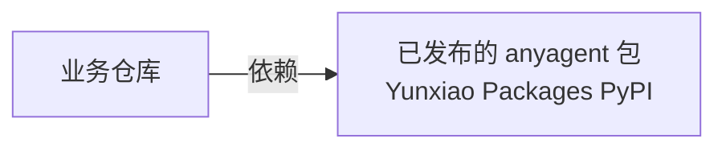

<!--
---
doc_kind: architecture
status: stable
tags: ["boundary", "framework", "consumer", "overview"]
summary: anyagent 框架与业务仓库的职责边界、依赖方向，以及业务仓库如何基于 anyagent 起步。
---
-->

# anyagent 与业务仓库的职责边界

anyagent 只提供框架：Server Core、SDK、Protocol、CLI 和内置 Studio。本仓不提供示例应用项目或部署模板仓库，业务方在自己的仓库里基于已发布的 `anyagent` 包搭建 agent 服务。

## 1. 框架负责什么

- 协议真源 `anyagent.protocol.*`，以及由它导出的 schema bundle 和 OpenAPI 文档。
- Agent Server 的两种部署形态（all-in-one 与拆分的 Agent API + Tool Runtime）、agent loop、Tool Runtime、MCP、Skills、Gateway 与 connector 契约。
- 存储接口与一致性语义（幂等、replay、resume、锁），以及 in-memory、SQLite、PostgreSQL、MySQL、Redis 适配器。
- 沙箱策略与后端适配、Credential Vault、Tool Policy。
- `anyagent` CLI、`AnyAgent` SDK 和内置 Studio。

模块清单见 [README.md](../../../README.md#已实现模块)，具体行为以代码为准。

## 2. 框架不做什么

- 不把默认安装变成重依赖包：PostgreSQL / MySQL / Redis / S3、外部凭据后端等通过 extras、插件或子命令按需启用。
- 不提供示例应用、业务 workspace 或部署模板。`anyagent init` 只生成最小可启动骨架。不写配置时，`anyagent serve` 使用内置 `main` agent。
- 不把示例 skill、示例 agent 配置上提为框架默认行为。
- 不做具体平台的业务接线配置。
- 不做 K8s / Helm / Docker Compose 等部署编排。

## 3. 业务仓库负责什么

- agent 配置：`.anyagent/anyagent.yaml`、`.anyagent/` 下的 Agent Pack、业务 skills。
- 业务插件与平台接入：按插件与 connector 契约实现，见 [platform-connectors.md](../integrations/platform-connectors.md)。
- 部署：进程编排，PostgreSQL / Redis / 对象存储 / OpenSandbox 等外部服务的部署与连接配置，网络策略和运行手册。
- 业务验收：针对所依赖的 `anyagent` 版本验证自己的 agent 行为。

## 4. 依赖方向

- anyagent 不得 import 或引用任何业务仓库的代码、配置或路径。
- 业务仓库不重新实现协议模型、agent loop 或 SDK client。扩展优先走插件、MCP、skills、CLI profile 和 `runtime` 扩展点；确实需要框架新增能力时，先在本仓修改协议与实现并发布新版本。

## 5. 业务仓库如何起步

1. 安装 `anyagent`。空目录可以直接 `anyagent serve`；需要骨架时用 `anyagent init --provider <provider> --model <model>`，见 [getting-started.md](../../guides/getting-started.md)。
2. 用 `anyagent doctor` 检查配置，用 `anyagent dev` 本地调试。
3. 生产部署按 [deployment.md](../../guides/deployment.md) 选择部署形态、存储和凭据后端。
4. 本仓 `.agents/skills/anyagent-dev/` 是面向业务仓库开发的 agent skill，汇总了初始化、配置、调试和部署的工作流。
