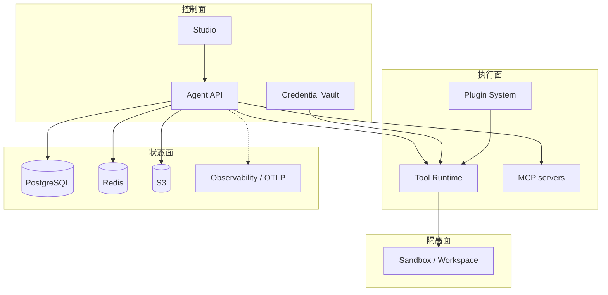
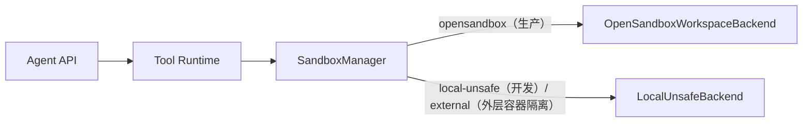
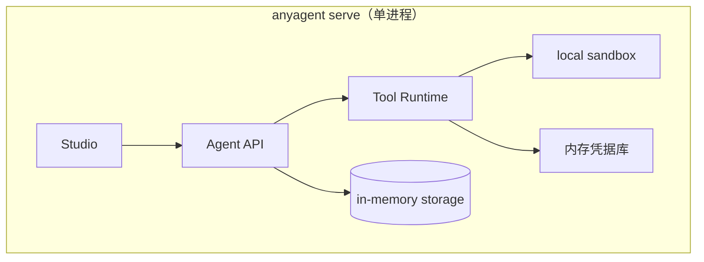
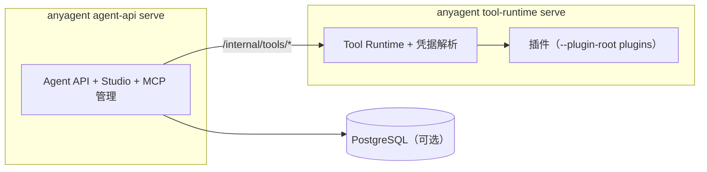
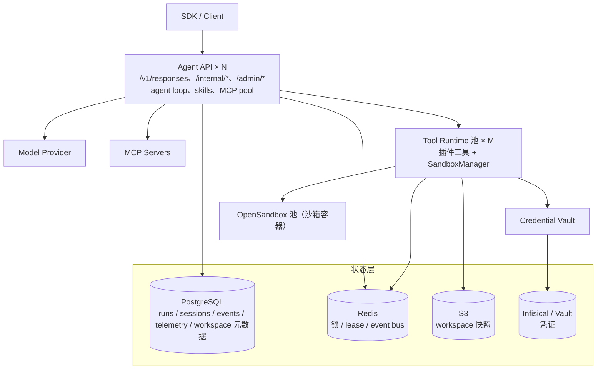
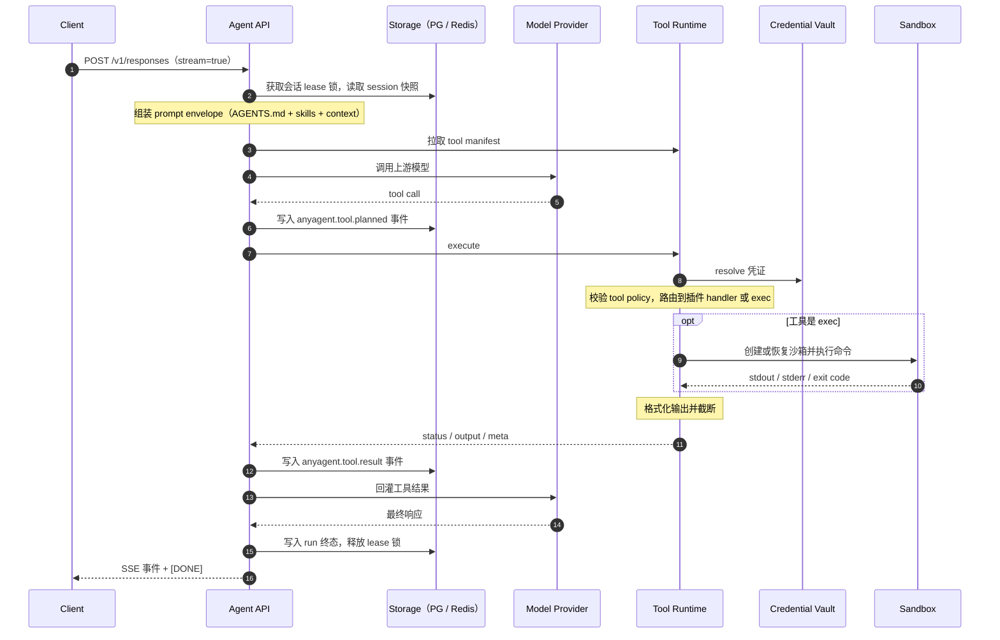

<!--
---
doc_kind: architecture
status: stable
tags: ["components", "deployment", "topology", "architecture", "overview"]
summary: AnyAgent 系统级组件职责划分、连接方式与推荐部署拓扑。
req: ["requirements.md#req-3-1", "requirements.md#req-5", "requirements.md#req-6", "requirements.md#req-8", "requirements.md#req-12"]
---
-->

# AnyAgent 系统组件架构

本文从部署视角定义 AnyAgent 的一等组件、职责边界、组件间连接协议与推荐拓扑。

设计原则：

- 组件按"控制面 / 执行面 / 隔离面 / 状态面"四个维度划分
- 单进程 all-in-one 与分布式拆分共享同一套 protocol contract
- 组件间通过 typed internal API 或标准协议连接，不共享进程内存

---

## 1. 组件总览

按控制面 / 执行面 / 隔离面 / 状态面划分。单进程 all-in-one 与分布式拆分共用同一套 protocol。Agent loop 在 Agent API 进程内，细节见 [agent-loop.md](../runtime/agent-loop.md)。



---

## 2. 组件职责定义

### 2.1 Agent API（控制面核心）

| 属性 | 值 |
|---|---|
| 进程命令 | `anyagent serve`（all-in-one）或 `anyagent agent-api serve`（独立） |
| 对外端口 | `/v1/responses`、`/internal/*`、`/admin/*` |
| 所属维度 | 控制面 |

职责：

- 对外提供 OpenAI Responses API 兼容的 `/v1/responses` 端点
- Agent Pack 加载：从 `.anyagent/` 读取 agent.yaml、AGENTS.md、mcp.json
- Skills 选择与 prompt context 注入
- Agent loop：经 `run_tool_loop_*` 把 envelope / manifest 交给 pydantic-ai；工具仍走 Tool Runtime execute。见 [agent-loop.md](../runtime/agent-loop.md)
- MCP server 连接管理与工具发现
- Session 序列化 / manifest cache / runtime config merge
- Run/Event/Session 存储写入与查询
- Observability 事件发射与查询 API
- 调用 Tool Runtime 执行工具（进程内或远端）

不负责：

- 直接执行插件工具逻辑（委托给 Tool Runtime）
- 沙箱容器生命周期管理（委托给 Sandbox Runtime）
- 凭证明文存储（委托给 Credential Backend）

### 2.2 Tool Runtime（执行面核心）

| 属性 | 值 |
|---|---|
| 进程命令 | `anyagent tool-runtime serve` |
| 对外端口 | `/internal/tools/manifest`、`/internal/tools/execute`、`/internal/tools/cancel` |
| 所属维度 | 执行面 |

职责：

- 工具注册与 manifest 构建（core/app/sandbox/channel 命名空间）
- 工具执行：接收 Agent API 的 execute 请求，路由到对应 handler
- 插件加载：从 `TOOL_RUNTIME_PLUGIN_ROOTS` 动态加载插件包
- Credential resolution：将 `auth_ref` 解析为 handler context 中的 `_credentials`
- Tool policy enforcement：校验工具调用权限
- 幂等与去重：基于 `response_id:tool_call_id` 的幂等键
- 输出限长与审计字段注入
- Sandbox 工具路由：`exec` 等保留名工具委托给 Sandbox Runtime

不负责：

- Agent loop 编排（属于 Agent API）
- MCP 工具发现与执行（属于 Agent API 侧 MCP 管理）
- 会话/Run 状态管理（属于 Agent API + Storage）

### 2.3 Plugin System（执行面扩展）

| 属性 | 值 |
|---|---|
| 形态 | `plugins/<plugin-id>/plugin.json` + `plugin.py` |
| 加载方 | Tool Runtime |
| 所属维度 | 执行面 |

职责：

- 注册工具名（如 `reddit.search_posts`）
- 声明参数 schema 与 credential spec
- 在 handler 中调用外部 API 完成业务逻辑

部署方式：

- 随 workspace 打包：Tool Runtime 启动时 `--plugin-root plugins` 加载
- 镜像内置：多个 Tool Runtime 副本加载同一套插件目录

约束：

- 插件不是独立部署单元，是 Tool Runtime 的扩展包
- 插件只能注册自身命名空间的工具，不得注册 `core.*` / `sandbox.*`
- 插件 credential 通过 `auth_ref` 声明，由 Tool Runtime 的 credential resolver 注入

### 2.4 MCP Servers（执行面 - 外部工具源）

| 属性 | 值 |
|---|---|
| 协议 | stdio / HTTP / SSE / Streamable HTTP |
| 管理方 | Agent API |
| 所属维度 | 执行面 |

职责：

- 作为独立工具源提供工具发现与执行能力
- 通过标准 MCP 协议暴露工具 schema 与执行入口

连接方式：

- stdio MCP：由 Agent API 进程拉起的 sidecar / 本地子进程
- HTTP/SSE MCP：独立部署的远程服务，Agent API 通过连接池管理

关键约束：

- MCP 工具由 Agent API 侧管理（发现、调用、credential 注入），不经过 Tool Runtime
- 凭证通过 MCP credential resolver 注入，不写入 `mcp.json`
- MCP tools 与 Tool Runtime tools 在 manifest 阶段合并，执行阶段按命名空间路由

### 2.5 Sandbox / Workspace Runtime（隔离面）

| 属性 | 值 |
|---|---|
| 调用方 | Tool Runtime（通过 SandboxManager 路由） |
| 后端 | LocalUnsafe / OpenSandbox / External |
| 所属维度 | 隔离面 |

职责：

- 为 `exec` 工具提供命令执行环境（per-session 文件系统隔离）
- 管理 sandbox 生命周期：创建、执行、快照、休眠、销毁
- 工作区文件系统持久化：热态工作区 + 冷归档快照
- 网络隔离：egress policy 阻止访问内部服务
- 资源限制：CPU/Memory/Disk 配额由 `ResourceLimits` 控制

分层架构：



关键约束：

- Agent loop 不感知 sandbox 后端，只消费 `exec` tool
- Sandbox 不挂载凭证，不暴露宿主文件系统
- per-session sandbox：同 session 内命令共享文件系统（有状态工作流）
- 跨实例恢复通过 S3 snapshot + Redis lease 实现

### 2.6 Storage Services（状态面）

| 属性 | 值 |
|---|---|
| 逻辑组件 | Session Store / Run Store / Event Store / Dedupe / Lock |
| 物理后端 | PostgreSQL + Redis + S3 |
| 所属维度 | 状态面 |

职责与后端映射：

| 逻辑组件 | 职责 | 推荐后端 |
|---|---|---|
| Session Store | 会话快照、消息历史、runtime config | PostgreSQL |
| Run Store | run 元数据与状态机（started/completed/errored/aborted） | PostgreSQL |
| Event Store | 增量事件日志，支持断线补发（`seq` 单调递增） | PostgreSQL |
| Dedupe Cache | `idempotency_key → run snapshot`，防重试重复执行 | Redis（热）+ PostgreSQL（持久） |
| Lock Service | `session_partition_key` 租约锁，保证会话内串行 | Redis |
| Event Bus | Worker → Ingress 的实时事件广播 | Redis PubSub |
| Snapshot Store | sandbox workspace 文件系统快照 | S3-compatible |
| Telemetry Store | 观测事件持久化 | PostgreSQL |

关键约束：

- 开发态可全部用 in-memory 替代（`anyagent serve` 默认）
- 外置存储驱动为可选 extras：`anyagent[postgres]`、`anyagent[redis]`
- Storage interface 属于 Core；deployment wiring 属于应用层

### 2.7 Credential / Secret Backend（控制面 - 安全）

| 属性 | 值 |
|---|---|
| 接口 | Admin CRUD + read-only resolve |
| 后端 | Env / File / Infisical / Database(future) / Vault(future) |
| 所属维度 | 控制面 |

职责：

- 凭证存储与生命周期管理（创建、读取引用、删除、轮转）
- 凭证解析：将 `credential_id` / `auth_ref` 解析为实际 secret 值
- 为 Tool Runtime 和 MCP 连接注入凭证
- 审计日志：记录凭证访问事件

关键约束：

- Agent 只见 `credential_id`，不见明文
- Read API 不回显 secret value，只返回引用信息与 capability metadata
- Tool Runtime 通过 `auth_ref` 声明凭证需求，Credential Backend 在执行时注入
- 当前 Phase 1-2 使用 Env/File/Infisical；Phase 3 引入 Database/Vault backend

### 2.8 Studio（控制面 - 前端）

| 属性 | 值 |
|---|---|
| 形态 | 静态前端（SPA），内嵌于 `anyagent serve` 或独立部署 |
| 消费 API | `/v1/responses`、`/internal/*`、`/admin/*` |
| 所属维度 | 控制面 |

职责：

- Agent 会话交互界面
- Agent catalog 浏览与配置
- Skills / MCP / Tools 管理与启用
- Credential 管理（只操作引用）
- Observability 面板：run timeline、event replay、prompt context 审计
- Debug 入口：prompt bundle preview、tool manifest 查看

关键约束：

- Studio 是纯 typed API consumer，不读取 server 内部 Python 模块
- Studio 不直接读数据库或日志后端
- 所有数据通过 shared typed client facade 收口

### 2.9 Observability / Telemetry（状态面 - 观测）

| 属性 | 值 |
|---|---|
| 内部 API | `/internal/observability/*` |
| 存储 | PostgreSQL `telemetry_events` 表 |
| 所属维度 | 状态面 |

职责：

- Normalized telemetry event 收集与持久化
- Run timeline 查询
- Token usage / latency / tool execution 统计
- 可选 HTTP collector sink 对接外部分析系统

关键约束：

- 观测查询面在 Agent API 进程内
- 存储/collector 可独立外置
- Studio 通过 `/internal/observability/*` 消费，不直接查数据库

---

## 3. 组件间连接协议

### 3.1 连接矩阵

| 调用方 | 被调用方 | 连接方式 |
|---|---|---|
| Client / SDK | Agent API | HTTP：`POST /v1/responses`（SSE） |
| Studio | Agent API | HTTP：`/v1`、`/internal/*`、`/admin/*` |
| Agent API | Tool Runtime | 进程内调用，或 HTTP `/internal/tools/*` |
| Agent API | MCP Servers | stdio / HTTP+SSE / Streamable HTTP |
| Agent API | Model Provider | HTTPS：OpenAI / Anthropic / Gemini API |
| Agent API | Storage | TCP：PostgreSQL / Redis |
| Agent API | Credential Vault | 进程内接口 |
| Tool Runtime | Sandbox | HTTP：OpenSandbox Lifecycle API + execd 代理 |
| Tool Runtime | Credential Vault | 进程内 resolve |
| Tool Runtime | Plugin | 进程内 Python 调用 |
| Sandbox 管理（宿主侧） | S3 / Redis | 快照存取、lease 续租 |

### 3.2 关键接口契约

#### Agent API ↔ Tool Runtime

三个端点：`POST /internal/tools/manifest`、`POST /internal/tools/execute`、`POST /internal/tools/cancel`。请求与响应字段以 `anyagent.protocol.tool_runtime` 中的模型为准，语义见 [tool-runtime-contract.md](../tool-runtime/tool-runtime-contract.md)。鉴权：mTLS 或签名 JWT / internal key。

#### Agent API ↔ Model Provider

请求上游 LLM（OpenAI / Anthropic / Gemini）时携带 `tools[]`、system prompt 和输入消息，接收流式响应（含 tool calls），再把工具结果回灌继续推理，直到得到最终响应。loop 细节见 [agent-loop.md](../runtime/agent-loop.md)。

#### Agent API ↔ MCP Server

- stdio 模式：Agent API 拉起子进程，通过 stdin/stdout 走 JSON-RPC。
- HTTP / SSE 模式：Agent API 用 HTTP POST 调用工具，通过 SSE 接收结果流。
- 凭证注入：`mcp.json` 声明 `credential_id`，由 Credential Vault 解析后注入 `Authorization` header。

#### Tool Runtime ↔ Sandbox

- OpenSandbox Lifecycle API（`/sandboxes`）：创建、查询、删除沙箱，并获取 execd 代理地址。
- execd 代理：在沙箱内执行命令、上传和下载文件。
- 快照由 Core 打包 workspace 后写入快照存储，不依赖 OpenSandbox 的快照接口。

实现见 `packages/anyagent/src/anyagent/server/sandbox/opensandbox_backend.py`。

---

## 4. 部署拓扑

### 4.1 本地最小（开发 / Demo）



命令：`anyagent serve`

特点：
- 零外部依赖，一条命令启动
- 所有组件进程内通信
- in-memory session/run/event store
- LocalUnsafe sandbox（不隔离，仅适合可信环境）
- 适合：本地开发、demo、轻量业务 workspace

### 4.2 插件型小生产



命令：
```bash
anyagent agent-api serve --tool-runtime-url http://tool-runtime:8788
anyagent tool-runtime serve --plugin-root plugins --port 8788
```

特点：
- Agent API 与 Tool Runtime 分进程，可独立扩容
- Tool Runtime 按 plugin 需求水平扩展
- PostgreSQL / Redis 可选（不配置则 fallback in-memory）
- 适合：小团队生产、单租户部署

### 4.3 生产级全拓扑



特点：
- Agent API 无状态多副本，通过 Redis lease 保证会话内串行
- Tool Runtime 独立池，可按工具负载独立扩容
- OpenSandbox 提供真正的命令执行隔离
- PostgreSQL 是持久化单一真源
- Redis 承载低延迟协调（lock、lease、pubsub）
- S3 承载大体积 workspace snapshot
- Credential 走 Infisical 或 Vault，不在进程内持有明文

---

## 5. All-in-One 与分布式的统一性

`anyagent serve`（all-in-one）与分布式拆分共享同一套代码路径：

| 关注点 | All-in-One | 分布式 |
|---|---|---|
| Agent API ↔ Tool Runtime | 进程内函数调用 | HTTP `/internal/tools/*` |
| Storage | in-memory adapter | PostgreSQL + Redis adapter |
| Sandbox | LocalUnsafe（本地目录） | OpenSandbox（容器隔离） |
| Credential | EnvBackend | Infisical / Vault |
| MCP | 子进程 stdio | 远程 HTTP/SSE |
| Studio | 内嵌静态资源 | 可独立部署 |

切换方式（取值以代码为准，查询入口见 [guides/README.md](../../guides/README.md#以代码为准)）：

- Tool Runtime：`anyagent agent-api serve` 通过 `--tool-runtime-url` 或 `tool_runtime.base_url`（环境变量 `TOOL_RUNTIME_BASE_URL`）调用远端 Tool Runtime。
- 存储：`storage.profile`（环境变量 `STORAGE_PROFILE`）。
- 沙箱：agent 的 `sandbox.mode`；独立 Tool Runtime 另有 `sandbox.backend`（环境变量 `SANDBOX_BACKEND`）。
- 凭据：`credentials.backend`（环境变量 `CREDENTIAL_BACKEND`），可写性是 `credentials.writable`。

---

## 6. 数据流全景

### 6.1 一次 tool call 的完整路径（分布式模式）



### 6.2 凭证流（Credential Flow）

插件工具通过 `ToolDefinition.credentials` 声明需要的凭证，执行时由 Tool Runtime resolve 并注入 handler 的 `_credentials`。完整流程见 [credential-vault.md](../../security/credential-vault.md#22-凭证流转路径)。安全边界：

- Agent 只见 `credential_id`。
- Tool Runtime 在执行时 resolve，不持久化明文。
- 沙箱内不注入任何凭证。

---

## 7. 扩容与隔离策略

| 组件 | 扩容维度 | 隔离边界 |
|---|---|---|
| Agent API | 水平扩容（无状态），通过 Redis lease 保证会话串行 | 租户级：`tenant_id` 隔离数据访问 |
| Tool Runtime | 按工具负载水平扩容，可按命名空间分池 | 进程级：不同 plugin 共享进程但 handler 隔离 |
| Sandbox | 按并发 exec 数扩容 | 容器级：per-session 独立文件系统与网络 |
| Storage | PostgreSQL 读写分离 / Redis cluster | 数据级：`session_partition_key` 分片 |
| MCP Servers | 按 MCP server 类型独立扩容 | 进程级：每个 MCP server 独立进程/服务 |

---

## 8. 相关文档

- [roadmap.md](roadmap.md)：分阶段路线图
- [../api/responses-api-sdk-and-server.md](../api/responses-api-sdk-and-server.md)：SDK + Server 泳道
- [../tool-runtime/tool-runtime-contract.md](../tool-runtime/tool-runtime-contract.md)：Tool Runtime 接口契约
- [../runtime/stateless-agent-service-architecture.md](../runtime/stateless-agent-service-architecture.md)：无状态服务并发架构
- [../runtime/sandbox-session-filesystem-design.md](../runtime/sandbox-session-filesystem-design.md)：沙箱文件系统设计
- [../storage/storage-minimal-design.md](../storage/storage-minimal-design.md)：存储最小设计
