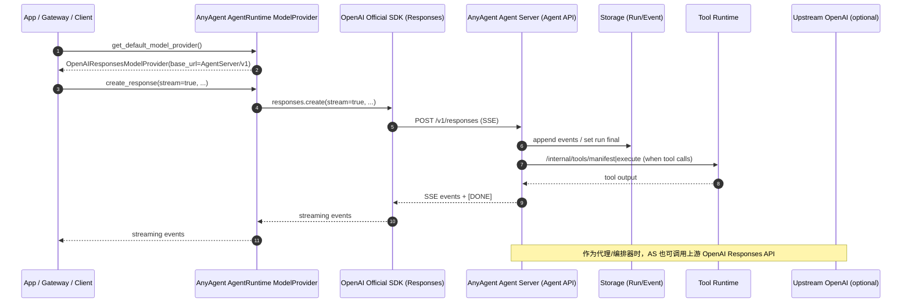

<!--
Single Source of Truth:
- External API contract: requirements.md#req-4 (Responses API) / requirements.md#req-4-4 (SSE)
- This doc focuses on swimlanes + module boundaries (how we wire it in code).
-->

# Responses API：SDK 接入与 Agent Server（AnyAgent）

目标：让 **接入侧（Agent SDK）** 与 **服务侧（Agent Server）** 都围绕 OpenAI **Responses API**（`POST /v1/responses` + SSE）形成一个稳定、可复用、类型清晰的接口面。

## 1) 关键约定

- **对外协议 SSOT**：`requirements.md#req-4`（Responses API）与 `requirements.md#req-4-4`（SSE）
- **服务侧**：AnyAgent Agent API 对外暴露 `POST /v1/responses`
- **接入侧**：优先使用 OpenAI 官方 SDK 的 Responses API 能力（类型/模型由官方维护），AnyAgent 提供 *Factory/Singleton* 负责配置与复用

## 2) 泳道（Swimlane）视角

## 3) 模块边界（Pattern）

- **Factory**：`anyagent.agent_runtime.model_providers` 提供 `create_openai_responses_model_provider()`
- **Singleton**：`anyagent.agent_runtime.model_providers` 提供 `get_default_model_provider()`（避免重复初始化 SDK client）
- **协议工具 SSOT**：SSE 解析/编码在 `anyagent.protocol.sse` 收敛（供 SDK/Server 复用）

## 4) Client SDK（AnyAgent Python）

AnyAgent 同时提供一个面向 **Agent API** 的 Python client（用于“接入侧 SDK 代码”复用与对齐）：

- `anyagent.agent_api_client.AnyAgentAgentAPIClient`
  - `create_openai_clients()`：创建 OpenAI 官方 SDK `OpenAI/AsyncOpenAI`，并自动把 `base_url` 指向 `Agent API /v1`
  - `list_events()/stream_events()`：访问 `GET /internal/events/list|stream`（用于断线补发、调试、replay 观测）
  - `list_skills()`：访问 `GET /internal/skills/list`（用于技能披露与审计）

说明：

- 外部兼容面仍以 OpenAI 官方 SDK 为主（Responses API typed models 由官方维护）
- AnyAgent client 主要解决 “AnyAgent 专有 internal endpoints + 正确拼接 base_url/auth” 的重复劳动
- `/internal/events/stream` 会在 SSE 的 `id:` 字段输出事件 `seq`（Event Store 序号），SDK 会将其映射为 `StageEvent.seq`，便于断线续传与 replay 观测
- 若希望获得 tool/command 粒度的阶段性事件（stage events），见：`docs/architecture/agent-api-client-stage-events.md`
