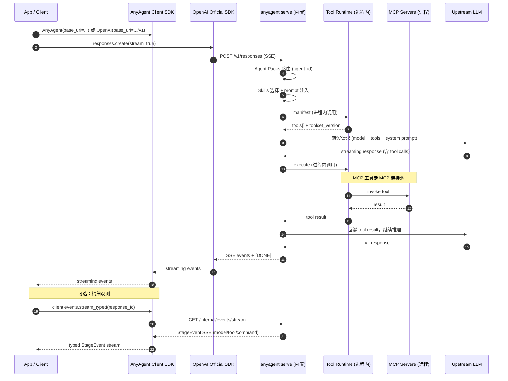
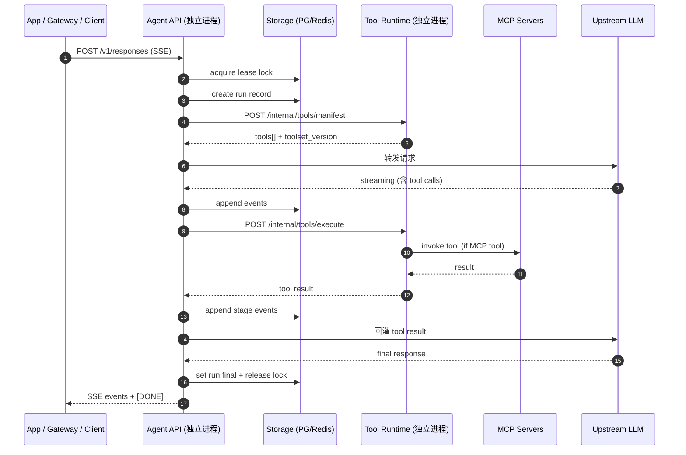

<!--
---
doc_kind: architecture
status: stable
tags: ["responses-api", "sdk", "server", "swimlane", "openai-compat", "stage-events"]
summary: SDK 接入与内置 Agent Server 的泳道视角与模块边界，覆盖 OpenAI 兼容层与 anyagent 精细层。
---
-->

# Responses API：SDK + 内置 Agent Server（anyagent）

目标：让 **接入侧（Client SDK）** 与 **服务侧（内置 Agent Server）** 都围绕 OpenAI **Responses API**（`POST /v1/responses` + SSE）形成一个稳定接口面，同时通过 anyagent 超集提供细粒度中间结果。

## 1. 两层 API 输出

anyagent 提供两层 API 输出，覆盖从"极简接入"到"精细观测"的完整需求：

| 层级 | 协议 | 内容 | 适用场景 |
|---|---|---|---|
| **OpenAI 兼容层** | `POST /v1/responses` + SSE | OpenAI Responses API 标准事件流 | 任意 OpenAI SDK 直连；极简集成 |
| **anyagent 精细层** | `GET /internal/events/stream` → StageEvent | tool/command 粒度的阶段性事件 | UI 进度展示、调试、审计、断线续传 |

## 2. 泳道视角

### 2.1 内置 Server 模式（`anyagent serve`）



### 2.2 分布式模式（anyagent-apps）



## 3. 模块边界

### 3.1 协议层（`anyagent.protocol.*`）

- Wire-level contract SSOT
- SSE 编解码：`anyagent.protocol.sse`
- OpenAI Responses helpers：`anyagent.protocol.openai_responses`
- Stage Events 类型定义：`anyagent.protocol.stage_events`
- Tool Runtime 协议模型：`anyagent.protocol.tool_runtime`

### 3.2 运行时层（`anyagent.agent_runtime.*`）

- Model Providers（OpenAI Responses / Anthropic / Gemini）
- Tool loop（tool call 提取 → execute → 回灌 → 继续推理）
- PromptEnvelope / ContextFragments（稳定前缀 + 结构化上下文片段）
- Prompt 注入（AGENTS.md / selected skills -> structured fragments -> provider role mapping）
- Skills 注入（selected skills → instructions + tool names）
- Session runtime（config merge / snapshot / resume）

补充约束：

- `PromptEnvelope`、`PromptContextAudit`、`PersistedSessionSnapshot` 等上下文编排相关数据模型应以 `anyagent.protocol.prompt_context`、`anyagent.protocol.session_snapshot` 为真源
- 运行时应优先构建统一的 `PromptEnvelope`，再由 provider adapter 决定映射到 `developer` / `system`
- AGENTS stack 在 v0 先收敛为 `workspace + agent-pack` 两层，更多 roots 延后再扩展
- `AGENTS.md` 与 skills 正文不再视为自由文本块，而应视为带 `path` / `sha256` / `stable_id` 的结构化 contextual fragments
- 若 provider 支持 prompt/prefix cache，稳定前缀应通过 `prompt_cache_key` 暴露
- `environment_context` 应作为独立 fragment 接入请求体，而不是混入自由文本说明；如需进入缓存，应明确区分其稳定字段与高波动字段
- 当 agent 启用 sandbox 且 `exec` 真正可见时，运行时应自动注入 `sandbox_guidance` fragment，而不是只把 `sandbox_mode` 混入环境字段
- built-in server 应提供一个 internal prompt bundle preview 入口，用于把 rendered fragments、manifest tools、tool context、`effective_body` 与 `applied_body` 一次性展示出来

### 3.3 内置 Server 层（`anyagent.server/`）

- FastAPI app + `POST /v1/responses` + SSE streaming
- 进程内 Tool Runtime（manifest + execute，共享进程内存）
- In-memory Session/Run/Event Store
- MCP 连接池管理
- Credential Vault（EnvBackend 默认）
- Tool Policy enforcement

### 3.4 Client SDK（`AnyAgent`）

```python
from anyagent import AnyAgent

client = AnyAgent(api_key="...", base_url="http://127.0.0.1:8787")

# ── OpenAI 兼容面 ──
oa = client.openai                       # 缓存的 openai.OpenAI(base_url=.../v1)
resp = oa.responses.create(model="gpt-4o", input="hello")

# ── anyagent 精细面 ──
async for ev in client.events.stream_typed(resp.id):
    # StageEvent union: model / tool.planned / tool.result / command.planned / command.result
    ...

events = await client.events.list_typed(resp.id, include_model_events=False)
prompt_context = await client.events.latest_prompt_context(resp.id)
replay_summary = await client.events.replay_summary(resp.id)

skills = await client.skills.list(agent_id="main")
preview = await client.prompts.preview({"model": "gpt-5", "input": "hello"})
example_bundle = client.prompts.example_run_bundle()
retry_bundle = client.prompts.example_run_bundle(scenario="toolset_retry")
catalog = client.prompts.example_scenarios()
custom_bundle = client.prompts.example_run_bundle(
    scenario="multi_skill_research",
    options={"include_mcp": False, "skill_count": 1, "sandbox_mode": "disabled"},
)
```

设计要点：
- `client.openai` / `client.async_openai` 是主入口，承载 OpenAI 兼容面
- `client.events.*` / `client.skills.*` 承载 anyagent 超集面；其中 replay/debug 主路径应优先使用 typed helpers，而不是让上层手写 SSE block 解析
- `client.prompts.preview()` 用于查看某一次请求会如何被上下文工程与 manifest 组装
- `client.prompts.example_run_bundle()` 用于返回一份纯本地、与真实运行时无关的完整 run bundle 示例，适合 explain / onboarding / UI 开发
- `client.prompts.example_run_bundle(scenario=...)` 现支持多种场景模板，例如 `sandbox_file_write`、`multi_skill_research`、`toolset_retry`
- `client.prompts.example_scenarios()` 可列出当前内置模板目录与默认选项
- `client.prompts.example_run_bundle(..., options=...)` 可按需覆盖 skill 数量、是否带 MCP、sandbox 模式或 user input
- 该本地示例还会返回 explanation steps，可直接用于 UI 文案或 onboarding 引导
- `prompt_context` 的 replay/debug 结果应直接返回压缩后的审计摘要，包括 fragments 去重后的 retained 列表与基础计数
- `client.responses.*` 只保留 anyagent 自己补充的 async helper（`retrieve/cancel`）
- 服务端 explain/debug 新增 `POST /internal/prompt/bundle`，用于预览一次请求会如何被 `PromptEnvelope`、manifest 与 tool context 组装

## 4. Stage Events（精细层事件）

v0 事件类型最小集合：

| 事件类型 | 产生时机 | 关键字段 |
|---|---|---|
| `anyagent.prompt.context` | run 真正调用模型前 | `prompt_cache_key`, `fragments[]` |
| `anyagent.model.stream_event` | 模型 SSE 增量 | `payload` (OpenAI ResponseStreamEvent JSON) |
| `anyagent.tool.planned` | 调用 Tool Runtime execute 之前 | `tool_call_id`, `tool_name`, `arguments` (摘要) |
| `anyagent.tool.result` | Tool Runtime 返回后 | `tool_call_id`, `tool_name`, `status`, `meta`, `output` (摘要) |
| `anyagent.command.planned` | 命令类工具参数派生 | `command` (摘要), `source_tool_call_id` |
| `anyagent.command.result` | 命令类工具结果派生 | `exit_code`, `stdout/stderr` (摘要), `source_tool_call_id` |

安全约束：
- 默认只提供摘要（`bytes` + `sha256` + `preview`），不传输原始 IO
- Debug 模式需显式开启且有硬性限长
- `anyagent.*` 事件在对外 `POST /v1/responses` 的 SSE 中被过滤，不影响 OpenAI SDK 兼容

## 5. MCP Server 集成

anyagent 通过 `mcp.json` 配置 MCP server 连接：

```text
Agent Pack 配置:
  .agents/agents/<agent_id>/mcp.json
    → MCPServerManager 加载
    → 工具发现 → 合并到 manifest
    → 执行时通过 MCP 连接池调用

凭证注入:
  mcp.json 中的 credential_id
    → Credential Vault resolve
    → 注入到 MCP 连接的 Authorization header
    → Agent 不见原值
```
