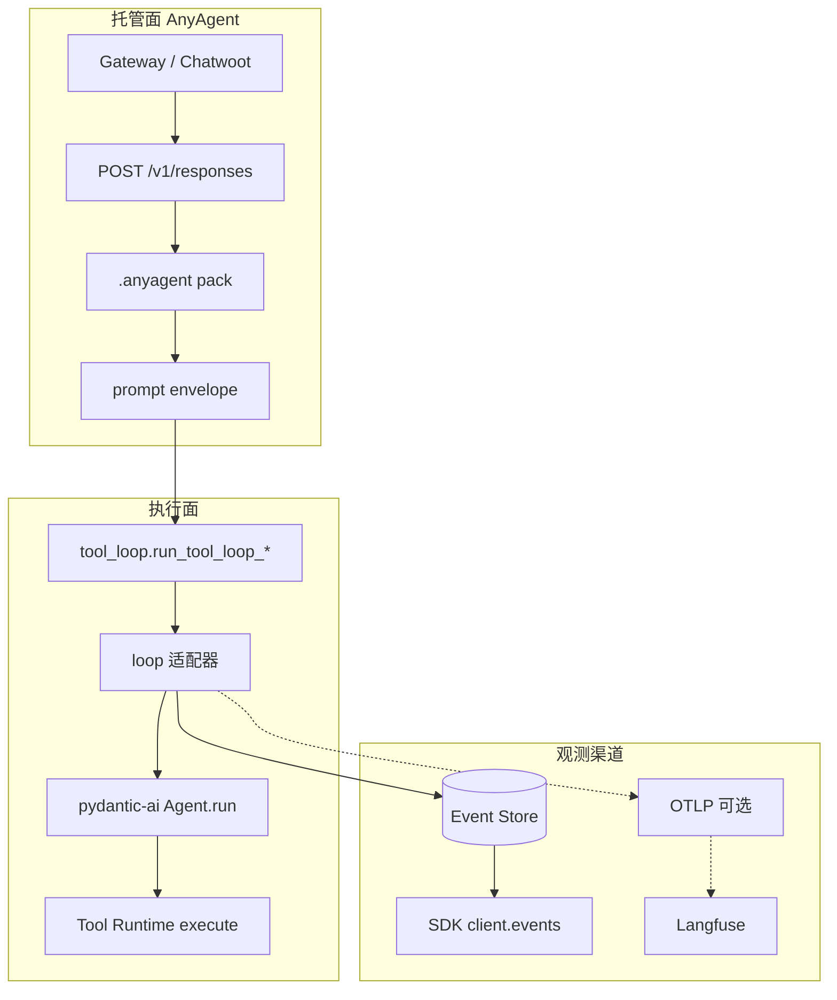
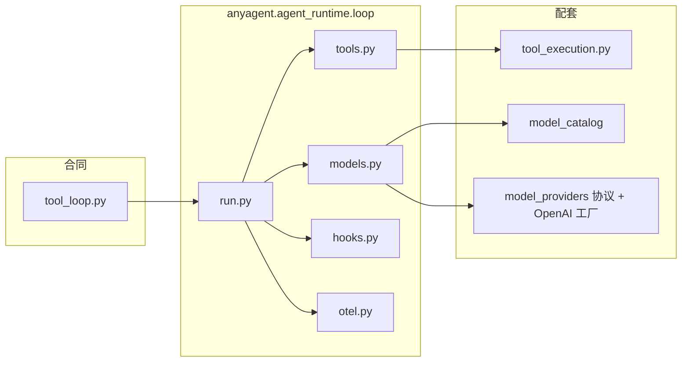
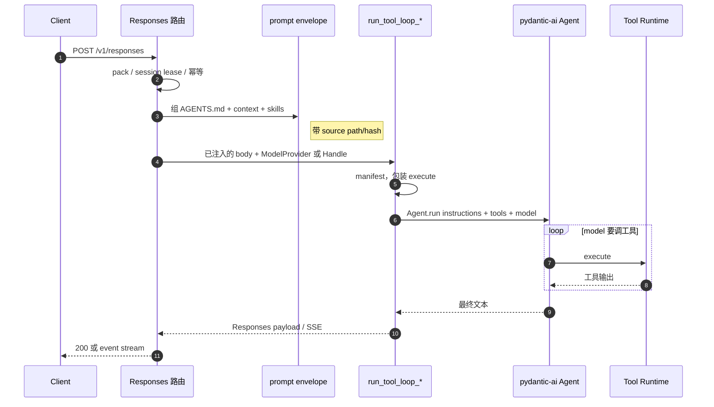
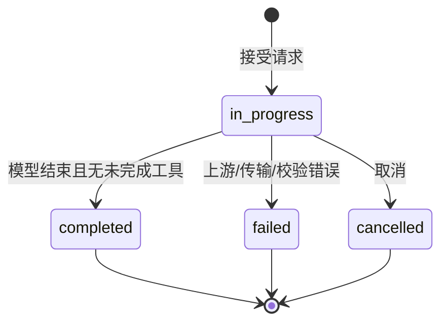
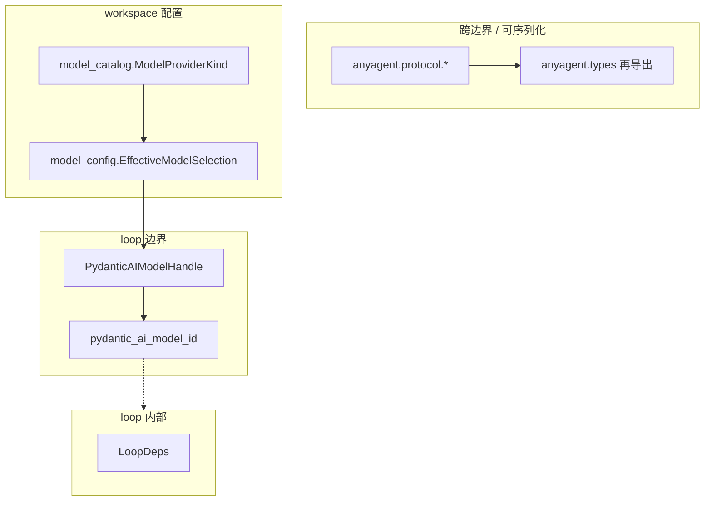
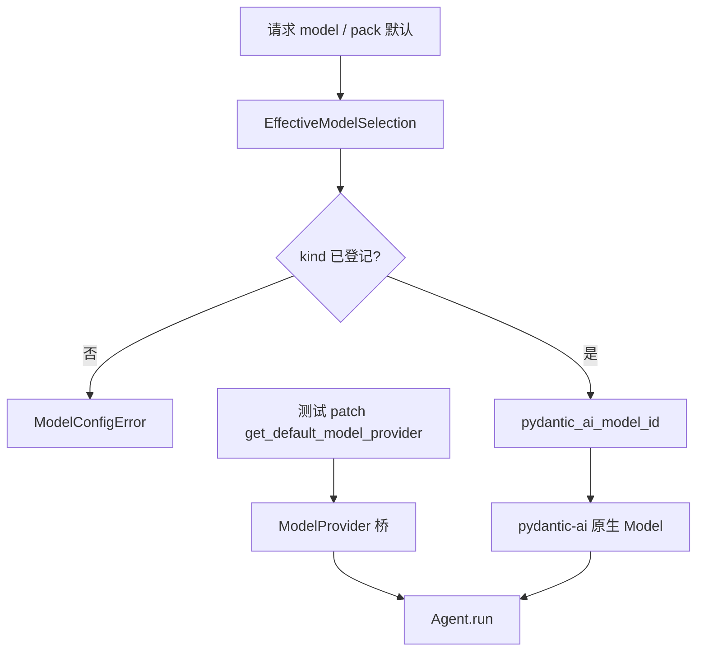

<!--
---
doc_kind: architecture
status: stable
tags: ["agent-loop", "pydantic-ai", "langfuse", "models", "runtime"]
summary: Responses 热路径的 agent loop：pydantic-ai 跑 model→tool→model；工具只走 Tool Runtime execute；模型 kind 映射为 pydantic-ai 字符串；SDK 跟踪走 Event Store，Langfuse OTLP 为可选附加渠道。
req: ["requirements.md#req-4-7", "requirements.md#req-4-5", "requirements.md#req-2-1", "requirements.md#req-5-13"]
---
-->

# Agent Loop

AnyAgent 的托管价值在 Gateway、`POST /v1/responses`、Session/Run/Event、Credential、Tool Runtime 和 `.anyagent` pack。model → tool → model 这一圈与 pydantic-ai 重叠，所以执行面把 loop 交给它，不再自研 vendor translator。

取舍见 [ADR · 决策结论](../decisions/pydantic-ai-loop-and-langfuse.md#决策结论)。本文只写当前怎么分层、类型落在哪、一次请求怎么走。

对应需求：`requirements.md#req-4-7`、`requirements.md#req-4-5`、`requirements.md#req-2-1`、`requirements.md#req-5-13`。

## Overview

一次对话请求先进托管面（鉴权、pack、envelope、lease），再进 `run_tool_loop_*`。适配器组好 pydantic-ai `Agent`：instructions 来自 envelope，tools 只调 Tool Runtime `execute`，模型来自 `models.yaml` 映射。

跟踪是两条渠道：Stage Events 仍写入 Event Store（库表），本 SDK `client.events` 走这条；Langfuse 经可选 OTLP 看 generation / tool / cost，未配置则关掉，不影响 SDK。



实线是现网 SDK 渠道；虚线是附加渠道。未配 OTLP endpoint 时不导出，Event Store 照写，服务照常跑。

## Key Concepts

| 概念 | 含义 |
| --- | --- |
| 托管合同 | `run_tool_loop_nonstream` / `run_tool_loop_stream_live` 的签名和 SSE 形态。Gateway / Responses 路由只认这一层。模型返回空 output 或只剩未注册 tool call 时，HTTP 仍是 200，body 是最后一次模型 Response，不因 pydantic-ai 要 typed `str` 而 500。 |
| prompt envelope | `AGENTS.md`、context providers、skill catalog 在进 pydantic-ai 之前组好，带 source path/hash。 |
| 工具真源 | Tool Runtime `manifest` / `execute`。pydantic-ai tool 是包装，不是第二套 handler。 |
| kind 目录 | `models.yaml` 的 `providers.*.kind`，由 `anyagent.model_catalog` 解析，再映射为 pydantic-ai 模型字符串。 |
| 注入缝 | 离线 smoke patch `get_default_model_provider()`；适配器把它桥成 pydantic-ai `Model`。 |

不要平行引入 pydantic-ai YAML spec，也不要把业务 instructions 写进 SDK。pack 磁盘布局见 [Agent Packs](agent-packs-and-runtime-config.md)。

## Architecture

适配器按职责拆包，对外合同不动。



| 模块 | 职责 |
| --- | --- |
| `anyagent.agent_runtime.tool_loop` | 对外合同：`run_tool_loop_*`、`resolve_manifest*` |
| `anyagent.agent_runtime.loop.run` | 组 Agent、跑 loop、映射 SSE / `response.output` |
| `anyagent.agent_runtime.loop.models` | kind → 模型字符串、`PydanticAIModelHandle`、离线 `ModelProvider` 桥 |
| `anyagent.agent_runtime.loop.tools` | manifest function → Tool Runtime execute |
| `anyagent.agent_runtime.loop.hooks` | `runtime.middlewares` 的压缩 / 循环检测 → pydantic-ai Hooks / ProcessHistory；直接接入原生 AbstractCapability |
| `anyagent.agent_runtime.loop.otel` | OTLP env；无 endpoint 不导出 |
| `anyagent.agent_runtime.tool_execution` | manifest 解析与单次 execute（含 Stage Events） |
| `anyagent.model_catalog` | kind / 别名 / 默认 env |
| `anyagent.agent_runtime.model_providers` | `ModelProvider` 协议、OpenAI Responses 默认工厂 |

不要再加自研 4-hook 或 vendor HTTP translator。历史口径：[agent-loop-middleware.md](agent-loop-middleware.md)、[model-provider-translators.md](../api/model-provider-translators.md)。

自 0.4.29 起，`runtime.middlewares` 的 classpath 类可继承 pydantic-ai `Hooks` 或其他 `AbstractCapability`，按配置顺序交给 `Agent.capabilities`。既有 `AgentMiddleware` 的工具回调仍由 `MiddlewareChain` 执行，原生能力不会再被当作旧 4-hook 调用。类来自部署者受信任代码，不能由访客 metadata 指定。显式配置列表会覆盖默认项，需要保留默认保护时把 `loop_detection` / `context_compaction` 一并列出。

原生 hook 可经 `ctx.deps.middleware_context` 读取当轮 metadata、session 与独立的 `state`；不要把会话状态存在跨请求复用的 hook 实例上。`before_model_request` 可修改当轮请求，`after_model_request` 可返回校验后的 `ModelResponse`。非流式和当前 SSE 路径均在完整 `Agent.run` 后输出最终文本，校验前的文本不会作为 SSE delta 交付。对应回归：`tests/unit/agent_runtime/test_pydantic_ai_loop.py`。

## How It Works

一次非流式 `POST /v1/responses`（含工具）大致如下。流式路径同一套适配器，最后多 `response.output_text.delta`、`response.completed` 和 `[DONE]`。



当前用户轮次只进 `user_prompt` 一次；更早的 user / assistant / tool 结果进 `message_history`。envelope 的 developer/system 只进 instructions。

Run 终态：



`in_progress` 期间 Event Store 仍按 `seq` 记 Stage Events，供 SDK `client.events` 与断线补发。OTLP span 是另一条渠道，不替代这条。

## 类型分层

协议形状只在 `anyagent.protocol.*` 定义；SDK 从 `anyagent.types` 再导出。runtime 不再抄一份 wire DTO。pydantic-ai 的 `Agent` / `Model` 不进 `anyagent.types`。



| 层 | 位置 | 放什么 |
| --- | --- | --- |
| Wire / SDK | `anyagent.protocol.*`，SDK 从 `anyagent.types` 再导出 | Responses body、Stage Events、Tool Runtime DTO |
| Workspace 模型目录 | `anyagent.model_config` | `WorkspaceModelsConfig`、`EffectiveModelSelection` |
| Kind 目录 | `anyagent.model_catalog` | `ModelProviderKind`、`ProviderSpec` |
| Loop 边界 | `anyagent.agent_runtime.loop` | `PydanticAIModelHandle`、`pydantic_ai_model_id()` |
| Loop 内部 | `loop.tools.LoopDeps` 等 | 不跨包、不进 protocol |

## 模型映射

`models.yaml` 的 `providers.*.kind`：

| kind | pydantic-ai 前缀 |
| --- | --- |
| `openai` | `openai:`（v2 为 Responses） |
| `openai_chat` | `openai-chat:` |
| `anthropic` | `anthropic:` |
| `gemini` | `google:` |

缺 kind 或缺 model id 时 fail-fast（`ModelConfigError`）。



生产路径走左边；离线 smoke 走右边，不打真实网。

## Configuration

- workspace：`models.yaml`、`.anyagent/agents/<id>/agent.yaml` 的 `runtime.middlewares`（`loop_detection` / `context_compaction` 映射为 hooks，不是新 4-hook API）
- OTLP：`OTEL_EXPORTER_OTLP_ENDPOINT`；头用 `OTEL_EXPORTER_OTLP_HEADERS`
- 未设 endpoint：OTLP 渠道关闭，Event Store / SDK events 不受影响
- 不引入 Langfuse Python SDK；凭证只进消费侧 env / Infisical

## Troubleshooting

| 现象 | 先看 |
| --- | --- |
| 工具没打到 Tool Runtime | 适配器是否绕过 `execute`，另写了一套 handler |
| 流式客户端挂住 | SSE 是否丢了 `[DONE]` |
| 启动失败 / 误连网 | OTLP 未配置是否被当成必填；测试 fake 是否没走到 `ModelProvider` 桥 |
| 当前用户说了两遍 | `split_user_prompt_and_history`：最后一条未接 assistant 的 user 只进 `user_prompt` |

## 验证

```bash
uv run --project packages/anyagent pytest tests/unit/agent_runtime/test_pydantic_ai_loop.py tests/unit/agent_runtime/test_pydantic_ai_otel.py tests/unit/agent_runtime/model_providers/ tests/acceptance/server/acceptance_chatwoot_connector_smoke.py -q
```
