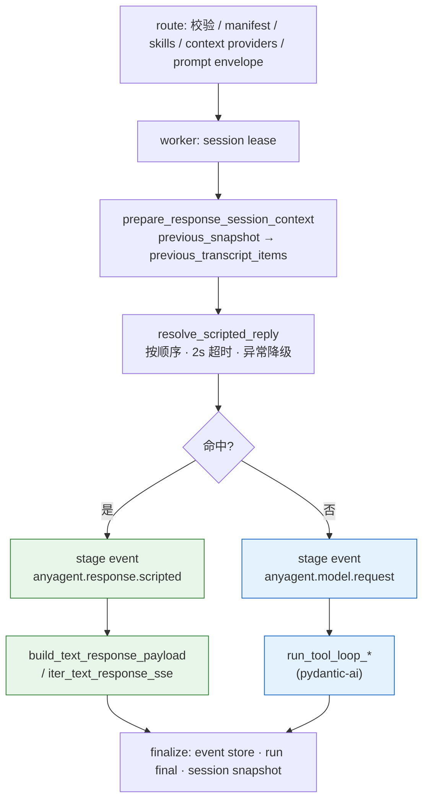

<!--
---
doc_kind: architecture
status: stable
tags: ["agent-packs", "agents-md", "agent-spec", "session", "runtime-config"]
summary: Agent Packs、AGENTS.md 注入、AgentSpec、agent_id 路由与 session runtime config 的稳定约束。
req: ["requirements.md#req-2-1", "requirements.md#req-2-1-1", "requirements.md#req-2-2", "requirements.md#req-4-3-1", "requirements.md#req-4-6", "requirements.md#req-4-7", "requirements.md#req-5", "requirements.md#req-5-13"]
---
-->

# Agent Packs 与 Runtime Config

本文承接原 `requirements.md` 中已经稳定的配置即服务设计：业务工作区通过 `.anyagent/` 声明 agent 行为、工具、skills、MCP 与多 agent 策略，Core 在边界处解析并校验，运行时只消费已知形状的数据。

提示与策略的归属、以及「不要平行引入 pydantic-ai spec」的口径见 [pydantic-ai loop + Langfuse ADR](../decisions/pydantic-ai-loop-and-langfuse.md#配置与提示)。loop 怎么跑见 [agent-loop.md](agent-loop.md)。pack 磁盘布局不随 loop 库迁移。

## Agent Packs

公共配置根目录：

```text
<workspace_dir>/.anyagent/agents/
  <agent_id>/
    agent.yaml
    AGENTS.md
    skills/
```

约束：

- `<agent_id>` 必须满足 `[a-zA-Z0-9_.-]{1,64}`。
- `agent.yaml` 与 `AGENTS.md` 为必需文件；缺失或不可解析时服务启动 fail-fast。
- 同一个 `agent_id` 只能定义一次；重复定义 fail-fast。
- v0 先冻结为 repo workspace root：`<workspace_dir>/.anyagent/agents/`。更多 roots 可以作为后续增强，但必须记录 root/path 以便审计。

## AGENTS.md 注入语义

AgentRuntime 在每次 run 初始化 prompt 时，必须把 agent pack 的 `AGENTS.md` 作为配置侧指令注入模型上下文。

要求：

- 注入发生在本次 run 的第一条 user 输入之前。
- 推荐映射为 `developer` message；不支持 `developer` role 的 provider 可退化为独立 system block。
- 注入内容必须带来源标记，至少包含 `agent_id`、path 与 hash。
- v0 使用 `workspace + agent-pack` 两层 stack：`<workspace_dir>/AGENTS.md` 为低优先级全局层，`<workspace_dir>/.anyagent/agents/<agent_id>/AGENTS.md` 为高优先级 agent 层。
- 多智能体 child thread 按目标 `agent_id` 注入对应 `AGENTS.md`，默认不继承父 thread 的 `AGENTS.md`。
- `AGENTS.md` 只影响模型推理与行为偏好，不作为 tool policy 或权限来源。
- 读取必须有硬性大小上限；超限 fail-fast，错误中包含 `agent_id/path/bytes`。
- run 记录应包含 `agent_id` 与注入文件 hash，避免配置漂移不可复盘。

## AgentSpec agent.yaml 最小 Schema

`agent.yaml` 定义该 agent 的配置集合。v0 最小字段：

```yaml
exposed: true
tools:
  requested_tool_names: ["core.web_fetch", "app.*"]
  policy:
    allow_tools: ["core.*", "app.*"]
    deny_tools: ["exec"]
skills:
  default_selected: ["repo-helper"]
  disabled_paths: []
multiagent:
  spawn_allow_agent_ids: ["researcher", "coder"]
  limits:
    max_depth: 2
    max_threads: 4
    run_timeout_seconds: 300
```

语义：

- `exposed=true`：允许外部 `POST /v1/responses` 通过 `metadata.agent_id=<agent_id>` 选择。
- `exposed=false`：不允许外部直连，只允许被 spawn 或内部受控调用。
- `tools.requested_tool_names` 是“希望披露”的工具名或 glob 集合，最终仍由 Tool Runtime manifest 收口。
- `tools.policy` 只能由服务端配置生成，外部请求的 `metadata.context.policy` 必须忽略。
- `skills.default_selected` 支持 skill name 或 `skill://.../SKILL.md` path 引用。
- `skills.disabled_paths` 配置时填写 skill name，运行时解析为当前可见 skill 的 stable id。
- `multiagent.spawn_allow_agent_ids` 缺省为空，表示禁止 spawn。
- `runtime.context_providers` 支持业务侧 classpath 列表，用于在模型调用前注入可审计的 `ContextFragment`。provider 代码由部署者配置，运行在 server 进程内，适合页面上下文、租户上下文、CRM 摘要等应用层事实注入；不适合放 agent/model 可控输入。

`runtime.context_providers` 示例：

```yaml
runtime:
  context_providers:
    - my_workspace.route_context:RouteContextProvider
```

每个 provider 应实现 `anyagent.agent_runtime.ContextProvider` 的 `build_context(request)`，返回 `ContextFragment` 列表。框架会将这些 fragment 作为独立业务/渠道上下文纳入 prompt envelope，与 agent-local `.anyagent/agents/<agent_id>/AGENTS.md`、skill catalog metadata、MCP/sandbox、environment fragment 一起写入 `anyagent.prompt.context` 审计事件和 rendered prompt preview。workspace 根目录 `AGENTS.md` 只作为研发 harness 元数据保留，不进入运行时模型 prompt。

### `runtime.scripted_reply_providers`

`runtime.scripted_reply_providers` 是与 context provider 平行的第二个 classpath 列表：**已知输入的确定性文本回复**。命中时框架不调用模型，直接合成一个正常的 OpenAI `Response`（一条 `message` + `output_text`），走与模型轮次相同的 event store / run final / session snapshot 路径，因此下一轮模型能在 `fallback_transcript_items` 里看到这句回复。

```yaml
runtime:
  scripted_reply_providers:
    - my_workspace.scripted:QuickPromptProvider
```

契约（`anyagent.agent_runtime.scripted_reply`）：

- provider 实现 `async resolve(request: ScriptedReplyRequest) -> ScriptedReply | dict | None`；`None` 表示继续走 loop。多个 provider 按顺序执行，先命中先返回。
- `ScriptedReplyRequest` = `ContextProviderRequest` 字段 + `previous_transcript_items`（本轮之前的会话 fallback transcript，`is_first_turn` 派生），供“首轮招呼语只回一次”之类判断。
- `ScriptedReply`（`anyagent.protocol.scripted_reply`）有 `text`（必填非空）、`variant_id`、`reason`，以及可选的 `content_type` / `content_attributes` 出站消息属性。**不允许**工具调用、handoff、多轮；需要判断或工具的场景走 loop。
- 失败语义：provider 抛异常、超时（默认 2s）、返回非法值一律降级为继续走 loop，只 warning；装载失败跳过该 provider，不影响 agent 启动。
- 可观测：命中轮次写 `anyagent.response.scripted` stage event（`provider` / `variant_id` / `reason` / `text_chars`），不写 `anyagent.model.request`；有出站属性时仅在 Response 的 assistant message item 上附 `content_type` / `content_attributes`，纯文本 Response 形状不变。
- 位置与代价：判定在内置 runtime `/v1/responses` worker 内、session lease 之下、`run_tool_loop_*` 之前（`packages/anyagent/src/anyagent/server/routes/responses.py`）。命中前 skill 选择、context providers、prompt envelope 仍会执行——节省的是模型与工具成本。**分布式 runtime（`routes/distributed_responses.py`）当前不支持**。

命中判定在 worker 内的位置，以及命中 / 未命中两条路径最终汇合到同一套持久化：



绿色为 scripted 路径、蓝色为模型路径；两者在 `FIN` 之后对 session snapshot、SDK 与 connector 不可区分，只靠 stage event 类型区分。

回复节奏（避免瞬时回复暴露“预设”）不归 provider，归 connector：见 [platform-connectors.md](../integrations/platform-connectors.md#typing-indicator-与回复节奏)。

## 配置层级与 merge

`agent.yaml` 与 `mcp.json` 并非只有 workspace 单层，而是按固定优先级跨四层 deep-merge 后再交给运行时消费。层级在 `resolve_config_layers` 中冻结为 system → user → workspace → session（`packages/anyagent/src/anyagent/agent_packs.py:172`）：

1. **system**：`SYSTEM_CONFIG_DIR`，默认 `/etc/anyagent`，承载平台运维下发的基线管控。
2. **user**：`USER_CONFIG_DIR`，默认 `~/.anyagent`，承载部署者个人默认值。
3. **workspace**：`<workspace_dir>/.anyagent`，业务工作区自带的 agent pack 配置。
4. **session**：单次请求经 `metadata.context` 注入的 `session_overrides`，不落盘，优先级最高。

merge 语义：

- 同名字段后层覆盖前层，dict 递归合并、标量/列表整体替换，由纯函数 `deep_merge` 实现（`packages/anyagent/src/anyagent/config_merge.py:18`）；`agent.yaml` 走 `_merged_agent_yaml`、`mcp.json` 走 `_merged_mcp_config`（`packages/anyagent/src/anyagent/agent_packs.py:299`、`packages/anyagent/src/anyagent/agent_packs.py:324`）。
- agent 发现是各层并集：任一层在 `agents/<agent_id>/` 下出现目录、或 session override 声明该 `agent_id`，即纳入 catalog（`_discover_layered_agent_ids`，`packages/anyagent/src/anyagent/agent_packs.py:263`），因此上层可定义基线 agent，workspace 仅做增量裁剪。

### workspace override denylist

为防止业务工作区把上层运维管控的安全敏感值改低，merge 在写入 workspace 层前先过 denylist 校验。受管路径定义为 `SENSITIVE_WORKSPACE_OVERRIDE_PATHS = {sandbox.mode, storage}`（`packages/anyagent/src/anyagent/config_merge.py:8`），校验逻辑在 `validate_workspace_override_denylist`（`packages/anyagent/src/anyagent/config_merge.py:30`），并只在 `_merged_agent_yaml` 处理 `name == "workspace"` 这一层时触发（`packages/anyagent/src/anyagent/agent_packs.py:315`）。

关键语义是“**拦截覆盖，而非禁止设置**”：仅当 base（已合并的 system+user 结果）与 workspace payload **同时**包含该路径时才 fail-fast。

- system/user 已设 `sandbox.mode` → workspace 再设同字段：拦截，报 `ConfigMergeError`（被包成 `AgentPackError`）。
- 上层未设该字段 → workspace **首次**设置：放行。即 denylist 防的是“workspace 下调上层既有管控值”，不阻止 workspace 在无人管控时自行声明。

session 层不受此 denylist 约束，因其属于受控内部注入而非外部业务配置。


## agent_id 选择与隔离

`agent_id` 来源优先级：

1. `metadata.agent_id`
2. 受控内部 header：`x-agent-id`
3. 可选 `model` 约定：`agent:<agent_id>`
4. 默认：`main`

选择规则：

- `agent_id` 必须存在于 Agent Catalog。
- 外部直连只能选择 `AgentSpec.exposed=true` 的 agent。
- 服务启动时校验默认 `main` 存在且 `exposed=true`。
- 会话分片键固定为 `session_partition_key = "{agent_id}::{session_key}"`。

这样同一平台 thread 被多个 agent 使用时不会抢占同一把 session lock；同一 agent 内仍保持会话内串行、跨会话并行。

## Session Resume 与 runtime_config

连续会话必须从 Session Store 或本地持久化快照恢复，不依赖进程内存。

### 跨请求上下文恢复

会话快照至少包含一种恢复游标：

- `last_response_id`：优先，适用于 OpenAI Responses provider。
- 可重放 transcript/items：上游不支持 `previous_response_id` 时的兜底。

首轮上游请求组装：

- 有 `last_response_id`：使用 `previous_response_id=<last_response_id>` + 当前 `request_delta_input`。
- 无 `last_response_id` 但有 transcript：使用 `snapshot_transcript + request_delta_input`。
- 无快照：按新会话处理。

run 完成后写回新的恢复游标，保证下一次请求可继续承接。

### runtime_config 绑定与 merge 更新

受管字段集合：

- `model`
- `temperature`
- `top_p`
- `frequency_penalty`
- `presence_penalty`
- `reasoning`

规则：

- 会话首次请求初始化 `runtime_config`。
- 后续请求默认复用会话中的 `runtime_config`。
- 仅调用方显式提供字段时才做字段级覆盖。
- 同一个 run 内后续 tool 回合必须沿用同一个 `effective_runtime_config`。
- run 终态提交时将最终 `effective_runtime_config` 写回 Session Store。
- 更新快照必须带 CAS 或等价版本语义，防止并发覆盖造成配置回退。

## Config 热重载与冷/热字段边界

为支持改 agent 配置而无需重启进程，每个 HTTP 请求进入业务路由前都会经 `_config_hot_reload_middleware` 触发一次按需重载检查（`packages/anyagent/src/anyagent/server/app.py` 的 `_config_hot_reload_middleware`）。设计动因是配置即服务下“边解析边消费”，但又要避免每请求全量重载的开销，故以 mtime 轮询做廉价变更检测。

检测与重载流程（`AnyAgentServerApp.refresh_config_if_needed`，`packages/anyagent/src/anyagent/server/app_state.py:98`）：

1. `stat_config_mtimes` 跨四层 stat 每个 `agent.yaml`/`mcp.json` 的 `st_mtime_ns`，得到指纹（`packages/anyagent/src/anyagent/agent_packs.py:190`）。
2. 指纹与缓存 `config_mtimes` 相等：直接返回，零额外开销。
3. 指纹变化：取 `config_reload_lock` 后**双检**（再 stat 一次比对），避免并发请求重复重载。
4. 重载 catalog 后校验“至少一个 exposed agent”，否则报错拒绝该次重载。

冷/热字段边界（`_catalog_has_cold_restart_change`，`packages/anyagent/src/anyagent/server/app_builders.py:38`）：

- **热字段**：`model`/`tools`/`skills`/`middlewares`/`context_providers`/`scripted_reply_providers` 等行为字段变化 → 即时换上新 catalog、刷新 models 配置、重置 manifest 缓存、更新 mtime 指纹，对后续请求立即生效（`packages/anyagent/src/anyagent/server/app_state.py:113`）。
- **冷字段**：`sandbox`（含 `sandbox.mode`）与 `storage` 这类影响进程级资源装配的字段变化 → **只更新 mtime 指纹并 log warning `restart required`，不替换运行 catalog**（`packages/anyagent/src/anyagent/server/app_state.py:109`）。

冷字段与上文 denylist 受管路径一致：这些字段在进程启动时已绑定 SandboxManager/Storage 等资源，热替换会造成运行态与配置态不一致，故强制走重启。更新 mtime 指纹是为了避免每请求重复刷同一条 warning。`AnyAgentServerApp.reload_catalog`（`packages/anyagent/src/anyagent/server/app_state.py:87`）则是 admin 显式触发的全量重载，不区分冷热。

## MCP 生命周期 Stage Events 与 stdio 会话池

### MCP 生命周期 Stage Events

解析 MCP 工具 manifest 时，每个 server 的连接进度以 stage event 透出，供客户端 SDK 呈现 1 级细粒度运行进度。事件类型为 `AnyAgentMcpServerLifecycleEvent`（`packages/anyagent/src/anyagent/protocol/stage_events.py:315`），三态 + 字段：

- `anyagent.mcp.server.starting` / `anyagent.mcp.server.ready` / `anyagent.mcp.server.failed`。
- `server_label`：MCP server 标签；`transport`：经 `infer_transport()` 推导的传输类型；`error`：仅 failed 态携带 `StageError`。

发射点在 `MCPServerManager.ensure_all_connected`（`packages/anyagent/src/anyagent/mcp/manager.py:91`）：connect 前发 `starting`、成功后发 `ready`、`except` 分支发 `failed`（`packages/anyagent/src/anyagent/mcp/manager.py:104`-`137`）。去重语义是关键——只在 `was_connected` 为假时发射，即已连接的 server 复用时不重复刷生命周期事件。单个 server 连接失败按 `drop_failed` 处理：记 warning、跳过，不阻断其余 server，保证部分 MCP 不可用时 agent 仍可运行。

### stdio 会话池

stdio 与 HTTP/SSE 两类传输的资源代价不同，故池化策略分流（`packages/anyagent/src/anyagent/mcp/manager.py:44`-`55`）：

- **stdio**：每条连接持有一个子进程，代价高。仅 manager 持有其 config（`_stdio_configs`），连接按需从共享的 `MCPStdioConnectionPool` 借取（`_acquire_server`，`packages/anyagent/src/anyagent/mcp/manager.py:69`）。
- **HTTP/SSE**：连接廉价，由 manager 直接持有整个生命周期（`_servers`），不进池。

池实现 `MCPStdioConnectionPool` 是 `OrderedDict` + `asyncio.Lock` 的 LRU 缓存（`packages/anyagent/src/anyagent/mcp/session_pool.py:32`）：

- 池键为 `(agent_id, server_label, session_key)`，`session_key=None` 时匿名请求共享同一 server 桶（`packages/anyagent/src/anyagent/mcp/session_pool.py:13`）。
- 容量默认 256，可被环境变量 `MCP_STDIO_POOL_SIZE` 覆盖（`packages/anyagent/src/anyagent/mcp/session_pool.py:17`-`29`）。
- `acquire` 命中时 `move_to_end` 刷新 LRU 顺序并复用已连接 server；未命中时由 `factory` 新建并连接，插入后若超容则 `popitem(last=False)` 逐出最久未用项并优雅 `disconnect`（关闭其子进程）（`packages/anyagent/src/anyagent/mcp/session_pool.py:53`-`77`）。

池由 `MCPManagerRegistry` 单例注入所有 manager（`packages/anyagent/src/anyagent/mcp/manager.py:331`），因此 stdio 连接在所有 agent 与 session 间统一 LRU 受限。`MCPServerManager.cleanup` 只断开自己持有的 HTTP/SSE server，池化 stdio 连接的清理交给池的 `cleanup_all`，避免重复释放（`packages/anyagent/src/anyagent/mcp/manager.py:265`、`packages/anyagent/src/anyagent/mcp/session_pool.py:86`）。
