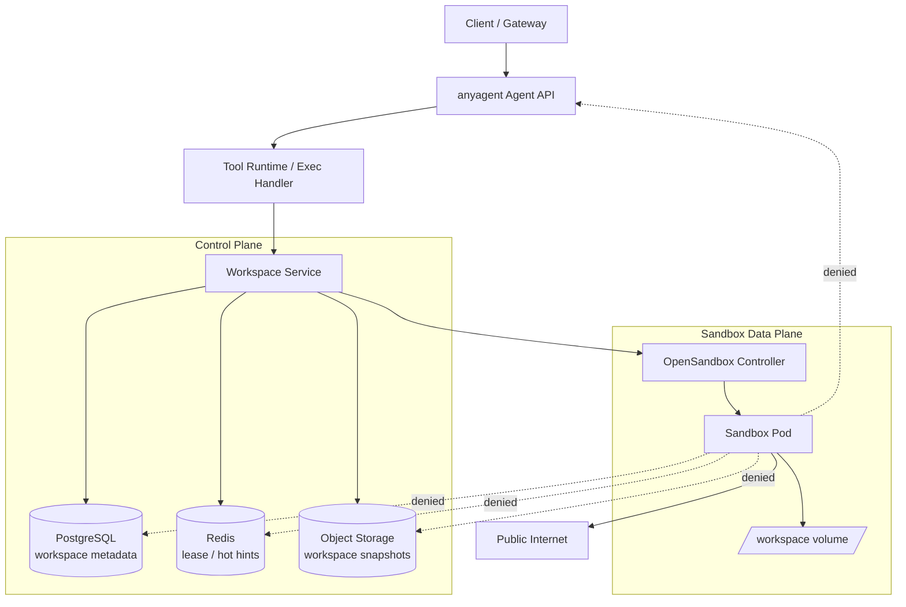
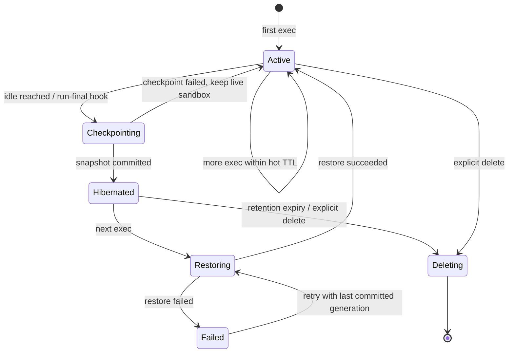
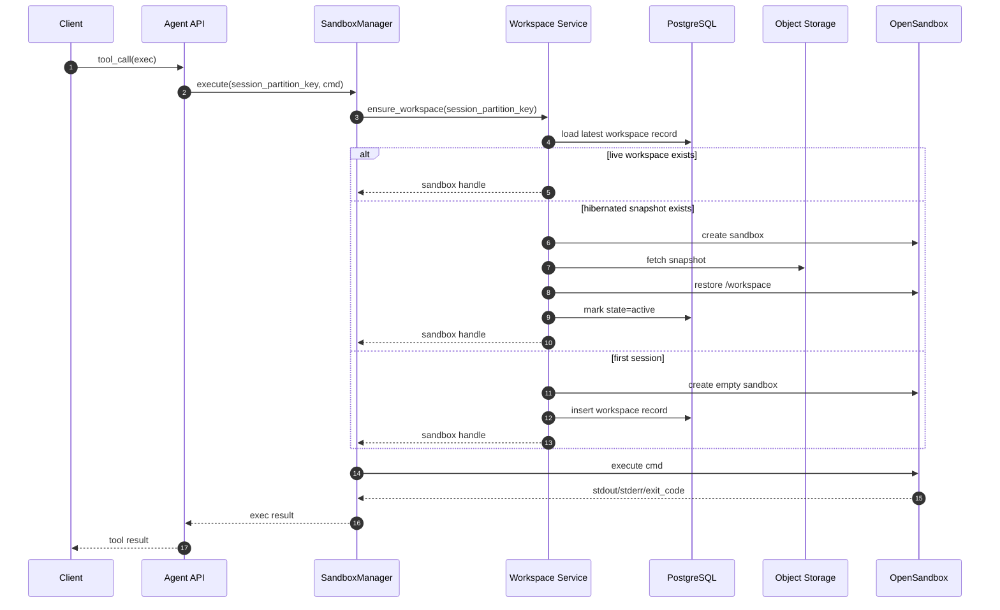

<!--
---
doc_kind: architecture
status: stable
tags: ["sandbox", "filesystem", "session", "opensandbox", "object-storage", "kubernetes"]
summary: 定义 anyagent 在服务化部署下的会话级沙箱文件系统方案：热冷分层、跨实例恢复、安全边界与数据治理。
req: ["requirements.md#req-3-1", "requirements.md#req-5", "requirements.md#req-5-5", "requirements.md#req-8"]
---
-->

# 服务化沙箱会话文件系统设计

本文定义 anyagent 在“服务化部署 + 会话级沙箱”场景下的文件系统方案。目标不是再做一层泛化存储抽象，而是把一个真实的故事讲清楚：

- Agent 需要在同一 session 内反复读写文件、安装依赖、生成脚本和中间产物
- 服务端会是多实例、无状态、低本地资源占用的云部署
- 沙箱既要能跨实例恢复工作目录，又不能把宿主机文件系统、对象存储凭证、内部网络暴露给 Agent

这篇文档给出 v1 的明确决策：**以 Kubernetes + OpenSandbox + PostgreSQL/Redis + 对象存储 为生产主路径，采用“会话热态工作区 + 冷归档快照”的分层模型。**

对应需求：`requirements.md#req-3-1`、`requirements.md#req-5`、`requirements.md#req-5-5`、`requirements.md#req-8`

## 1. 背景与问题故事

当前 anyagent 已经明确了“per-session sandbox，同一 session 内命令共享文件系统”的语义，协议与最小实现分别可见：

- `SandboxPolicy` 当前只收敛了 `mode/network/resource_limits/ttl_seconds` 最小字段：`packages/anyagent/src/anyagent/protocol/sandbox.py:28`
- `exec` 当前仍是统一的 `core` 命令工具入口：`packages/anyagent/src/anyagent/server/sandbox/exec_handler.py:12`
- `SandboxManager` 当前最小实现仍以本地目录复用为主，`opensandbox` 尚未落地：`packages/anyagent/src/anyagent/server/sandbox/manager.py:11`
- Core storage 今天已经有“会话级元数据/快照”的 rollout journal 持久化思路，但只覆盖 session snapshot 和 rollout 事件，不覆盖沙箱文件系统本体：`packages/anyagent/src/anyagent/storage/rollout.py:369`

这在单机或 demo 模式下够用，但一旦进入服务化部署，马上会遇到四类问题：

1. **本地磁盘不可靠**
   - 请求可能打到不同实例
   - Pod 重建、节点漂移、自动扩缩容后，本地工作目录直接丢失

2. **资源成本不能按“每会话一台机器”设计**
   - 真实部署里每台机器资源不会很多
   - 长时间保留一批空闲 sandbox/PVC，会让调度、成本和容量管理都失控

3. **Agent 真的需要“工作台”，不是只要一条命令执行能力**
   - coding/data agent 会 `git clone`、创建 venv、下载数据、跑脚本、保存中间结果
   - 如果每次命令都从零开始，体验和可靠性都会大幅下降

4. **安全与数据治理不能靠约定**
   - 不能把对象存储访问密钥直接给 sandbox
   - 不能让 sandbox 能够访问 anyagent、PG、Redis 或云 metadata 服务
   - 不能无限制持久化与保留用户数据

因此，问题并不是“沙箱里要不要有文件系统”，而是：

> 在多实例、低本地资源、云化部署前提下，如何把“session 级工作目录”做成一个既可恢复、又可回收、同时安全边界清晰的服务能力？

## 2. 设计目标

### 2.1 必须满足

- 保持 `per-session sandbox` 的用户心智：同一 `session_partition_key` 下的文件和用户态依赖可持续
- 支持跨实例恢复：一次 session 在不同 Pod 上继续执行时，仍能拿回完整工作目录
- 不要求长期保留 live sandbox：空闲后可以休眠，下一次按需恢复
- 安全上做到“沙箱内自由，沙箱外隔离”：Agent 可自由使用 `/workspace`，但不能直接接触控制面和基础设施凭证
- 成本上避免“每 session 长驻 Pod/PVC”

### 2.2 明确不做

- v1 不持久化容器根文件系统 writable layer
- v1 不做文件级去重或增量块级快照
- v1 不把 `external` 模式扩展成服务化持久文件系统主路径
- v1 不支持在运行时由模型申请提权或变更持久化策略

### 2.3 Backend Contract Matrix

后续新增 sandbox backend 时，至少要通过以下 reference contract。矩阵以 protocol policy 为入口，而不是以后端私有字段为入口。

| Contract | Policy / model | Reference implementation | Verification |
|---|---|---|---|
| Mode selection | `SandboxPolicy.mode` | `SandboxManager` routes local / external / opensandbox | `tests/unit/protocol/test_sandbox_protocol.py`, `tests/unit/server/test_opensandbox_backend.py` |
| Session filesystem | per-session `/workspace` | local workspace + OpenSandbox workspace restore/checkpoint | `tests/unit/server/test_sandbox_workspace.py`, `tests/unit/server/test_workspace_service.py` |
| Network policy | `NetworkSandboxPolicy` | backend egress config / deny-by-default posture | `tests/unit/server/test_opensandbox_backend.py` |
| Resource limits | `ResourceLimits` | backend command runtime limits | `tests/unit/protocol/test_sandbox_protocol.py`, `tests/unit/server/test_exec_handler.py` |
| Workspace events | workspace lifecycle event store | in-memory / JSONL workspace events | `tests/unit/server/test_workspace_events.py`, `tests/unit/server/test_workspace_persistence.py` |
| Snapshot lifecycle | hot restore + cold checkpoint | workspace service snapshot adapters | `tests/unit/server/test_workspace_snapshots.py`, `tests/unit/server/test_workspace_runtime.py` |

接入规则：

- 新 backend 必须先声明如何消费 `SandboxPolicy` / `NetworkSandboxPolicy` / `ResourceLimits`。
- backend 私有配置只能作为 adapter 参数，不能替代 protocol policy。
- `local-unsafe` 只作为开发/reference backend；生产 build 默认不得把它作为安全隔离能力宣传。
- OpenSandbox on Kubernetes 是当前第二 backend 决策，详见 [../decisions/sandbox-backend-selection.md](../decisions/sandbox-backend-selection.md)。

## 3. 结论先行：v1 决策

### 3.1 主路径

生产默认采用：

- **调度与隔离**：Kubernetes + OpenSandbox
- **元数据真源**：PostgreSQL
- **热态锁与提示层**：Redis
- **冷归档**：S3/GCS/OSS 等对象存储
- **文件系统模型**：会话级热冷分层

### 3.2 核心决策

1. **`/workspace` 是唯一持久化工作目录**
   - `HOME=/workspace/home`
   - `TMPDIR=/workspace/tmp`
   - 常见 cache 目录也重定向到 `/workspace`
   - 这样 Python venv、npm cache、git repo、脚本输出都能随 session 保留

2. **“整个工作目录持久化”固定解释为“整个 `/workspace` 卷”**
   - 不包含容器根文件系统
   - 不承诺 `/usr`、系统包、root home 等位置的修改能跨恢复存在

3. **热态与冷态分离**
   - session 活跃时，工作目录存在 live sandbox 中
   - session 空闲达到 TTL 后，控制面把 `/workspace` 打包为快照上传对象存储
   - 上传完成后销毁 live sandbox，释放计算与节点磁盘

4. **对象存储只由控制面访问**
   - sandbox Pod 不持有 bucket 凭证
   - restore/checkpoint 必须由 anyagent 服务侧或专门的 workspace service 发起

5. **不默认使用“每 session 一个长期 PVC”**
   - 原因是跨节点调度受限、卷成本高、资源回收困难
   - 会话恢复依赖对象存储快照，而不是依赖卷长期挂着

## 4. 用户故事

### 4.1 Coding Agent

用户让 agent “克隆仓库、安装依赖、修 bug、再跑测试”。典型执行序列：

1. `exec: git clone ... /workspace/repo`
2. `exec: python -m venv /workspace/.venv`
3. `exec: /workspace/.venv/bin/pip install -r /workspace/repo/requirements.txt`
4. `exec: cd /workspace/repo && pytest`
5. session 空闲 15 分钟后，sandbox 休眠并上传 `/workspace`
6. 第二天用户继续追问，新的 Pod 恢复 `/workspace` 后继续执行

用户期待的是“继续昨天那台工作机”，而不是“重新来一遍”。

### 4.2 Data Agent

用户让 agent 下载数据、清洗、生成中间 CSV 和图表，再导出结果。典型风险在于：

- 数据量可能不大，但处理链路长
- 中间产物对后续复盘有价值
- 会话暂停后如果全部丢失，模型只能重新计算，既费时也费 token

### 4.3 服务端视角

平台不能因为存在 1,000 个近期活跃 session，就同时保留 1,000 个空闲 Pod 或 1,000 个永久卷。  
因此文件系统必须像“可休眠的工作台”，而不是“固定绑在一台机器上的目录”。

## 5. 总体架构



### 5.1 组件职责

- `anyagent` Core
  - 定义 `SandboxPolicy` 扩展位与会话工作区语义
  - 定义 `SessionWorkspaceRecord` 等 typed contract
  - 定义 exec 生命周期事件和错误语义

- `anyagent-apps`
  - 实现 `Workspace Service`
  - 接线 OpenSandbox/K8s/object storage/PG/Redis
  - 实现 restore/checkpoint/hibernate/destroy 运维能力与验收脚本
  - 提供 admin/control-plane 视角的 runtime diagnostics 与 workspace lifecycle 调试事件缓冲

- `OpenSandbox`
  - 提供 Lifecycle API 与 execd 代理能力
  - Lifecycle API 负责 `/sandboxes` create/list/get/delete
  - execd 代理负责 `/command`、`/files/upload`、`/files/download`
  - 承载真正的命令执行与 `/workspace` 数据面

- `Object Storage`
  - 保存 session workspace 的冷归档快照
  - 不参与实时执行

## 6. 生命周期：从热态到休眠再到恢复



### 6.1 首次进入 session

1. `exec` 进入 `SandboxManager`
2. 按 `session_partition_key` 查询 workspace metadata
3. 若不存在，创建新 workspace：
   - 新建 sandbox
   - 挂载空的 `/workspace`
   - 记录 `state=active`

### 6.2 热态复用

在 `hot_idle_ttl_s` 内，后续 `exec` 直接复用同一个 live sandbox：

- 不做 restore
- 不上传快照
- 文件、venv、repo、cache 全部保留

### 6.3 休眠

达到空闲 TTL，或 run 结束后系统决定回收资源时：

1. 对当前 session 获取 checkpoint lease，避免并发导出
2. 从 sandbox 导出整个 `/workspace`
3. 生成：
   - `workspace.tar.zst`
   - `manifest.json`
   - `sha256 digest`
4. 上传对象存储
5. PostgreSQL 记录新 `generation`
6. 状态改为 `hibernated`
7. 删除 live sandbox

### 6.4 恢复

下一次 `exec` 到来时：

1. 读取最新成功的 `generation`
2. 新建 sandbox
3. 控制面拉取快照
4. 解压回 `/workspace`
5. 标记 `state=active`
6. 把命令继续发给 exec handler

### 6.5 控制面调试事件

workspace lifecycle 还需要一条单独的控制面观察链，用于解释“为什么恢复慢”“为什么 checkpoint 失败”“当前 OpenSandbox 到了哪个状态”。v1 的边界如下：

- 事件类型复用 Core `stage_events` 中的 workspace lifecycle typed model
- `tool-runtime` 进程内维护一个有界 event buffer，用于 `/admin/sandbox/events`
- 同时产出结构化 `workspace_event` audit log，和 `tool_execute.*` 共用 `trace_id` / `audit_ref` 锚点
- 若需要跨重启的最小 replay，`tool-runtime` 可以把这条控制面事件链镜像到本地 `jsonl` event store，作为 v1 的持久 audit sink
- 事件负载只保留最小控制面诊断信息：
  - `sandbox_id`
  - `state`
  - `reason`
  - `message`
  - `image_uri`
  - `created_at`
  - `expires_at`
  - `last_transition_at`
- 这些字段只服务于 admin / debug / tracing，不进入 agent loop，不透传给模型
- 当事件由 `exec` 触发时，`trace_id` 与 `audit_ref` 需要沿调用链透传到 workspace lifecycle 事件，便于把 tool runtime 审计日志、workspace 事件和后续 tracing 系统串成一条链
- v1 不把这条 event buffer 当作跨进程持久化真源；真正的长期事件真源仍应由更高层 event store 承担
- `jsonl` event store 的定位是“控制面持久 audit sink”，不是跨实例强一致总线；它解决的是重启后还能查、能排障、能最小回放，而不是替代正式的事件基础设施

## 7. 一次请求的端到端时序



## 8. 数据模型

服务化文件系统需要一份独立于 Session/Run/Event 的“工作区真源”。建议新增 `SessionWorkspaceRecord`：

| 字段 | 说明 |
|---|---|
| `tenant_id` | 多租户隔离键 |
| `session_partition_key` | `"{agent_id}::{session_key}"` |
| `workspace_id` | workspace 的稳定标识 |
| `generation` | 最近一次成功提交的快照代次 |
| `state` | `active` / `checkpointing` / `hibernated` / `restoring` / `deleting` / `failed` |
| `sandbox_id` | 当前 live sandbox 标识，休眠后可为空 |
| `snapshot_uri` | 对象存储 URI |
| `snapshot_digest` | 快照完整性校验值 |
| `snapshot_bytes` | 快照大小 |
| `last_accessed_at` | 最近一次 exec 时间 |
| `hot_expires_at` | live sandbox 的热态失效时间 |
| `cold_expires_at` | 冷归档删除时间 |
| `failure_code` / `failure_message` | 最近一次 restore/checkpoint 失败信息 |

### 8.1 快照格式

对象存储中的每一代快照固定由两部分组成：

- `workspace.tar.zst`
- `manifest.json`

`manifest.json` 至少包含：

```json
{
  "workspace_id": "ws_123",
  "generation": 7,
  "root": "/workspace",
  "created_at": "2026-03-14T10:20:30Z",
  "digest": "sha256:...",
  "bytes": 10485760
}
```

这保证“是否提交成功”以 manifest + digest 校验为准，而不是以“对象上传成功但内容可能残缺”为准。

## 9. 文件系统边界

这是整套设计里最重要的约束之一。

### 9.1 持久化边界

只有 `/workspace` 及其子路径受持久化语义保护。

推荐的环境变量约定：

```text
WORKSPACE_ROOT=/workspace
HOME=/workspace/home
TMPDIR=/workspace/tmp
PIP_CACHE_DIR=/workspace/.cache/pip
UV_CACHE_DIR=/workspace/.cache/uv
NPM_CONFIG_CACHE=/workspace/.cache/npm
```

这样可以让大部分用户态状态自然落在持久化目录里。

### 9.2 不持久化边界

以下内容在 v1 不纳入跨会话恢复承诺：

- root 文件系统 writable layer
- `/usr`、`/opt`、`/bin` 等系统目录变更
- 系统级包管理结果（如 `apt-get install`）
- 宿主机挂载、K8s projected volume、容器运行时内部状态

这意味着我们不把“容器状态快照”当成能力边界，而是把“workspace 工作区快照”当成能力边界。

## 10. Core 与 Apps 的集成边界

### 10.1 `anyagent` Core 应新增的语义

建议在 `anyagent.protocol.sandbox` 上增量扩展，而不是平行造一套新配置：

- `filesystem.persistence_mode`: `ephemeral | session_hot_cold`
- `filesystem.workspace_root`: 默认 `/workspace`
- `filesystem.hot_idle_ttl_s`
- `filesystem.cold_retention_s`
- `filesystem.max_snapshot_bytes`

同时在共享 storage contract 中新增 `SessionWorkspaceRecord` 与对应仓储接口。

`exec` tool 外部参数保持不变，仍只暴露：

- `cmd`
- `workdir`
- `timeout`

这样 agent loop 不需要理解对象存储、restore、generation 等基础设施细节。

### 10.2 `anyagent-apps` 应实现的内容

`anyagent-apps` 侧实现 `Workspace Service`，负责：

- `ensure_workspace`
- `checkpoint_workspace`
- `hibernate_workspace`
- `restore_workspace`
- `destroy_workspace`

以及下面这些 production glue：

- PostgreSQL schema
- Redis lease / hot route hints
- 对象存储 bucket 与 retention
- OpenSandbox 导入导出
- K8s 网络与安全配置

## 11. 安全设计

### 11.1 基本原则

依然坚持：**沙箱内自由，沙箱外隔离**。

但服务化文件系统让“数据面”和“控制面”分离更加重要。新的边界是：

- Agent 可以自由读写 `/workspace`
- Agent 不可以直接访问对象存储、workspace metadata、checkpoint API
- 只有控制面能发起导出、上传、恢复、删除

### 11.2 必须执行的安全约束

1. **Sandbox Pod 不挂载对象存储凭证**
   - 不给 bucket access key
   - 不给 cloud IAM token

2. **Sandbox Pod 不自动挂载 service account token**
   - 避免通过 K8s API 侧路访问集群资源

3. **网络出口默认拒绝内部地址**
   - 禁止访问 anyagent API、PG、Redis、credential store
   - 禁止访问云 metadata 地址
   - 只允许 public internet 和必要 allowlist

4. **运行用户非 root**
   - 配合 seccomp/AppArmor
   - 优先使用 gVisor/Kata 等更强隔离 runtime

5. **快照默认加密**
   - 对象存储强制 SSE-KMS
   - URI 命名包含 `tenant_id/session_partition_key/generation`

6. **快照完整性校验**
   - 上传成功不代表 generation 生效
   - 只有 digest 校验通过，才将 PG 里的 generation 前移

### 11.3 数据治理

需要把“可以恢复”与“无限保留”分开：

- 默认 `hot_idle_ttl_s = 900`
- 默认 `cold_retention_s = 604800`（7 天）
- 默认 `max_snapshot_bytes = 5 GiB`
- 每个租户可以再加总量 quota

超过配额时：

- 允许 live sandbox 继续执行到当前命令结束
- 拒绝新的 checkpoint
- 对用户返回可解释错误，而不是 silently 丢弃状态

## 12. 成本与容量模型

### 12.1 为什么不用长期 Pod/PVC

如果每个 session 都长期保留：

- 一个低活跃 session 仍占用 compute
- 一个长期 PVC 会占用存储与调度绑定
- 横向扩缩容时很难自由迁移

这与 anyagent 的“服务化、低本地资源依赖、云上弹性”方向冲突。

### 12.2 热冷分层的成本结构

- 热态成本：活跃 session 才占 Pod + 节点临时盘
- 冷态成本：只占对象存储 + 少量 PG 元数据
- 恢复成本：下一次唤醒时多一次 restore latency

因此 v1 的 tradeoff 很明确：

> 用一次可控的 restore 延迟，换取大幅更低的常驻资源成本和更好的多实例弹性。

## 13. 支持矩阵

| 模式 | 文件系统语义 | 结论 |
|---|---|---|
| `opensandbox + ephemeral` | 仅 live sandbox 内有效 | 支持 |
| `opensandbox + session_hot_cold` | 热态复用 + 冷归档恢复 | **v1 主路径** |
| `external + ephemeral` | 依赖外部隔离环境 | 支持 |
| `external + session_hot_cold` | 需要额外导入导出与控制面约束 | v1 不做 |
| `local-unsafe` | 本地目录复用 | 仅开发模式 |

## 14. 失败路径与恢复策略

### 14.1 Checkpoint 失败

- 不前移 generation
- 保留旧快照为最近成功版本
- 如果 live sandbox 仍在，则继续保留为 active，稍后重试

### 14.2 Restore 失败

- 标记 `state=failed`
- 记录失败原因
- 允许基于最近成功 generation 重试
- 不允许恢复到未提交成功的临时快照

### 14.3 并发冲突

对同一 `session_partition_key`：

- restore 和 checkpoint 都必须走 lease
- 同一时刻只允许一个 workspace lifecycle 变更
- 普通 exec 复用 active sandbox 时不需要重复 restore

## 15. 可观察性

建议新增以下结构化事件：

- `anyagent.sandbox.workspace.restoring`
- `anyagent.sandbox.workspace.restored`
- `anyagent.sandbox.workspace.checkpointing`
- `anyagent.sandbox.workspace.checkpointed`
- `anyagent.sandbox.workspace.hibernated`
- `anyagent.sandbox.workspace.restore_failed`
- `anyagent.sandbox.workspace.checkpoint_failed`

最小字段建议包含：

- `session_partition_key`
- `workspace_id`
- `generation`
- `sandbox_id`
- `snapshot_uri`
- `snapshot_bytes`
- `duration_ms`
- `failure_code`

### 15.1 Runtime Diagnostics 边界

OpenSandbox 的真实返回会包含比 workspace lifecycle 更多的运行时字段，例如：

- `sandbox.id`
- `status.state`
- `status.reason`
- `status.message`
- `status.lastTransitionAt`
- `createdAt`
- `expiresAt`
- `image.uri`
- provider 自带 metadata

这些字段的价值并不相同，v1 建议明确分层：

1. **进入控制面，不进入 agent loop**
   - `sandbox_id`
   - `state`
   - `reason`
   - `message`
   - `created_at`
   - `expires_at`
   - `last_transition_at`
   - `image_uri`

2. **默认不进入模型上下文**
   - provider 端口、代理 endpoint、底层 label、容器网络细节
   - 任何可暴露基础设施拓扑的信息

3. **用途**
   - admin / health / inspect
   - workspace lifecycle 失败定位
   - TTL 与清理行为审计
   - 指标与 tracing

因此，v1 应在 typed model 中增加一份 `runtime_diagnostics`，但它属于**控制面诊断字段**，不是 agent loop 输入，也不是 `exec` tool 的模型可见输出。

当前 apps 侧的推荐落地方式是：

- 在 `admin/workspace` 与 metadata store 中保留 `runtime_diagnostics`
- 默认只收最小运行态字段，不收 provider 原始 metadata
- `exec` tool 的返回与模型上下文继续保持 provider 无感

## 16. 验收标准

v1 交付至少要证明下面六件事：

1. 同一 session 的文件能跨多次 `exec` 保留
2. session 休眠后能在另一实例完整恢复 `/workspace`
3. Python venv / repo / 中间文件能随 `/workspace` 一并恢复
4. sandbox 无法访问对象存储凭证、K8s token、PG/Redis/anyagent 内网
5. checkpoint 失败不会污染上一代快照
6. retention 到期后，对象存储和元数据都能被删除

## 17. 落地顺序

推荐按下面顺序推进：

1. 在 `anyagent` 中补齐 protocol/storage contract 和事件语义
2. 在 `anyagent-apps` 中实现 `Workspace Service` 与 PG/Redis/object storage schema
3. 用 OpenSandbox 跑通“首次创建 -> checkpoint -> hibernate -> restore -> exec”闭环
4. 为 admin/control-plane 补 `runtime_diagnostics` typed model，先承载 OpenSandbox 的最小运行态信息，不进入 agent loop
5. 补安全策略与 acceptance
6. 再考虑增量快照、warm pool、tenant quota dashboard 等增强项

## 18. 一句话总结

服务化场景下，anyagent 的沙箱文件系统不应该被设计成“绑在某台机器上的目录”，而应该被设计成**可休眠、可恢复、受控治理的会话工作区服务**：  
live 时像一台工作机，休眠后像一个对象存储中的版本化工作台快照，而这两者之间的切换只能由控制面完成。
