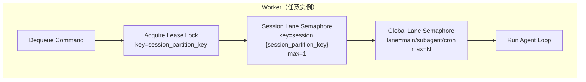
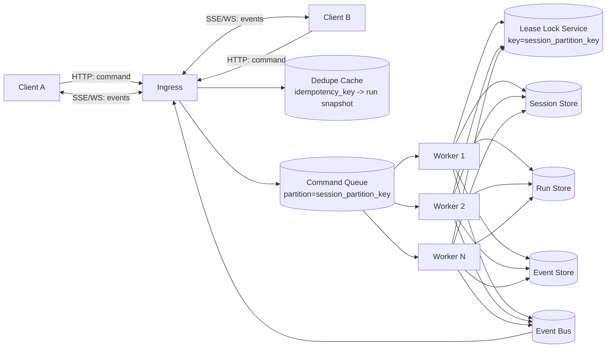
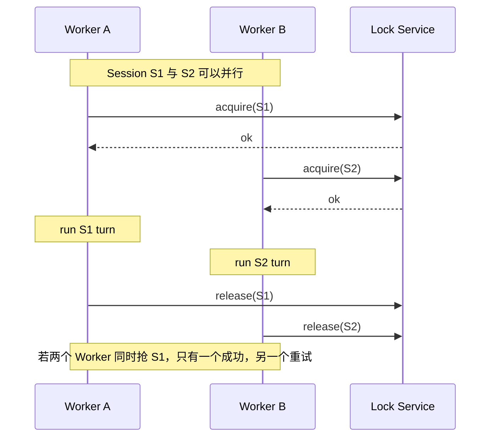
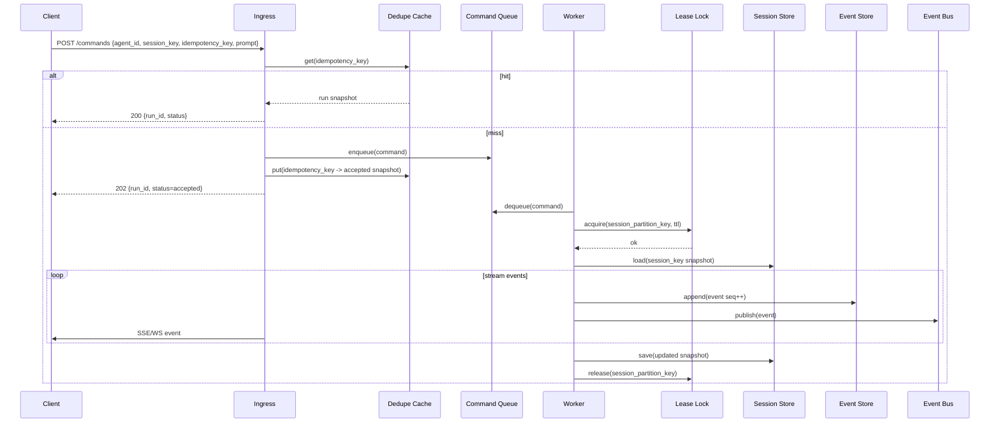
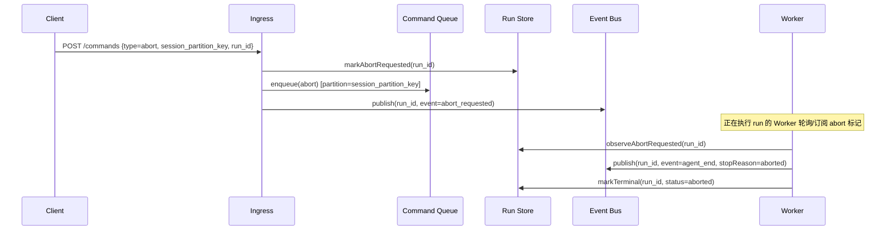
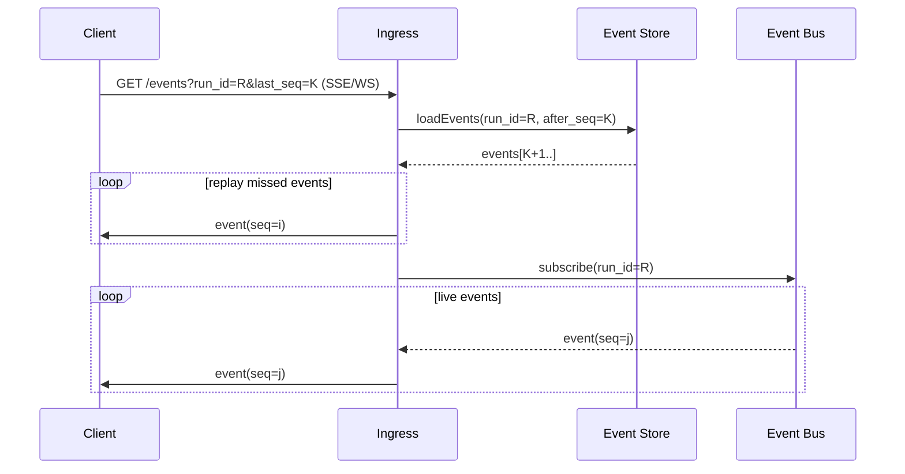

# 无状态 Agent Chat 服务并发架构（增强版）

本文聚焦“服务侧”：在多实例部署下，提供端到端 `agent chat`（流式输出、工具调用、可中断/可恢复），并支持较高并发。

## 1. 核心概念：为什么“会话内串行”不会阻塞全系统

很多人会把“会话内串行”误解成“全局串行”。

- 正确含义：同一个 `session_partition_key` 在任意时刻只允许一个运行中的 Agent Loop（保证上下文一致性）。
- 并不代表：所有会话排成一条全局队列。

可以理解为：

- `session A` 串行（A1 -> A2 -> A3）
- `session B` 串行（B1 -> B2）
- 但 `A` 与 `B` 可以并行执行

这是一种 **按会话分片的串行（keyed serialization）**，不是系统级单线程。

`session_partition_key` 建议定义为：

- `session_partition_key = "{agent_id}::{session_key}"`
- `agent_id`：同一套服务里不同 agent 的标识（persona/权限/skills/tool policy 组合）
- `session_key`：平台侧线程/会话标识（飞书群+thread、Discord thread、TG topic 等）

## 2. 实体与机制定义（建议统一术语）

### 2.1 实体（Entities）

- `AgentId / AgentSpec`：一个服务里可同时运行多个 agent（通过配置/注册区分）。
- `Session`：会话的唯一标识与状态集合（系统提示、模型偏好、消息历史、工具集合、策略配置等）。
  - 建议用 `session_key` 指代外部会话键（跨请求稳定）
  - 建议用 `session_partition_key` 作为并发分片键（含 agent_id）
- `Command`：一次“用户意图”输入，进入系统排队执行。典型命令：`prompt`、`steer`、`follow_up`、`abort`。
- `Run`：一次命令触发的一段执行过程（通常从接收 prompt 到输出 final/error/aborted）。`run_id` 必须全局唯一。
- `Turn`：Run 内的一次“LLM 响应 +（可选）工具调用/工具结果 + 后续继续”组合单元。
- `Event`：执行过程中产生的增量事件，用于流式 UI 和审计重放。建议包含 `seq`（单 run 递增序号）。
- `Transcript`：持久化的会话消息日志（可用于恢复上下文）。若存在“父子链/叶子路径”结构（如 parentId DAG），必须通过统一写入器追加，避免破坏链路。

### 2.2 机制（Mechanisms）

- `Keyed Serialization`：按 `session_partition_key` 串行化执行（同会话分片只允许一个 active run）。
- `Lane / Queue`：并发车道与队列的抽象，用于控制不同类别任务的并行度与公平性。
  - `session lane`：以 `session:{session_partition_key}` 为键的车道，强制会话内串行。
  - `global lane`：全局并发阈值（例如 main/subagent/cron 等类别车道），防止系统过载。
- `Lease Lock`：分布式执行租约（带 TTL/续租），用于多实例环境里保证 session 内串行。
- `Idempotency / Dedupe`：用 `idempotency_key` 去重，确保客户端重试不会启动第二次 run。
- `Abort / Cancellation`：可中断机制。服务端必须能把 abort 传播到正在运行的 run。
- `Backpressure`：慢消费者治理。对 WS/SSE 发送队列设置上限，`dropIfSlow` 或断开，避免拖垮整个网关。
- `Draining`：维护/重启模式。开启后拒绝新入队（fail fast），但保留已入队任务或让其优雅完成。

## 3. 无状态服务模式（推荐）

### 3.1 核心原则

- API 层无状态：不在网关进程内长期持有会话状态。
- 状态外置：消息、事件、运行状态存储在 DB/Redis。
- 执行租约：通过分布式锁保证“同一会话同一时刻仅一个执行者”。

### 3.2 关键组件

- `Ingress`（HTTP 入口层）：鉴权、限流、接收命令、推送 SSE/WebSocket。**注意**：本文的 `Ingress` 是 Agent API 的 HTTP 接入层，不是 AnyAgent 的 `Platform Gateway`（平台连接器服务）。Platform Gateway 是 Ingress 的上游调用方之一。
- `Command Queue`：存放用户命令（prompt/steer/follow_up/abort），建议支持按 `session_partition_key` 分区/路由。
- `Worker Pool`：多个 Worker 并行消费不同会话任务（跨会话并行）。
- `Session Store`：持久化会话状态（消息、快照、游标等）。
- `Run Store`：记录 run 的元数据与状态机（started/ok/error/aborted/timeout），支持查询与恢复。
- `Lock Service`：按 `session_partition_key` 加租约锁（TTL + 续租）。
- `Event Bus`：把 Worker 产生的增量事件广播给网关（也可与事件存储合并为“事件日志 + 订阅”）。

存储落地（选型、schema、TTL/保留策略、一致性边界）见：`docs/architecture/storage-minimal-design.md`。

### 3.3 执行语义

本架构支持两种请求处理路径（对外行为统一，由 Ingress 根据请求类型选择）：

#### 路径 A：同步 SSE 模式（OpenAI SDK 兼容，v0 必须）

当外部客户端发起 `POST /v1/responses` 且 `stream=true` 时，Ingress **不返回 202**，而是在同一 HTTP 连接上直接推送 SSE 事件流：

1. 客户端发送请求（含 `agent_id`、`session_key`、`idempotency_key`）到 Ingress。
   - Ingress 构造 `session_partition_key = "{agent_id}::{session_key}"`
2. Ingress 做 `dedupe`：若命中已完成 run，直接返回 `200` + 完整 response。
3. 未命中：Ingress 将命令写入 Command Queue，同时在**同一连接上阻塞等待**，订阅 Event Bus 上该 `run_id` 的事件。
   - 排队期间 Ingress 发送 SSE 心跳（`:` 注释行）保持连接
   - 超时未被 Worker 认领则返回 `503 Service Unavailable`
4. Worker 认领命令，获取 lease lock，开始执行 agent loop。
5. Worker 产生的每个 Event 写入 Event Store + 发布到 Event Bus。
6. Ingress 从 Event Bus 实时收到事件，直接写入 SSE 响应流推送给客户端。
7. Run 结束后 Worker 写入终态，Ingress 发送 `[DONE]` 并关闭连接。

> 这条路径是 OpenAI SDK `.responses.create({ stream: true })` 的强预期：请求发出后立即开始收到 SSE 事件。

#### 路径 B：异步模式（内部调用 / Platform Gateway）

当 Platform Gateway 或内部服务不需要在同一 HTTP 连接上收到 SSE（例如通过独立 Event Bus 订阅获取更新）时，走经典异步路径：

1. 客户端发送请求到 Ingress。
   - Ingress 构造 `session_partition_key`
2. Ingress 做 `dedupe`：若命中，直接返回已接受/已完成的结果快照或 run 引用。
3. 未命中：Ingress 写入 `Command Queue`，并立刻 ACK（返回 `202 { run_id, status: "accepted" }`）。
4. Worker 取到命令后按 `session_partition_key` 获取租约锁（会话内串行的根保证）。
5. Worker 加载 `Session Store` 的快照，进入执行：
   - 先过 `session lane`（确保同 session 串行）
   - 再过 `global lane`（确保系统整体不超并发）
6. 执行过程中产出 `Event`：写入 `Event Store` 并发布到 `Event Bus`；调用方通过 Event Bus 或轮询 `/v1/responses/{response_id}` 获取结果。
7. 结束后写入 `Run Store` 终态（ok/error/aborted/timeout），更新会话快照并释放锁。

#### 路径选择规则

| 调用方 | `stream` 参数 | 路径 | 响应 |
|--------|--------------|------|------|
| OpenAI SDK 直连 | `true` | 路径 A（同步 SSE） | SSE 事件流 |
| OpenAI SDK 直连 | `false` | 路径 A 或 B 均可 | `200` + 完整 response JSON |
| Platform Gateway | `true` | 路径 A 或 B（推荐 B + Event Bus 订阅） | 按选择返回 |
| Platform Gateway | `false` | 路径 B | `202` + `run_id` |

## 4. 并发控制模型（两级车道）

目标：既保证“会话内严格顺序”，又能在高并发下保护系统资源。

- `session lane`: `session:{session_partition_key}`，并发固定为 `1`
- `global lane`: `main`（或按类别拆分 `main/subagent/cron`），并发为可配置 `N`

直观效果：

- 同 session 的请求永远不并发
- 不同 session 的请求最多并发 `N`（或按类别各自 `N`）

## 5. Mermaid：并发架构图（无状态部署）

## 6. Mermaid：同会话串行、跨会话并行（行为示意）

## 7. Mermaid：一次 prompt 的端到端时序（含幂等与流式）

### 7.1 Prompt（命令入队 + 事件流）

### 7.2 Abort（中断正在执行的 Run）

### 7.3 Reconnect（断线重连与事件补发）

## 8. 关键设计要点（建议写进实现规范）

- `幂等键`：每次用户输入必须携带 `idempotency_key`；网关与存储都用它防止重复 run。
- `事件序号`：每个 run 内 `seq` 单调递增；客户端重连时用 `last_seq` 拉取缺失事件（从 `Event Store` 补发）。
- `慢消费者`：网关对每条连接维护发送缓冲上限；超限时 `drop deltas` 或断开（确保系统不被拖垮）。
- `Abort`：`abort` 作为命令进入队列或直达“运行中表”；必须能取消正在执行的 run（以及持久化“已中止”的终态）。
- `Transcript 一致性`：若采用 parentId 链/DAG 的 transcript，写入必须走统一组件（类似 SessionManager），禁止 raw JSONL 追加。
- `Draining`：部署滚动或重启前进入 draining，拒绝新入队；已入队/执行中的任务走可控超时与收敛路径。

## 9. 一句话落地标准

“会话内强顺序 + 会话间高并发 + 服务实例无状态 + 状态外置可恢复”。

## 10. 对照：OpenClaw / pi-mono 在系统里的角色（回答常见误解）

你这个问题的关键在于：`pi-mono` 是“可复用的 Agent 核心库”，而 `OpenClaw Gateway` 是“把 Agent 跑起来并对外提供能力的服务进程”。

### 10.1 一个更贴近事实的映射

- `pi-mono/packages/agent`（`@mariozechner/pi-agent-core`）：
  - 更像 **Agent Runtime Library / SDK**（提供 `Agent` 类、工具调用循环、事件流协议形态、steer/follow-up 等行为抽象）。
  - 它本身不是一个“常驻网络服务”，默认也不承担“多通道接入、鉴权、限流、连接管理”这些 gateway 职责。

- `openclaw/src/gateway/*`（Gateway 进程）：
  - 更像 **Agent Hosting Server + Control Plane**：
    - 接收来自各种入口的指令（CLI/Web/UI/节点/通道）
    - 管理 session/run/transcript/events
    - 负责把事件广播给在线客户端
    - 负责慢消费者治理、draining、鉴权、连接生命周期等
  - 同时也承载 **Channel Integrations**（Discord/Slack/WhatsApp/飞书等的连接、收消息、发消息）。

换句话说：在 OpenClaw 里，“Agent Server”更接近 `Gateway` 本身，而不是 `pi-mono`。

### 10.2 “gateway 是 agent client 吗？”怎么理解更准确

如果从“对外部平台”角度看：

- Gateway 对 Discord/飞书/Slack 等平台，确实扮演“客户端”(client) 身份去连它们的 API/WS，然后把外部消息转换为内部 `Command`。

但从“我们系统内部架构”角度看：

- Gateway 是 **服务端入口**（clients 连接到它），而不是 agent client。
- 真正的 agent client 通常是：
  - `openclaw` 的 CLI（`openclaw agent ...` / `openclaw message send ...`）
  - WebChat/Control UI
  - macOS/iOS/Android 节点（作为 node client 报告能力、接受 invoke）
  - 各类通道适配器（也可以视为“外部平台 client”，但它们通常运行在 gateway 进程内部）

### 10.3 把本设计套回 OpenClaw（你可以用它验证理解）

你可以把本文的无状态拆分想象成把 OpenClaw Gateway 拆成两层（逻辑层面，不一定要物理拆）：

- `Ingress`：对应 OpenClaw 的 WS/HTTP 控制面，负责连接、鉴权、订阅事件、下发命令。
- `Worker Pool`：对应“实际执行 Agent Loop + 工具调用”的执行面（可在同进程线程池/事件循环里，也可以独立进程/独立服务）。

这也解释了你前面担心的点：

- “会话内串行”对应 keyed serialization（session lane max=1）。
- 并不会形成“全局串行阻塞”，因为不同 `session_partition_key` 在不同 worker 上并行跑。

## 11. Tool Runtime（避免重复，统一指向 requirements）

Tool Runtime 的协议、联邦路由、幂等/取消/审计语义等在 AnyAgent 中属于“契约型内容”，以需求文档为准：

- `/Users/ticoag/Documents/myws/clawers/AnyAgent/requirements.md` 的 **第 5 节（内部接口：Tool Runtime）**

本文档仅聚焦“无状态并发与可恢复执行”这条主线（keyed serialization、事件补发、慢消费者治理等），不再重复 Tool Runtime 的设计与图。
