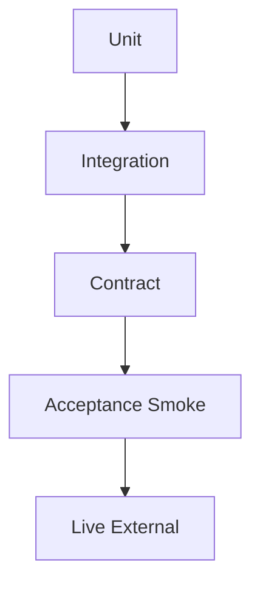

<!--
---
doc_kind: architecture
status: stable
tags: ["testing", "quality", "acceptance", "unit", "contract"]
summary: anyagent 的分层测试策略，定义 unit、integration、contract、acceptance 与 live 验证边界。
req: ["requirements.md#req-9"]
audience: ["developer", "agent"]
---
-->

# anyagent 测试分层策略

本文档定义 `anyagent` 仓库的测试分层与默认补齐顺序，目标是把当前偏 acceptance/smoke 的验证方式，逐步收敛为“快速回归 + 契约守护 + 最小闭环验收”并存的体系。

## 目标

- 让高频回归依赖快速、可定位的测试，而不是把所有回归都挤进大 acceptance 脚本。
- 让 Responses API、Stage Events、Tool Runtime、安全边界有明确的契约守护层。
- 保留最小 smoke/acceptance 闭环，作为“系统真的能跑起来”的最终证明。

## 分层模型



默认原则：

- 越靠下越接近用户真实路径，但也越慢、越难定位。
- 新增行为时，优先补能最快锁住根因的那一层。
- 同一个风险点允许被多层覆盖，但每一层都要有清晰职责，避免重复堆叠。

## 1. Unit Tests

位置建议：

- `tests/unit/agent_runtime/`
- `tests/unit/server/`

适用对象：

- 纯函数
- 小状态机
- JSON 归一化 / hash / merge 逻辑
- 不需要真正起 FastAPI app、Redis、PG、MCP server 的模块

典型模块：

- `agent_runtime/session_runtime.py`
- `server/manifest_cache.py`
- `server/security/credential_store.py`
- `server/sandbox/exec_handler.py`

要求：

- 快速运行
- 不依赖外部服务
- 失败后能直接定位到模块级根因

## 2. Integration Tests

位置建议：

- `tests/integration/server/`
- `tests/integration/runtime/`

适用对象：

- 两个或以上模块边界的拼接验证
- in-process store / runtime / app 之间的协作
- 不需要真实外部依赖，但需要真实对象交互

典型场景：

- `server.app` 与 `runtime` 的执行路径
- Event Store 与 typed event client 的补发一致性
- sandbox manager 与 exec handler 的上下文传递

## 3. Contract Tests

位置建议：

- `tests/contract/responses/`
- `tests/contract/events/`

适用对象：

- 对外协议形状
- SSE event block 顺序与结束语义
- Stage Events typed schema
- Tool Runtime execute / manifest payload shape

重点：

- 保护 OpenAI Responses API 兼容面
- 保护 `anyagent` 自己的 typed events / internal APIs
- 尽量使用固定 fixture 或最小 fake provider，避免把契约验证和复杂环境强耦合

## 4. Acceptance / Smoke

位置：

- `tests/acceptance/**`

适用对象：

- 一条命令可跑通的最小闭环
- 用户视角的主路径行为证明
- SDK / MCP / 内置 server 的关键回归

要求：

- 每个脚本回答“系统是否还能工作”
- 不承担过多细碎分支矩阵
- 更关注闭环成立，而不是覆盖全部边界

## 5. Live / External Tests

位置：

- 仍可放在 `tests/acceptance/server/`，通过环境变量 gating
- 或在后续演进中单独收口到 `tests/live/`

适用对象：

- Redis / PostgreSQL / 外部存储
- 在线兼容性
- 真正的 provider / network / sandbox backend

要求：

- 必须显式依赖环境变量
- 默认本地和 CI 不强制
- 失败时要能区分“代码问题”和“环境问题”

## 当前缺口判断

当前仓库已有：

- 一批离线 acceptance/smoke
- 一个较大的 `tests/acceptance/server/acceptance_builtin_server_smoke.py`

当前主要缺口：

- `tests/unit/` 几乎为空
- `tests/integration/` 与 `tests/contract/` 尚未成型
- 性能、鲁棒性、安全回归尚未形成单独层次

## 首批补齐顺序

### P0

- `session_runtime`：请求/会话合并、fallback transcript、snapshot 构造
- `manifest_cache`：key 稳定性、clone 语义、缓存失效
- `credential_store`：scope/kind 解析、agent 覆盖 global、delete 语义
- `exec_handler`：UTF-8 截断、stderr 预算传递、输出截断标记

### P1

- Responses API / SSE / Stage Events contract fixtures
- in-process app/runtime/event-store integration tests
- tool policy / credential scope / secret redaction 的负向测试

### P2

- 并发与压力
- Redis / PG / MCP / provider 的鲁棒性与故障注入
- 更系统的 security regression matrix

## 运行约定

推荐命令：

```bash
# unit
uv run --with pytest --project packages/anyagent python -m pytest tests/unit -q

# formal pytest regressions
bash scripts/ci/run_pytest_regressions.sh

# acceptance smoke
bash scripts/ci/run_offline_smokes.sh
```

当一次改动同时影响：

- 纯逻辑：至少跑对应 `tests/unit`
- 协议 / 事件 / SDK：加跑相关 acceptance
- server 主路径：加跑 `tests/acceptance/server/acceptance_builtin_server_smoke.py` 的 targeted pytest
