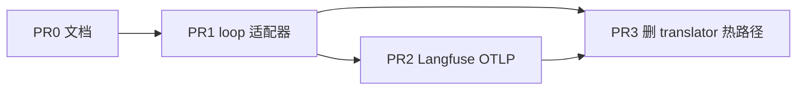

# pydantic-ai loop 与 Langfuse 跟踪

设计与取舍在 [ADR · 决策结论](../../../architecture/decisions/pydantic-ai-loop-and-langfuse.md#决策结论)，这篇只回答**怎么落、按什么顺序、验收什么**。[^adr]
pack 磁盘布局以 [Agent Packs](../../../architecture/runtime/agent-packs-and-runtime-config.md#agent-packs) 为准。[^packs]
需求锚点 `requirements.md#req-4-7`。[^req]

## Context

自研 `tool_loop.py` 与 vendor translator 和 pydantic-ai 重叠，却不是托管价值。Gateway、Session/Run/Event、Credential、Tool Runtime、`.anyagent` 加载保持原样。人类跟踪改走 Langfuse；Event Store 只服务 resume / SSE / 幂等。

## Approach

在现有 `run_tool_loop_nonstream` / `run_tool_loop_stream_live` 后面接 pydantic-ai 适配器，Responses 与 Gateway 调用面不动。工具继续走 Tool Runtime execute。`AGENTS.md` 与 context providers 仍由 prompt envelope 组好再交给 pydantic-ai instructions。OTLP 指向 Langfuse；未配置则跟踪关闭。

提示简化只做「禁止双真源」：不引入 pydantic-ai YAML spec，不把业务 instructions 写进 SDK。skill 仍可选。见 [ADR · 配置与提示](../../../architecture/decisions/pydantic-ai-loop-and-langfuse.md#配置与提示)。[^adr]

## Key Decisions

见 [ADR · 分层边界](../../../architecture/decisions/pydantic-ai-loop-and-langfuse.md#分层边界)、[配置与提示](../../../architecture/decisions/pydantic-ai-loop-and-langfuse.md#配置与提示)、[跟踪：Langfuse 与 Event Store](../../../architecture/decisions/pydantic-ai-loop-and-langfuse.md#跟踪langfuse-与-event-store)。[^adr]

## Scope

- In: pydantic-ai 适配器、OTLP、工作区 `models` 配置 → pydantic-ai model 字符串、envelope 注入、loop 单测与 Chatwoot 离线 smoke
- Out: Gateway 改拓扑、用 Langfuse 换 Event Store、Temporal、Rust runtime、业务仓提示迁移、平行 agent spec

## Files

- [`packages/anyagent/src/anyagent/agent_runtime/tool_loop.py`](../../../../packages/anyagent/src/anyagent/agent_runtime/tool_loop.py) — 保持函数签名，内部改调适配器
- [`packages/anyagent/src/anyagent/server/responses/response_execution.py`](../../../../packages/anyagent/src/anyagent/server/responses/response_execution.py) — 确认调用面零改
- [`packages/anyagent/src/anyagent/agent_runtime/prompt_envelope.py`](../../../../packages/anyagent/src/anyagent/agent_runtime/prompt_envelope.py) — envelope 仍是注入入口
- [`packages/anyagent/pyproject.toml`](../../../../packages/anyagent/pyproject.toml) — 加 `pydantic-ai` 与可选 OTLP extra
- `packages/anyagent/src/anyagent/agent_runtime/loop/` — Agent 构造、tool wrap、stream 映射

## Reuse

- `run_tool_loop_nonstream` / `run_tool_loop_stream_live` — 对外合同，适配器藏在后面
- `build_agents_md_fragment` / prompt envelope 其余 builder — 注入 pydantic-ai instructions，带 path/hash
- `ToolRuntimeClient` execute — pydantic-ai `@tool` 的唯一执行后端
- `resolve_manifest_with_mcp` — 工具列表来源仍是 manifest
- Observability sink 接口 — OTLP exporter 作为新 sink，不改 Event Store 写路径

## 依赖

待办三态：`- [ ]` 未完成，`- [x]` 完成，`- [-]` 废弃。完成或废弃一项就改那一行。

## PR0 文档

- [x] ADR `docs/architecture/decisions/pydantic-ai-loop-and-langfuse.md` 可被本计划章节引用
- [x] `requirements.md#req-4-7`、`todo/server-runtime.md`、ADR 索引、roadmap 决策记录已挂上
- [x] `python3 scripts/docs/check.py --root .` 通过

验收：frontmatter 可解析；本计划引用的章节标题在 ADR / pack 文里存在。无业务代码。

## PR1 loop 适配器

- [x] `pyproject.toml` 增加 `pydantic-ai` 依赖并 `uv lock`
- [x] 适配器从 pack + envelope + manifest 构造 `pydantic_ai.Agent`，`instructions` 只来自 envelope，不写死业务文案
- [x] 每个 manifest function tool 包一层 pydantic-ai tool，内部只调 `ToolRuntimeClient.execute`
- [x] `run_tool_loop_nonstream` / `run_tool_loop_stream_live` 改走适配器，SSE 事件名与 `response.output` 形状与现网兼容
- [x] 工作区 `models` 的模型 id 映射为 pydantic-ai model 字符串；缺映射 fail-fast
- [x] 单测：无网络情况下 envelope 注入、tool wrap 调用 execute、stream 结束带 `[DONE]`
- [x] `tests/acceptance/server/` 里现有 built-in server smoke 与 `acceptance_chatwoot_connector_smoke.py` 通过

验收：`anyagent serve` 从 `.anyagent/` 启动后，`POST /v1/responses` 与 Chatwoot webhook 离线 smoke 与替换前行为一致；工具仍打到 Tool Runtime。

## PR2 Langfuse OTLP

- [x] 可选 extra（如 `anyagent[otel]`）装 OTLP exporter；loop 侧用 pydantic-ai Instrumentation，不引入 Langfuse SDK
- [x] 环境变量契约：OTLP endpoint + 认证；未设置时零导出、服务可跑
- [x] session / run / agent_id 写入 span attribute，便于在 Langfuse 按会话查
- [x] 单测：无 endpoint 时不发网络；有 fake exporter 时至少一条 generation span
- [x] 确认 Event Store 写入路径未改，resume / idempotency smoke 仍过

验收：配好 OTLP 后 Langfuse 能看到一轮 tool 调用树；不配时 Chatwoot 离线 smoke 仍绿。语义见 [ADR · 跟踪](../../../architecture/decisions/pydantic-ai-loop-and-langfuse.md#跟踪langfuse-与-event-store)。[^adr][^obs]

## PR3 收敛自研 loop

- [x] Responses 主路径不再走 `model_providers/` translator；OpenAI 兼容模型经 pydantic-ai
- [x] `runtime.middlewares` 的压缩 / 循环检测映射为 pydantic-ai capabilities 或 hooks；禁止再加自研 4-hook
- [x] 旧 `tool_loop` 内循环与 translator 从热路径删除或降为未引用模块，CI 不再当主实现测
- [x] 更新 `docs/architecture/api/model-provider-translators.md` 与 `runtime/agent-loop-middleware.md` 为过渡/历史，指向本 ADR

验收：grep 热路径无 Anthropic/Gemini 自研 HTTP translator；middleware 文档不再把 4-hook 当新能力入口。

## Verification

- 离线：`uv run --project packages/anyagent pytest tests/acceptance/server/acceptance_chatwoot_connector_smoke.py tests/acceptance/server -q`
- 结构：`uv run --project packages/anyagent anyagent doctor --workspace <example-or-tmp-workspace> --json`
- 文档：`python3 scripts/docs/check.py --root .`
- 有 Langfuse 时：跑一轮 `POST /v1/responses`（含一次 tool call），在项目里能按 `session_key` 打开对应 trace
- 失败时先看适配器是否绕过 Tool Runtime、SSE 是否丢 `[DONE]`、OTLP 未配置是否误阻塞启动

消费侧 workspace 升级 SDK 后的 Chatwoot 联调不在本仓本计划；本仓只保证协议与离线 smoke。

## 不做

见 [ADR · 明确不做](../../../architecture/decisions/pydantic-ai-loop-and-langfuse.md#明确不做)。[^adr]

## Deviations

- pydantic-ai 锁 2.40.0（用户要求最新版；v2 的 `openai:` 已是 Responses API，压缩走 `ProcessHistory` 而非 Harness Compaction）
- 适配完成后删除自研 Anthropic/Gemini/Chat Completions HTTP translator 与配套单测；`model_providers/` 只留协议、OpenAI Responses 工厂和 kind 目录
- pydantic-ai 适配器收进 `agent_runtime/loop/`；execute/manifest 进 `tool_execution.py`，`tool_loop.py` 只保留对外合同
- 自研 Event Store / Stage Events 仍作为 SDK 消费渠道（写库）；Langfuse OTLP 只作附加渠道，不替代 `client.events`

[^adr]: pydantic-ai Agent Loop + Langfuse Tracing
[^packs]: Agent Packs 与 Runtime Config
[^responses]: Responses API SDK 与 Server
[^obs]: Unified Observability Replay Sink
[^req]: anyagent 活跃需求索引
