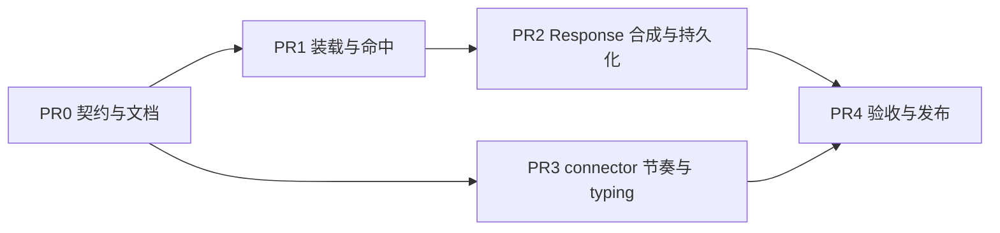

# Scripted Reply 扩展点与 connector 回复节奏

Context provider 与 middleware 的既有边界见 [Agent Loop Middleware · Context Providers 与 middleware 的边界](../../../architecture/runtime/agent-loop-middleware.md#7-context-providers-与-middleware-的边界)。[^middleware]
跨请求上下文恢复与首轮 input 组装口径见 [Agent Packs · 跨请求上下文恢复](../../../architecture/runtime/agent-packs-and-runtime-config.md#跨请求上下文恢复)。[^packs]
Connector contract 见 [Platform Connectors](../../../architecture/integrations/platform-connectors.md)。[^connectors]
需求锚点 `requirements.md#req-4-1`、`requirements.md#req-4-6-1`、`requirements.md#req-6-1`。[^req]

## Context

托管面目前缺一个能力：**已知输入的确定性回复**。

对话式业务里有一批输入是部署者自己造出来的——widget 的 quick prompt 按钮、固定入口语、纯招呼语、营业时间外的自动回复。这些输入的正确回复是已知常量，却只能交给模型每次重新生成：慢（模型路径实测数十秒，确定性回复本应接近 0）、贵（每次都付 token）、且不稳定（同一个 chip 21 次触发得到 21 个不同长度的回复）。

部署者今天只有三个不完美的出口：

- `runtime.context_providers` 只能注入 `ContextFragment`，影响不了是否调用模型。用它写「请逐字输出以下文本」仍要付一次模型调用，且模型可能不照做。
- `runtime.middlewares` 的 `before_model_call` 有 `stop=True`，但 [Agent Loop Middleware](../../../architecture/runtime/agent-loop-middleware.md) 已标为过渡/历史，明确不再扩展自研 4-hook；`stop` 也只是终止 loop，不产生干净的 output message。
- connector 侧自己短路：能把消息发出去，但这一轮不会进 session snapshot 的 `fallback_transcript_items`，**下一轮模型看不到自己"说过"什么**，且每个 connector 要各写一遍。

第三点是关键约束：确定性回复必须和模型回复一样进入会话历史，否则多轮对话会立刻错乱。

## Approach

在内置 runtime 的 `/v1/responses` worker 内、**session lease 之下、`prepare_response_session_context` 之后、`run_tool_loop_*` 之前**，增加一个 scripted reply 扩展点。命中时由框架合成一个**正常的 Response**（`output` 为 message / `output_text`），直接交给该 worker 既有的 terminal finalizer（event store 写入 + run final + session snapshot CAS）返回；未命中时不付模型与工具成本继续走 loop。

这个位置是刻意选的，四个理由：

- **进上下文是免费的。** `response_to_transcript_items` / `build_fallback_transcript_items`（`packages/anyagent/src/anyagent/agent_runtime/session_runtime.py:396`、`:191`）消费的是 Response 结构，不关心它是不是模型产的。合成 Response 意味着不用为"合成轮次"新写一套持久化。
- **finalize 只在 worker 内可达。** route 层（`packages/anyagent/src/anyagent/server/routes/responses.py:162-181`）命中时 run 已 `create_started`、`on_agent_start` 已派发、`anyagent.response.request` 已写；而 `_finalize_nonstream_terminal`（`:687-751`）与 `session_ctx`（previous_snapshot / version）只在 worker 内、session lease 之下。放 worker 内才能复用，且天然保序。
- **消费侧零改动。** Gateway connector 从 `payload.output` 提取回复（`packages/anyagent/src/anyagent/plugins/builtin/chatwoot_connector/plugin.py:554`），SDK 从 Event Store 读事件。两边都看不出差别。
- **不碰迁移中的 loop。** 执行面正在换 pydantic-ai（见 [ADR · 分层边界](../../../architecture/decisions/pydantic-ai-loop-and-langfuse.md#分层边界)）。pydantic-ai `Hooks` 只能改写请求、不能短路模型调用并返回最终文本，所以这不是 hook 能承载的横切能力；扩展点落在 loop 之外，与该迁移无耦合。[^adr]

代价要写明：命中前 skill 选择、context providers、prompt envelope、MCP manager 获取仍会执行，本扩展点节省的是**模型与工具成本**，不是全部请求开销。

接口形状：定义 `ScriptedReplyRequest`，字段 = `ContextProviderRequest`（`agent_id` / `session_key` / `body` / `metadata` / `tool_context` / `pack` / `selected_skills`）+ `previous_transcript_items`（来自 `session_ctx.previous_snapshot` 的 fallback transcript）。不原样复用 `ContextProviderRequest` 的原因是它不带历史，"首轮招呼语只回一次""上一轮已 scripted 则不再 scripted"都判不了。classpath 装载与 workspace import path 复用 context provider 的同一套机制（`packages/anyagent/src/anyagent/server/handlers/context_providers.py:26`、`:45`）。部署者写一个类、在 `agent.yaml` 加一行，与写 context provider 的心智一致。返回 `None` 或一个 `ScriptedReply`。

**Protocol-first。** `ScriptedReply` 是跨边界 typed model，落 `anyagent.protocol.scripted_reply`；scripted 轮次的可识别标记是一条 typed Stage Event `AnyAgentScriptedReplyEvent`（`anyagent.protocol.stage_events`，携带 `provider` / `variant_id` / `reason`），写入 Event Store，SDK Stage Events 与审计一处解决。Response 顶层不加自定义字段，保持 OpenAI 兼容面不动。

**边界要写清楚**，否则这个扩展点会变成"在 server 里写业务分支"的后门：scripted reply 只允许返回**文本**，不允许发起工具调用、不允许触发 handoff、不允许多轮。需要工具或判断的场景走 loop。

**回复节奏归 connector**，不归扩展点。理由是它是渠道呈现问题而非生成问题：确定性回复瞬间返回会暴露"这句是预设的"，但给所有回复加固定延迟又会让本来就慢的模型回复更慢。正确形态是**节奏下限（floor）**：本轮从收到消息到准备发送若不足 `[min, max]` 内的随机值，补足差额再发；已经超过就立即发。这样确定性回复被垫到 2–4 秒，模型回复不受任何影响。typing indicator 在调 `/v1/responses` **之前**就打开、发送前关闭（`try/finally`）：模型路径几十秒同样受益，且与 floor 逻辑解耦。节奏补足必须放在 `_conversation_owned_by_human` 二次检查**之前**——等完再查再发，避免等待期间人工接管的会话被 bot 插话。

## Scope

- In：`ScriptedReply` / `ScriptedReplyRequest` / `ScriptedReplyProvider` 契约与装载、`AnyAgentScriptedReplyEvent`、`RuntimeSpec` 新增配置项、内置 runtime 命中时的 Response 合成与持久化（非流式 + 流式）、connector 回复节奏下限、Chatwoot typing indicator、对应文档与测试
- Out：话术表内容与匹配规则（属消费侧）、把 scripted reply 做成可返回工具调用或多轮、为节奏下限新增独立配置文件、其他 connector 的 typing indicator（先只做 Chatwoot，契约留出位置）、**分布式 runtime**（`packages/anyagent/src/anyagent/server/routes/distributed_responses.py` → `packages/anyagent/src/anyagent/server/responses/response_tooling.py` 是另一条执行面，finalize 形状不同；本轮不支持，文档明确标注）、`anyagent doctor` 报告装载状态（context providers 今天也不报，不单独为 scripted reply 开口子）

## Files

- `packages/anyagent/src/anyagent/protocol/scripted_reply.py` — 新增。`ScriptedReply` pydantic model（wire-level SSOT）
- `packages/anyagent/src/anyagent/protocol/stage_events.py` — 新增 `AnyAgentScriptedReplyEvent`
- `packages/anyagent/src/anyagent/agent_runtime/scripted_reply.py` — 新增。`ScriptedReplyRequest` / `ScriptedReplyProvider` 契约、classpath 装载、带超时的 `resolve_scripted_reply`，参照 `agent_runtime/context_providers.py`
- `packages/anyagent/src/anyagent/agent_runtime/loop/run.py` — `_response_payload` / `_iter_completed_sse` 提为公共 helper（合成 Response 与 SSE 的唯一形状来源）
- `packages/anyagent/src/anyagent/server/handlers/scripted_reply.py` — 新增。装载器（复用 `_workspace_import_paths`）
- `packages/anyagent/src/anyagent/server/routes/responses.py` — `run_nonstream_worker` / `run_stream_worker` 在 loop 入口前插入命中判定
- `packages/anyagent/src/anyagent/agent_packs.py` — `RuntimeSpec` 增加 `scripted_reply_providers`
- `packages/anyagent/src/anyagent/plugins/builtin/chatwoot_connector/plugin.py` — 回复节奏下限与 typing indicator 接线
- `packages/anyagent/src/anyagent/plugins/builtin/chatwoot_connector/chatwoot.py` — `ChatwootOutboundDelivery.set_typing`
- `packages/anyagent/src/anyagent/gateway/connector_contracts.py` — `ConnectorOutboundDelivery` 增加可选 typing indicator 能力

## Reuse

- `packages/anyagent/src/anyagent/agent_runtime/context_providers.py` `load_context_provider_from_classpath` — classpath 校验/导入/实例化模式照搬
- `packages/anyagent/src/anyagent/server/handlers/context_providers.py:26` `_workspace_import_paths` — workspace `src/` 导入路径的既有处理
- `packages/anyagent/src/anyagent/agent_runtime/loop/run.py:201` `_response_payload`、`:593` `_iter_completed_sse` — 已经是"message + output_text"与"单 delta + completed + [DONE]"的现成形状，提为公共后 scripted 与模型轮次共用同一来源
- `packages/anyagent/src/anyagent/server/routes/responses.py:687` `_finalize_nonstream_terminal`、`:459-463` stream worker 的 persist 路径 — 合成 Response 后直接交给它们，不新写持久化
- `packages/anyagent/src/anyagent/agent_runtime/session_runtime.py:396` `response_to_transcript_items`、`:191` `build_fallback_transcript_items` — 合成 Response 后的历史写入完全走这条既有路径
- `packages/anyagent/src/anyagent/agent_runtime/loop/models.py:262` — 首轮 body 会 `pop("previous_response_id")`，scripted 的 `response_id` 成为 `last_response_id` 不会透传上游模型
- `packages/anyagent/src/anyagent/plugins/builtin/chatwoot_connector/plugin.py:292` `_process_incoming_message` — 节奏下限插在 `/v1/responses` 返回与 `_conversation_owned_by_human` 二次检查之间
- `packages/anyagent/src/anyagent/plugins/builtin/chatwoot_connector/chatwoot.py:116` `ChatwootOutboundDelivery` — typing indicator 落在同一个 access token 与 HTTP client 上，不新增凭据

## 依赖



PR3 不依赖 PR1/PR2，可并行。待办三态：`- [ ]` 未完成，`- [x]` 完成，`- [-]` 废弃。

## PR0 契约与文档

- [x] `anyagent.protocol.scripted_reply.ScriptedReply`：`text`（必填、非空）、`variant_id` / `reason` 可选标识；显式不含工具调用、handoff、多轮
- [x] `anyagent.protocol.stage_events.AnyAgentScriptedReplyEvent`：`type="anyagent.response.scripted"`，携带 `provider` / `variant_id` / `reason`；登记进 stage event 联合类型与 protocol schema 导出
- [x] `anyagent.agent_runtime.scripted_reply`：`ScriptedReplyRequest`（ContextProviderRequest 字段 + `previous_transcript_items`）、`ScriptedReplyProvider` Protocol（`async resolve(request) -> ScriptedReply | None`）、`load_scripted_reply_provider_from_classpath`
- [x] 明确失败语义：provider 抛异常或超时一律降级为继续走 loop，只 warning，不影响该轮回复
- [x] `docs/architecture/runtime/agent-loop-middleware.md` 的 §7 边界表补第三行：确定性回复 → scripted reply provider，并说明为什么它既不是 context provider 也不是 pydantic-ai hook
- [x] `docs/architecture/api/responses-api-sdk-and-server.md` 说明 scripted 轮次的可识别标记只在 Stage Event，Response 面不变；并标注分布式 runtime 不支持
- [x] `requirements.md` 在 `req-4-6-1` 下补一句能力描述，供 `todo/*.md` cite
- [x] `todo/server-runtime.md` 增任务条目并 cite 需求锚点

验收：契约文件可 import；文档三处链接互通。无行为变更。

## PR1 装载与命中

- [x] `RuntimeSpec` 增加 `scripted_reply_providers: list[str] | None`（classpath 列表，语义与顺序同 `context_providers`，先命中先返回）
- [x] `server/handlers/scripted_reply.py` 装载器复用 `_workspace_import_paths`；装载失败 warning 跳过，不影响 agent 启动
- [x] `run_nonstream_worker` / `run_stream_worker` 在 `prepare_response_session_context` 之后、`run_tool_loop_*` 之前执行命中判定；`previous_transcript_items` 取自 `session_ctx.previous_snapshot`
- [x] provider 执行加 `asyncio.wait_for` 超时保护（默认 2s），超时按未命中处理
- [-] `anyagent doctor` 能报出 scripted reply provider 的装载状态（context providers 今天也不报，不单独开口子）
- [x] 单测：未配置不触发、装载失败降级、抛异常降级、超时降级、返回 `None` 继续走 loop

验收：配一个恒返回 `None` 的 provider，行为与未配置完全一致。

## PR2 Response 合成与持久化

- [x] `agent_runtime/loop/run.py` 的 `_response_payload` / `_iter_completed_sse` 提为公共 `build_text_response_payload` / `iter_text_response_sse`；scripted 轮次与模型轮次共用同一形状（现有 payload 不含 `usage`，scripted 也不加，保持一致）
- [x] 非流式：命中时合成 payload 交给 `_finalize_nonstream_terminal`，`fallback_transcript_items` 同时收进用户输入与合成回复——**这是本 PR 的核心验收点**
- [x] 流式：命中时把 `iter_text_response_sse` 的 chunk 推进既有 queue 与 persist 路径，SSE 序列为 delta → completed → [DONE]
- [x] 命中时先写 `AnyAgentScriptedReplyEvent` 到 Event Store，再 finalize
- [x] 单测 + 集成测：命中轮次不调用模型；第二轮请求的 input 中能看到第一轮的合成回复；SSE 事件序列合法
- [x] 集成测走 Chatwoot connector 全链路：命中后 `payload.output` 可被 `_extract_reply_and_handoff` 正常提取

验收：两轮会话，第一轮 scripted、第二轮模型，第二轮的模型输入包含第一轮合成回复。

## PR3 connector 节奏与 typing

- [ ] 前置验证：用 Agent Bot access token 直接调 Chatwoot `POST .../conversations/{id}/toggle_typing_status`，确认该 token 有权限；不通则 typing 降级为 no-op 并记录。（代码侧降级已实现：`_set_typing_indicator` 捕获 `OutboundDeliveryError` / `NotImplementedError` 只 warning；本地无 `ANYAGENT_TEST_CHATWOOT_*` 凭据，live 验证待有环境时用 `tests/acceptance/server/acceptance_chatwoot_live_smoke.py` 同一组 env 补做）
- [x] `ConnectorOutboundDelivery.set_typing(platform_conversation_id, *, typing: bool)`：可选实现，默认 `NotImplementedError`，与 `send_private_note` 同样式
- [x] `ChatwootOutboundDelivery.set_typing` 调 `toggle_typing_status`，复用现有 access token 与 client
- [x] `_process_incoming_message`：`CHATWOOT_TYPING_INDICATOR=true` 时在调 `/v1/responses` 前 typing on，发送前 `finally` typing off；失败只 warning
- [x] `_process_incoming_message`：`CHATWOOT_REPLY_PACING_MIN_S` / `CHATWOOT_REPLY_PACING_MAX_S` 配置节奏下限，默认关闭；记录处理起点，`/v1/responses` 返回后、`_conversation_owned_by_human` 二次检查**之前**补足到 `[min, max]` 区间内的随机值
- [x] 节奏下限是 floor 不是 delay：耗时已超过区间上限时立即发送，不叠加
- [x] 单测：耗时不足时补足、耗时超出时不等待、开关关闭时零行为变化、typing on/off 成对且异常时仍 off

验收：构造一个瞬时返回的回复，实际发送时间落在配置区间内；构造一个 10 秒回复，发送时间不被额外拉长。

## PR4 验收与发布

- [x] 相关 pytest 全绿
- [x] `docs/acceptance/README.md` 补 scripted reply 的验收入口
- [x] 版本号更新、commit、push；等云效 pipeline 构建并发布到 Packages（`scripts/anyagent-dev-cli version bump 0.4.27`；commits `155d6f9`、`425f4fe` 已推到 `origin/main`）
- [ ] 用 `anyagent-dev-cli` 确认发布状态与产物版本，写进本节（本轮会话无 Yunxiao MCP 可用，未完成远端验证；待查条件：Codeup `anyagent` 仓 `main` 分支由 `425f4fe` 触发的最新 pipeline run，以及 Yunxiao Packages PyPI `lyriktrip` 仓 `anyagent==0.4.27` 是否出现）

验收：消费侧能安装到含本能力的发布版本。

## Verification

```bash
uv run pytest tests/unit -q -k "scripted_reply or session_runtime"
uv run pytest tests/integration/server -q -k chatwoot
uv run pytest tests/unit/gateway -q
```

端到端：配一个恒命中的 scripted reply provider，发两轮 Chatwoot 消息，确认第一轮 0 token、发送耗时落在节奏区间，第二轮模型输入含第一轮回复。

## 不做

- 不让 scripted reply 返回工具调用、handoff 或多轮。需要判断的场景走 loop，这个扩展点只做确定性文本。
- 不扩展自研 4-hook middleware。按 [Agent Loop Middleware](../../../architecture/runtime/agent-loop-middleware.md) 的现行口径，新横切能力不落在那条链上。
- 不在框架内置任何话术、匹配规则或语言表。命中逻辑与文案全部属于部署者。
- 不给所有 connector 补 typing indicator。契约留出位置，实现先只做 Chatwoot。
- 不在本轮支持分布式 runtime（`routes/distributed_responses.py`）。它的 finalize 形状不同，需要单独一轮；文档标注。
- 不在 route 层做命中判定。命中前的 skill 选择 / context providers / prompt envelope 开销接受，换取 finalize 与保序完全复用。

## 已决

1. scripted 标记：只放 Stage Event `anyagent.response.scripted`（typed，进 protocol SSOT），Response 面不动。
2. 多 provider：先命中先返回，与 `context_providers` 顺序语义一致。
3. 节奏与 typing 配置：沿用 `CHATWOOT_*` 环境变量（`anyagent.env.getenv`），默认关闭，不新增配置文件。

[^middleware]: Agent Loop Middleware（过渡 / 历史）

[^packs]: Agent Packs 与 Runtime Config

[^connectors]: Platform Connectors

[^adr]: pydantic-ai Agent Loop + Langfuse Tracing

[^req]: anyagent 活跃需求索引

[^responses]: Responses API SDK 与 Server
