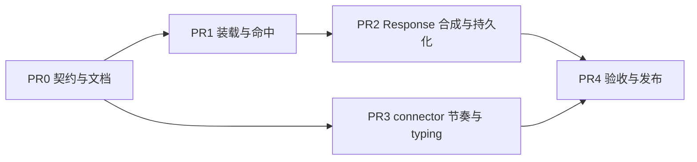

# Scripted Reply 扩展点与 connector 回复节奏

Context provider 与 middleware 的既有边界见 [Agent Loop Middleware · Context Providers 与 middleware 的边界](../../../architecture/runtime/agent-loop-middleware.md#7-context-providers-与-middleware-的边界)。[^middleware]
跨请求上下文恢复与首轮 input 组装口径见 [Agent Packs · 跨请求上下文恢复](../../../architecture/runtime/agent-packs-and-runtime-config.md#跨请求上下文恢复)。[^packs]
Connector contract 见 [Platform Connectors](../../../architecture/integrations/platform-connectors.md)。[^connectors]
需求锚点 `requirements.md#req-4-1`、`requirements.md#req-4-6-1`、`requirements.md#req-6-1`。[^req]

## Context

托管面目前缺一个能力：**已知输入的确定性回复**。

对话式业务里有一批输入是部署者自己造出来的——widget 的 quick prompt 按钮、固定入口语、纯招呼语、营业时间外的自动回复。这些输入的正确回复是已知常量，却只能交给模型每次重新生成：慢（模型路径实测数十秒，确定性回复本应接近 0）、贵（每次都付 token）、且不稳定（同一个 chip 21 次触发得到 21 个不同长度的回复）。

部署者今天只有三个不完美的出口：

- `runtime.context_providers` 只能注入 `ContextFragment`，影响不了是否调用模型。用它写「请逐字输出以下文本」仍要付一次模型调用，且模型可能不照做。
- `runtime.middlewares` 的 `before_model_call` 有 `stop=True`，但 [Agent Loop Middleware](../../../architecture/runtime/agent-loop-middleware.md) 已标为过渡/历史，明确不再扩展自研 4-hook；`stop` 也只是终止 loop，不产生干净的 output message。
- connector 侧自己短路：能把消息发出去，但这一轮不会进 session snapshot 的 `fallback_transcript_items`，**下一轮模型看不到自己"说过"什么**，且每个 connector 要各写一遍。

第三点是关键约束：确定性回复必须和模型回复一样进入会话历史，否则多轮对话会立刻错乱。

## Approach

在 `/v1/responses` 处理链上、进入 agent loop **之前**，增加一个 scripted reply 扩展点。命中时由框架合成一个**正常的 Response**（`output` 为 message / `output_text`），走既有的 event store 写入与 session snapshot 更新路径返回；未命中时零开销继续走 loop。

这个位置是刻意选的，三个理由：

- **进上下文是免费的。** `response_to_transcript_items` / `build_fallback_transcript_items`（`packages/anyagent/src/anyagent/agent_runtime/session_runtime.py:396`、`:191`）消费的是 Response 结构，不关心它是不是模型产的。合成 Response 意味着不用为"合成轮次"新写一套持久化。
- **消费侧零改动。** Gateway connector 从 `payload.output` 提取回复（`packages/anyagent/src/anyagent/plugins/builtin/chatwoot_connector/plugin.py:554`），SDK 从 Event Store 读事件。两边都看不出差别。
- **不碰迁移中的 loop。** 执行面正在换 pydantic-ai（见 [ADR · 分层边界](../../../architecture/decisions/pydantic-ai-loop-and-langfuse.md#分层边界)），扩展点落在 loop 之外，与该迁移无耦合。[^adr]

接口形状复用 `ContextProviderRequest`：同一个受信任的 server-side 输入（`agent_id` / `session_key` / `body` / `metadata` / `tool_context`），同一套 `agent.yaml` classpath 装载与 workspace import path 机制（`packages/anyagent/src/anyagent/server/handlers/context_providers.py:26`、`:45`）。部署者写一个类、在 `agent.yaml` 加一行，与写 context provider 的心智完全一致。返回 `None` 或一个 `ScriptedReply`。

**边界要写清楚**，否则这个扩展点会变成"在 server 里写业务分支"的后门：scripted reply 只允许返回**文本**，不允许发起工具调用、不允许触发 handoff、不允许多轮。需要工具或判断的场景走 loop。

**回复节奏归 connector**，不归扩展点。理由是它是渠道呈现问题而非生成问题：确定性回复瞬间返回会暴露"这句是预设的"，但给所有回复加固定延迟又会让本来就慢的模型回复更慢。正确形态是**节奏下限（floor）**：本轮从收到消息到准备发送若不足 `[min, max]` 内的随机值，补足差额再发；已经超过就立即发。这样确定性回复被垫到 2–4 秒，模型回复不受任何影响。同时补 typing indicator——纯 sleep 的体感比立刻回更差。

## Scope

- In：`ScriptedReplyProvider` 契约与装载、`RuntimeSpec` 新增配置项、命中时的 Response 合成与持久化、可观测标记（scripted 轮次可被区分）、connector 回复节奏下限、Chatwoot typing indicator、对应文档与测试
- Out：话术表内容与匹配规则（属消费侧）、把 scripted reply 做成可返回工具调用或多轮、为节奏下限新增独立配置文件、其他 connector 的 typing indicator（先只做 Chatwoot，契约留出位置）

## Files

- `packages/anyagent/src/anyagent/agent_runtime/scripted_reply.py` — 新增。`ScriptedReply` / `ScriptedReplyProvider` 契约与 classpath 装载，参照 `agent_runtime/context_providers.py`
- `packages/anyagent/src/anyagent/server/handlers/` — 新增装载器 + 在 `/v1/responses` 链上插入命中判定与 Response 合成
- `packages/anyagent/src/anyagent/agent_packs.py` — `RuntimeSpec` 增加 `scripted_reply_providers`
- `packages/anyagent/src/anyagent/plugins/builtin/chatwoot_connector/plugin.py` — 回复节奏下限与 typing indicator 接线
- `packages/anyagent/src/anyagent/gateway/connector_contracts.py` — `ConnectorOutboundDelivery` 增加可选 typing indicator 能力

## Reuse

- `packages/anyagent/src/anyagent/agent_runtime/context_providers.py` `ContextProviderRequest` / `load_context_provider_from_classpath` — 请求形状与 classpath 装载直接复用，不新造一套
- `packages/anyagent/src/anyagent/server/handlers/context_providers.py:26` `_workspace_import_paths` — workspace `src/` 导入路径的既有处理
- `packages/anyagent/src/anyagent/agent_runtime/session_runtime.py:396` `response_to_transcript_items`、`:191` `build_fallback_transcript_items` — 合成 Response 后的历史写入完全走这条既有路径
- `packages/anyagent/src/anyagent/plugins/builtin/chatwoot_connector/plugin.py:292` `_process_incoming_message` — 节奏下限插在 `/v1/responses` 返回与 `outbound.send_message` 之间
- `packages/anyagent/src/anyagent/plugins/builtin/chatwoot_connector/chatwoot.py` `ChatwootOutboundDelivery` — typing indicator 落在同一个 access token 与 HTTP client 上，不新增凭据

## 依赖



PR3 不依赖 PR1/PR2，可并行。待办三态：`- [ ]` 未完成，`- [x]` 完成，`- [-]` 废弃。

## PR0 契约与文档

- [ ] 定义 `ScriptedReply`：`text`（必填）、`reason` / `variant_id` 等可选标识字段；显式不含工具调用、handoff、多轮
- [ ] 定义 `ScriptedReplyProvider`：入参复用 `ContextProviderRequest`，返回 `ScriptedReply | None`；`None` 表示继续走 loop
- [ ] 明确失败语义：provider 抛异常或超时一律降级为继续走 loop，只 warning，不影响该轮回复
- [ ] `docs/architecture/runtime/agent-loop-middleware.md` 的 §7 边界表补第三行：确定性回复 → scripted reply provider，并说明它与 context provider、middleware 的分工
- [ ] `docs/architecture/api/responses-api-sdk-and-server.md` 说明 scripted 轮次在 Response 与事件里的可识别标记
- [ ] `requirements.md` 在 `req-4-1` 或 `req-4-6-1` 下补一句能力描述，供 `todo/*.md` cite
- [ ] `todo/server-runtime.md` 增任务条目并 cite 需求锚点

验收：契约文件可 import；文档三处链接互通。无行为变更。

## PR1 装载与命中

- [ ] `RuntimeSpec` 增加 `scripted_reply_providers: list[str]`（classpath 列表，语义与顺序同 `context_providers`，先命中先返回）
- [ ] 装载器复用 `_workspace_import_paths`；装载失败 warning 跳过，不影响 agent 启动
- [ ] 在 `/v1/responses` 处理链上、prompt envelope 组装与 loop 入口之间执行命中判定
- [ ] provider 执行加超时保护，超时按未命中处理
- [ ] `anyagent doctor` 能报出 scripted reply provider 的装载状态
- [ ] 单测：未配置零开销、装载失败降级、抛异常降级、超时降级、返回 `None` 继续走 loop

验收：配一个恒返回 `None` 的 provider，行为与未配置完全一致。

## PR2 Response 合成与持久化

- [ ] 命中时合成 Response：`output` 为一条 message + `output_text`，`usage` 计为 0，`status` 与 `id` 生成规则与模型轮次一致
- [ ] 该轮走既有 session snapshot 更新路径，`fallback_transcript_items` 同时收进用户输入与合成回复——**这是本 PR 的核心验收点**
- [ ] Event Store 写入该轮事件，并带 scripted 标记（`variant_id` 等 provider 给出的标识一并落库），使审计能区分 scripted 与模型轮次
- [ ] 流式请求（`stream: true`）也要正确产出 SSE，不能只支持非流式
- [ ] 单测 + 集成测：命中轮次 0 token；第二轮请求的 input 中能看到第一轮的合成回复；SSE 事件序列合法
- [ ] 集成测走 Chatwoot connector 全链路：命中后 `payload.output` 可被 `_extract_reply_and_handoff` 正常提取

验收：两轮会话，第一轮 scripted、第二轮模型，第二轮的模型输入包含第一轮合成回复。

## PR3 connector 节奏与 typing

- [ ] `ConnectorOutboundDelivery` 增加可选 typing indicator 方法，默认 `NotImplementedError`，与 `send_private_note` 同样式
- [ ] `ChatwootOutboundDelivery` 实现 typing indicator（Chatwoot `toggle_typing_status`），复用现有 access token 与 client
- [ ] `_process_incoming_message` 增加回复节奏下限：记录处理起点，发送前若耗时不足则补足到 `[min, max]` 区间内的随机值
- [ ] 环境变量开关，默认关闭（不改变现有部署行为）；开启后 typing indicator 在等待期间挂起
- [ ] 节奏下限是 floor 不是 delay：耗时已超过区间上限时立即发送，不叠加
- [ ] 单测：耗时不足时补足、耗时超出时不等待、开关关闭时零行为变化

验收：构造一个瞬时返回的回复，实际发送时间落在配置区间内；构造一个 10 秒回复，发送时间不被额外拉长。

## PR4 验收与发布

- [ ] 相关 pytest 全绿
- [ ] `docs/acceptance/README.md` 补 scripted reply 的验收入口
- [ ] 版本号更新、commit、push；等云效 pipeline 构建并发布到 Packages
- [ ] 用 `anyagent-dev-cli` 确认发布状态与产物版本，写进本节

验收：消费侧能安装到含本能力的发布版本。

## Verification

```bash
uv run pytest tests/unit -q -k "scripted_reply or session_runtime"
uv run pytest tests/integration/server -q -k chatwoot
uv run pytest tests/unit/gateway -q
```

端到端：配一个恒命中的 scripted reply provider，发两轮 Chatwoot 消息，确认第一轮 0 token、发送耗时落在节奏区间，第二轮模型输入含第一轮回复。

## 不做

- 不让 scripted reply 返回工具调用、handoff 或多轮。需要判断的场景走 loop，这个扩展点只做确定性文本。
- 不扩展自研 4-hook middleware。按 [Agent Loop Middleware](../../../architecture/runtime/agent-loop-middleware.md) 的现行口径，新横切能力不落在那条链上。
- 不在框架内置任何话术、匹配规则或语言表。命中逻辑与文案全部属于部署者。
- 不给所有 connector 补 typing indicator。契约留出位置，实现先只做 Chatwoot。

## Open questions

1. scripted 轮次的可识别标记放在哪一层？Response 顶层字段会动到 OpenAI 兼容面，放 Event Store 事件与 `metadata` 更安全但 SDK 侧查询稍绕。倾向后者。
2. 多个 scripted reply provider 时是「先命中先返回」还是只允许配一个？先按前者实现，若无实际多 provider 场景可收紧为一个。
3. 节奏下限的配置形态：环境变量够用，还是应该进 connector 级配置（与 `CHATWOOT_*` 系列一致即可）？倾向沿用现有环境变量风格，不新增配置文件。

[^middleware]: Agent Loop Middleware（过渡 / 历史）

[^packs]: Agent Packs 与 Runtime Config

[^connectors]: Platform Connectors

[^adr]: pydantic-ai Agent Loop + Langfuse Tracing

[^req]: anyagent 活跃需求索引

[^responses]: Responses API SDK 与 Server
