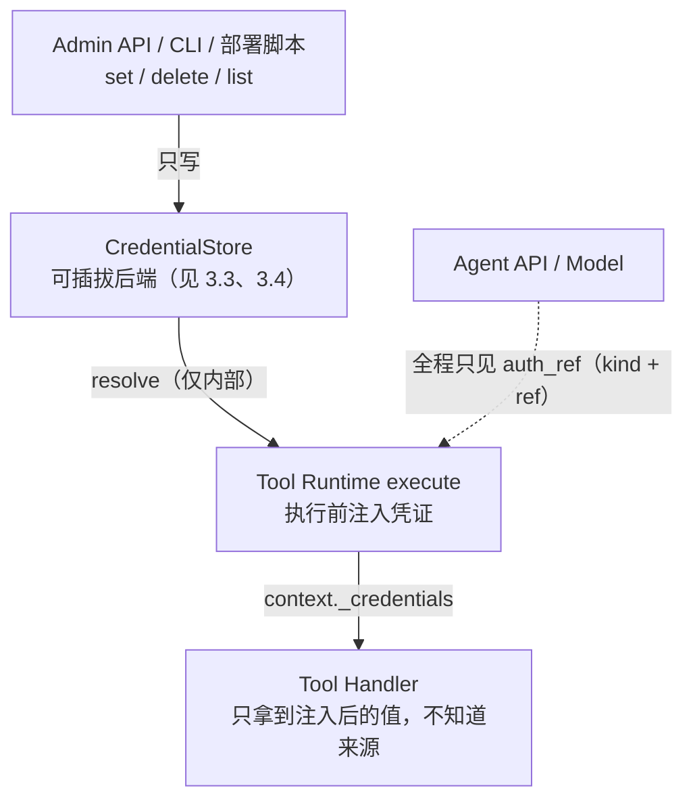
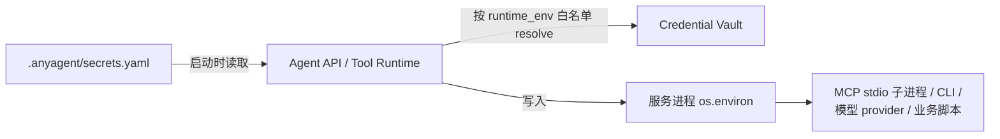
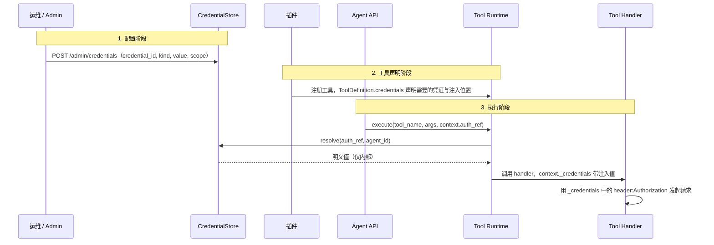

# Credential Vault：凭证管理与工具鉴权注入

对应需求：`requirements.md#req-8`、`requirements.md#req-5-9`

## 0. 背景与动机

### 0.1 现状问题

anyagent v0 的凭证处理方式是"环境变量直通"：

- 插件通过 `os.getenv()` 直接读取平台 token（如飞书 `FEISHU_TENANT_ACCESS_TOKEN`）
- `OPENAI_API_KEY`、`TOOL_RUNTIME_INTERNAL_KEY` 等均以明文环境变量存在
- `auth_ref`（`AuthRef.kind + ref`）在协议中已预留，但尚未接入实际的凭证存储

这意味着：

- **模型/Agent 理论上可通过工具间接获取密钥**（如让 sandbox 工具读环境变量）
- **没有统一的凭证生命周期管理**（注册、轮转、撤销）
- **插件各自实现凭证获取逻辑**，缺乏标准化

### 0.2 设计目标

借鉴 hiclaw 的安全模型核心思想——"AI Gateway 代理注入，Agent 永远不经手密钥"——在 anyagent 的 Tool Runtime 层实现等价的凭证隔离：

- **密钥对模型/Agent 不可见**：只提供 `set`，不提供 `get`
- **工具执行时自动注入鉴权信息**：Tool Runtime 在调用 handler 前自动 resolve 凭证
- **支持企业级预配置与个人级自助配置**两种场景

### 0.3 参考架构

hiclaw 的安全模型关键设计点（本方案借鉴但不照搬）：

| hiclaw 设计 | anyagent 对应方案 |
|---|---|
| Higress AI Gateway Consumer + Bearer key-auth | Credential Vault + Tool Runtime 内部注入 |
| MCP Server 配置中注入 `accessToken`，Worker 不可见 | ToolCredentialSpec 声明 + handler context 注入 |
| Worker 只传业务参数，Gateway 自动附加 Authorization | Agent 只传 `auth_ref`（引用），Tool Runtime resolve 明文 |
| `/data/worker-creds/<name>.env`（chmod 600）| CredentialStore 抽象（env / file / Infisical / DB / Vault） |
| Consumer 三层权限（网关→路由→MCP Server） | Policy + CredentialScope 二层权限 |

## 1. 核心概念

### 1.1 Credential（凭证）

一条凭证记录包含：

```
credential_id   : str           # 唯一标识，如 "cred_feishu_default"
kind            : str           # 凭证类型，如 "bearer_token", "api_key", "oauth2_client"
value           : str (secret)  # 明文值（仅存储层可见，永不暴露到 API 响应或日志）
scope           : CredentialScope
metadata        : dict          # 描述信息（display_name, provider, 创建时间等，不含敏感值）
expires_at      : datetime?     # 到期后 resolve 不再返回明文
rotate_before   : datetime?     # 操作侧轮转建议时间，不暴露明文
```

### 1.2 CredentialScope（作用域）

```python
class CredentialScope(BaseModel):
    level: Literal["global", "agent", "session"]
    agent_id: str | None = None        # level=agent/session 时必填
    session_key: str | None = None     # level=session 时必填
```

- `global`：全局凭证，所有 Agent 共享（企业级预配置场景）
- `agent`：Agent 级凭证，仅指定 Agent 可用（多 Agent 隔离场景）
- `session`：会话级临时凭据，仅指定 `agent_id + session_key` 可用，解析优先级高于 agent/global。

当前协议层 `CredentialScope` 已强制校验 scope 所需字段；schema bundle 会把该 Pydantic-only 语义导出给多语言 SDK scaffold。`expires_at` 到期后所有 reference backend 都不得返回明文；`rotate_before` 是操作侧轮转信号，保留在引用响应和后端 metadata 中。

### 1.3 CredentialRef（凭证引用）

即现有协议中的 `AuthRef`，用于在 Tool Runtime 执行时定位到具体凭证：

```python
class AuthRef(BaseModel):
    kind: str | None = None   # 匹配 credential.kind
    ref: str | None = None    # 匹配 credential.credential_id
```

**关键约束**：`AuthRef` 只是引用，永远不包含明文值。

## 2. 架构设计

### 2.1 系统分层



### 2.1.1 Workspace runtime env projection

Credential Vault 解决的是 tool handler 执行期的凭证解析与注入；另一个常见场景是第三方 stdio MCP、CLI 或模型 provider 只能从环境变量读取凭证。Core 支持 workspace 启动期按白名单把 Credential Vault 引用一次性投影成 runtime env：



示例：

```yaml
credential_vault:
  backend: infisical
  infisical_host: https://app.infisical.com
  infisical_universal_auth_client_id_env: INFISICAL_UNIVERSAL_AUTH_CLIENT_ID
  infisical_universal_auth_client_secret_env: INFISICAL_UNIVERSAL_AUTH_CLIENT_SECRET
  infisical_project_id_env: INFISICAL_PROJECT_ID
  infisical_environment_env: INFISICAL_ENVIRONMENT
  infisical_credential_root_path: /anyagent/credentials

runtime_env:
  - name: OPENAI_API_KEY
    credential_id: openai_api_key
    kind: api_key
  - name: AMAP_MAPS_API_KEY
    credential_id: amap_maps_api_key
    kind: api_key
```

约束：

- 只投影 `runtime_env` 明确列出的 Credential Vault 引用，不全量倾倒 provider 下所有 secret。
- `.anyagent/secrets.yaml` 只应保存 Credential Vault 后端、项目、环境、路径和变量白名单，不保存明文 secret。
- 默认不覆盖进程里已存在的环境变量；需要覆盖时在条目上显式设置 `overwrite: true`。
- 该机制适用于 MCP stdio `env`、CLI、模型 provider 和业务脚本；tool handler 内部凭证注入仍优先使用 Credential Vault / `ToolDefinition.credentials`。
- Agent sandbox 不应挂载宿主凭证环境；需要让 agent 执行 CLI 时，应通过受控 sandbox/runner 提供最小必要环境和网络出口。

### 2.2 凭证流转路径



### 2.3 个人级场景（OpenClaw 类）的扩展点

个人场景下 Agent 拥有更高自由度，可通过一个**特权工具**配置凭证：

```
工具名: admin.credential_set
类别: core（需要在 AgentSpec 中显式 allow）
参数: { credential_id, kind, value, scope? }
行为: 调用 CredentialStore.set()
```

- 该工具属于 `core` 类别，默认不暴露，需要 AgentSpec 显式声明
- **只有 set，没有 get**：Agent 可以配置密钥，但无法通过任何工具回读密钥明文
- 审计：每次调用 `admin.credential_set` 必须记录 audit_ref（但日志中不记录 value）

## 3. 协议扩展

### 3.1 ToolDefinition 扩展

在现有 `ToolDefinition` 基础上新增 `credentials` 字段：

```python
class ToolCredentialSpec(BaseModel):
    """声明工具需要的凭证及注入方式"""
    ref_kind: str                                # 凭证类型，如 "bearer_token"
    injection_target: str                        # 注入目标，如 "header:Authorization"
    format: str = "{value}"                      # 注入格式模板，如 "Bearer {value}"
    required: bool = True                        # 是否必须（缺失时拒绝执行 vs 跳过注入）
    description: str | None = None               # 可读说明

class ToolDefinition(BaseModel):
    name: str
    description: str | None = None
    parameters: dict[str, Any] = Field(default_factory=dict)
    category: ToolCategory
    kind: ToolKind | None = None
    credentials: list[ToolCredentialSpec] = []   # 新增：凭证需求声明
```

### 3.1.1 CLI Profile 的 env/file 注入

CLI Profile 在同一个 `ToolCredentialSpec` contract 上复用 Credential Vault，但把 `injection_target` 从传统的 `header:*` 扩展到了受控子进程场景：

- `env:NAME`：把 resolved secret 写入 CLI 子进程环境变量 `NAME`
- `file:relative/path.txt`：把 resolved secret 物化为 profile `cwd` 下的临时文件，命令退出后清理

当前运行时形态：

- `local-unsafe`：在命令 cwd 下本地创建临时文件，命令退出后删除
- `opensandbox`：先创建远端父目录，再通过 execd `/files/upload` 上传临时文件到 sandbox cwd

补充约束：

- `ToolCredentialSpec.credential_id` 可显式绑定具体凭证；当它非空时，优先于 `context.auth_ref.ref` 解析，适合“profile 固定吃某个 vault 引用”的场景。
- manifest / agent list / doctor 输出只能暴露 credential target 名，例如 `env:API_TOKEN`，不得回显 secret 明文，也不得暴露 `credential_id`。
- CLI Profile 的 credential 只进入子进程环境或临时文件；agent prompt、manifest、tool arguments 与普通 context 中都不应携带 secret。

### 3.2 CredentialStore 抽象

```python
from abc import ABC, abstractmethod

class CredentialStore(ABC):
    """凭证存储抽象层——只有 set/resolve/delete/list_refs，没有 get_value"""

    @abstractmethod
    async def set(self, credential_id: str, kind: str, value: str,
                  scope: CredentialScope, metadata: dict | None = None,
                  expires_at: datetime | None = None,
                  rotate_before: datetime | None = None) -> None:
        """写入或更新凭证（幂等）"""

    @abstractmethod
    async def resolve(self, auth_ref: AuthRef,
                      scope_context: dict | None = None) -> str | None:
        """
        根据 auth_ref 解析凭证明文值。
        仅供 Tool Runtime 内部调用，不暴露为 HTTP API。
        scope_context 用于传递 agent_id/session_key 等上下文（用于 scope 匹配）。
        返回 None 表示凭证不存在或 scope 不匹配。
        """

    @abstractmethod
    async def delete(self, credential_id: str) -> bool:
        """删除凭证"""

    @abstractmethod
    async def list_refs(self, scope: CredentialScope | None = None) -> list[dict]:
        """
        列出凭证引用（credential_id + kind + scope + metadata + 生命周期字段）。
        不返回 value 明文。
        """
```

### 3.3 存储后端

#### EnvBackend（v1 默认，向后兼容）

向后兼容现有的环境变量方式。凭证映射规则：

- 默认按 `CREDENTIAL__` 前缀加大写 `credential_id` 取环境变量，例如 `cred_openai_default` 对应 `CREDENTIAL__CRED_OPENAI_DEFAULT`。
- 也可以通过 `metadata.env_var_name`（例如 `OPENAI_API_KEY`）直接映射到已有的环境变量。

`resolve()` 逻辑：
1. 优先查找 `metadata.env_var_name` 指定的环境变量
2. 回退到 `CREDENTIAL__{CREDENTIAL_ID}` 命名规则
3. 再回退到内存写入的值（通过 `set()` 写入）

#### FileBackend（企业级推荐）

凭证存储在文件系统中，文件权限 `chmod 600`：

```
/data/credentials/
├── global/
│   ├── cred_openai_default.json    # { kind, value(加密), metadata }
│   └── cred_websearch_default.json
└── agents/
    ├── main/
    │   └── cred_feishu_main.json
    └── assistant/
        └── cred_custom_api.json
```

#### DatabaseBackend（preview）

使用 PostgreSQL `pgcrypto` 加密列存储，表结构由 Alembic 管理（`anyagent db migrate` 或兼容入口 `anyagent storage migrate`）。配置：

```bash
MCP_CREDENTIAL_STORE_BACKEND=db-write
POSTGRES_DSN=postgresql://...
POSTGRES_SCHEMA=public
CREDENTIAL_ENCRYPTION_KEY=...
```

`credentials.value_ciphertext` 仅保存密文；`credential_audit` 持久化 set/delete 审计 envelope。默认不在运行期建表，生产环境应先跑 Alembic 迁移；开发兜底可显式设 `CREDENTIAL_DB_CREATE_SCHEMA=true`。

#### VaultBackend（preview）

对接 HashiCorp Vault KV v2：

```bash
MCP_CREDENTIAL_STORE_BACKEND=vault-write
VAULT_ADDR=https://vault.example.com
VAULT_TOKEN=...
VAULT_MOUNT=secret
VAULT_CREDENTIAL_ROOT_PATH=anyagent/credentials
```

### 3.4 运行时后端选择与能力查询

后端由 `MCP_CREDENTIAL_STORE_BACKEND` 选择。Core server 与独立 Tool Runtime 共用 `packages/anyagent/src/anyagent/server/security/credential_runtime.py` 中的 `CredentialRuntimeConfig`、`build_credential_resolver_from_config` 和 `build_credential_store_from_config` 组装 resolver 与 admin store，可选取值和每个后端需要的环境变量以这里为准。语义约定：

- 未设置时，`anyagent serve` 使用 Admin API 的 write-only 内存凭据库，重启后丢失。
- 不带 `-write` 后缀的取值只提供 resolver；带 `-write` 后缀的取值让同一后端同时作为 admin store，支持 `/admin/credentials` 写入。外部系统托管的后端（如 Infisical）即使带 `-write` 也保持只读，凭据在外部系统中维护。
- 独立 Tool Runtime 读取同一组环境变量（解析入口 `ToolRuntimeSettings`），用 `--admin-key` 或 `ADMIN_API_KEY` 启用 `/admin/credentials`。

运行时以 `GET /admin/credentials/capabilities` 为准：Core server 与独立 Tool Runtime 都提供该接口，返回当前 resolver/admin store、是否只读、缺少的 extras/env 以及规划中的后端，不返回任何凭证明文。

## 4. 管理接口

### 4.1 Admin API

Admin API 使用独立的鉴权机制（`ADMIN_API_KEY`，与 `AGENT_API_KEY` 分离）：

```
POST   /admin/credentials              # 创建或更新凭证
DELETE /admin/credentials/{id}          # 删除凭证
GET    /admin/credentials               # 列出凭证引用（不返回 value）
GET    /admin/credentials/{id}          # 获取凭证元信息（不返回 value）
GET    /admin/credentials/capabilities  # 当前后端能力矩阵（见 3.4，不返回 value）
```

**关键约束**：

- **没有任何 API 可以读取凭证明文值**（包括 Admin API）
- `POST` 是 set 语义（幂等写入），不是 create-only
- 凭证创建/更新/删除必须记录审计事件

#### 请求/响应示例

**创建凭证**：

```http
POST /admin/credentials
Authorization: Bearer <ADMIN_API_KEY>
Content-Type: application/json

{
    "credential_id": "cred_openai_default",
    "kind": "api_key",
    "value": "sk-...",
    "scope": { "level": "global" },
    "expires_at": "2026-06-30T00:00:00Z",
    "rotate_before": "2026-06-23T00:00:00Z",
    "metadata": {
        "display_name": "OpenAI API Key",
        "provider": "openai"
    }
}

→ 201 Created / 200 OK (update)
{
    "credential_id": "cred_openai_default",
    "kind": "api_key",
    "scope": { "level": "global" },
    "expires_at": "2026-06-30T00:00:00Z",
    "rotate_before": "2026-06-23T00:00:00Z",
    "metadata": { "display_name": "OpenAI API Key", "provider": "openai" },
    "created_at": "2026-03-04T10:00:00Z",
    "updated_at": "2026-03-04T10:00:00Z"
}
```

**列出凭证（不含 value）**：

```http
GET /admin/credentials
Authorization: Bearer <ADMIN_API_KEY>

→ 200 OK
{
    "credentials": [
        {
            "credential_id": "cred_openai_default",
            "kind": "api_key",
            "scope": { "level": "global" },
            "metadata": { "display_name": "OpenAI API Key", "provider": "openai" }
        },
        {
            "credential_id": "cred_feishu_main",
            "kind": "bearer_token",
            "scope": { "level": "agent", "agent_id": "main" },
            "metadata": { "display_name": "飞书 Tenant Token", "provider": "feishu" }
        }
    ]
}
```

### 4.2 CLI 管理（部署脚本）

提供 CLI 命令用于自动化部署时批量配置凭证：

```bash
# 单条设置
anyagent credential set \
    --id cred_openai_default \
    --kind api_key \
    --value "$OPENAI_API_KEY" \
    --scope global \
    --expires-at 2026-06-30T00:00:00Z \
    --rotate-before 2026-06-23T00:00:00Z \
    --display-name "OpenAI API Key"

anyagent credential set \
    --id cred_thread_token \
    --kind bearer_token \
    --value "$SESSION_TOKEN" \
    --scope session \
    --agent-id main \
    --session-key thread-1

# 从 YAML 文件批量导入
anyagent credential import --file credentials.yaml

# 列出（不显示 value）
anyagent credential list

# 删除
anyagent credential delete --id cred_openai_default
```

## 5. 自动化部署时的凭证注入

### 5.1 凭证清单（Credential Manifest）

部署时用一个 YAML 清单声明需要的凭证，再通过 Admin API 批量写入。字段与解析规则以 `packages/anyagent/src/anyagent/cli/credential.py` 的 `cmd_credential_import` / `_import_resolve_value` 为准，模板见 `scripts/credentials.yaml.template`。约束：

- 每条凭证包含 `credential_id`、`kind`、`scope`，可选 `metadata`。
- 值的来源依次为 `value`、`value_from_env`（环境变量未设置时取 `default_value`）、`default_value`。清单里建议只写 `value_from_env`，不写明文。
- 含明文值的清单文件必须 `chmod 600`，不提交到版本控制。

### 5.2 批量导入

```bash
anyagent credential import --admin-url <url> --admin-key "$ADMIN_API_KEY" --file credentials.yaml --skip-missing
```

`scripts/init-credentials.sh` 是这条命令的封装。导入只写不读，不会回读明文。

### 5.3 部署平台注入

Docker Compose、K8s Secret 等编排由业务仓库负责，分工见 [framework-boundary.md](../architecture/overview/framework-boundary.md)。无论用哪种平台：

- 用 `MCP_CREDENTIAL_STORE_BACKEND` 选择凭据后端（见 3.4）：env 后端从进程环境变量读取，file 后端从只读挂载的目录读取。
- 凭证只注入 Agent API / Tool Runtime 进程，不注入沙箱。
- `ADMIN_API_KEY`、`AGENT_API_KEY`、`TOOL_RUNTIME_INTERNAL_KEY` 等内部密钥与业务凭证一样通过平台的 secret 机制管理。

## 6. 工具执行时的凭证注入流程

### 6.1 执行时的注入步骤

实现见 `packages/anyagent/src/anyagent/server/runtime/in_process.py` 的 `InProcessToolRuntimeService.execute` 与 `_resolve_tool_credentials`。约定：

- policy 校验通过后、handler 执行前，按 `ToolDefinition.credentials` 逐项 resolve 凭证。
- 必需凭证缺失时，工具返回 `credential_not_found` 授权错误，不调用 handler。
- resolve 出的值按 `format` 格式化后，以 `injection_target` 为键放入 context 的 `_credentials`；`_credentials` 只对 handler 可见，不回传给 Agent。

### 6.2 Handler 使用凭证

handler 从 `context["_credentials"]` 读取已注入的值（例如 `header:Authorization`），不再直接读环境变量。

### 6.3 凭证 resolve 优先级

当多个 scope 存在同类凭证时，resolve 按以下优先级：

1. `agent` scope（agent_id 精确匹配）
2. `global` scope
3. EnvBackend 兜底（环境变量）

## 7. 企业级 vs 个人级场景对比

| 维度 | 企业级（私域 Agent 服务） | 个人级（OpenClaw 类） |
|---|---|---|
| 凭证配置方 | 运维人员 / 部署脚本 | Agent 自身（通过 `admin.credential_set` 工具） |
| 配置入口 | Admin API / CLI / credentials.yaml | Agent 调用 `admin.credential_set` 工具 |
| Agent 自由度 | 低：预制工具 + Skill 白名单 | 高：可修改 AGENTS.md、创建 Skill、配置凭证 |
| 密钥可见性 | Agent 永远不可见 | Agent 可 set 但不可 get（set 时知道值，之后遗忘） |
| AGENTS.md | 只读（AgentSpec 控制） | 可写（AgentSpec `allow_sandbox` + 文件工具） |
| Skill 管理 | 预制 + 禁用列表 | 可创建/修改 |
| 凭证 Scope | 主要 global | global + agent |
| Admin API 暴露 | 不暴露给 Agent（独立鉴权） | 通过 `admin.credential_set` 工具间接暴露 set 能力 |

### 7.1 企业级场景部署流程

1. 运维准备 `credentials.yaml`（模型 Key、搜索 Key、平台 Token 等）。
2. 启动服务，凭证通过环境变量或平台 Secret 注入。
3. 运行 `scripts/init-credentials.sh`，批量写入 CredentialStore。
4. 在 Agent Pack 的 `agent.yaml` 中配置工具白名单和 policy。
5. 用户通过 Agent API 使用预制的 agent 和工具；工具执行时由 Tool Runtime 注入凭证，agent 和模型全程不接触密钥。

### 7.2 个人级场景部署流程

1. 用户部署 anyagent（最小配置：`AGENT_API_KEY` + `OPENAI_API_KEY`）。
2. 在 AgentSpec 中开启 `admin.credential_set` 工具。
3. 用户在对话中让 agent 配置凭证，例如“请配置飞书的 App ID 和 Secret”。
4. agent 调用 `admin.credential_set` 写入凭证。
5. 后续工具调用自动使用已配置的凭证。agent 只在写入时经手一次用户主动提供的明文，之后无法通过任何工具回读。

## 8. 安全约束（强约束）

### 8.1 不可违反的规则

1. **无 get value API**：任何 HTTP 端点、CLI 命令、Agent 工具都不得返回凭证明文值
2. **日志脱敏**：凭证明文不得出现在任何日志、错误消息、审计事件中
3. **context 隔离**：`_credentials` 字段仅在 Tool Runtime 内部流转，不得回传给 Agent API 或模型
4. **scope 强制校验**：`agent` scope 的凭证只能被对应 agent_id 的工具执行 resolve
5. **Admin API 独立鉴权**：`ADMIN_API_KEY` 必须与 `AGENT_API_KEY` 不同，防止 Agent 直接调用 Admin API

### 8.2 威胁缓解

| 威胁 | 缓解措施 |
|---|---|
| Agent 通过 sandbox 工具读取环境变量 | sandbox 隔离（独立容器/VM），不挂载凭证环境变量 |
| Agent 构造请求调用 Admin API 获取凭证 | Admin API 使用独立的 `ADMIN_API_KEY`；SSRF 防护拒绝本机访问 |
| 插件代码泄漏凭证到工具输出 | 输出截断 + 审计；插件审查流程（v2） |
| 凭证文件被未授权进程读取 | 文件权限 `chmod 600`；容器中以最小权限用户运行 |
| 凭证在传输中被截获 | Admin API 必须使用 HTTPS（生产环境） |

## 9. Agent 级 Credential Scope 多租户扩展（v2 规划，暂不实现）

> 本节描述未来扩展方向，v1 不实现。

### 9.1 Session 级临时凭据

```python
class CredentialScope(BaseModel):
    level: Literal["global", "agent", "session"]  # v2 新增 session
    agent_id: str | None = None
    session_key: str | None = None                 # level=session 时必填
```

适用场景：用户在一次对话中提供临时 token，仅在该会话内有效。

### 9.2 凭证轮转与过期

```python
class CredentialRecord(BaseModel):
    # ... 现有字段
    expires_at: datetime | None = None    # 过期时间
    rotate_before: timedelta | None = None  # 过期前 N 提前轮转
```

### 9.3 凭证审计日志持久化

将凭证操作（set/delete/resolve）写入持久化审计表，支持合规审查。

## 10. 与现有协议的对齐

### 10.1 `AuthRef` 已预留，无需破坏性变更

现有 `ToolContext.auth_ref: AuthRef | None` 字段已经预留了凭证引用的协议位置。Credential Vault 是对这个预留接口的实现补全，不需要修改现有协议定义。

### 10.2 插件改造路径

以飞书插件为例的渐进式改造：

```
v0（当前）: plugin.py 直接 os.getenv() 读取 token
v1（过渡）: plugin.py 优先从 context["_credentials"] 获取，回退到 os.getenv()
v2（完成）: plugin.py 完全依赖 context["_credentials"]，不再直接读环境变量
```

### 10.3 向后兼容

- EnvBackend 作为默认后端，完全兼容现有的环境变量配置方式
- 未声明 `credentials` 的工具不受影响，行为与 v0 完全一致
- Admin API 是可选组件，不部署不影响现有功能
