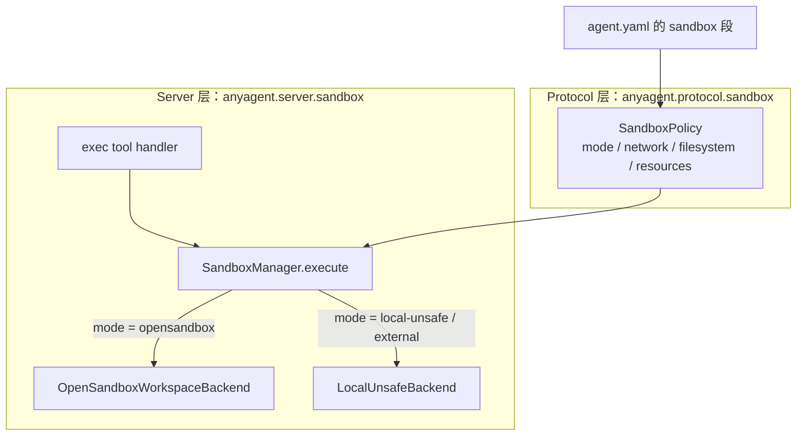
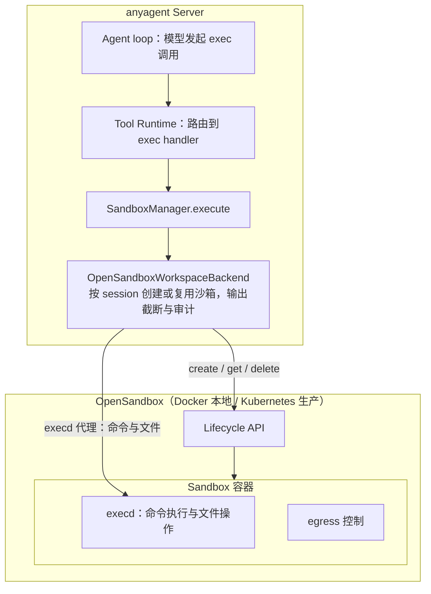
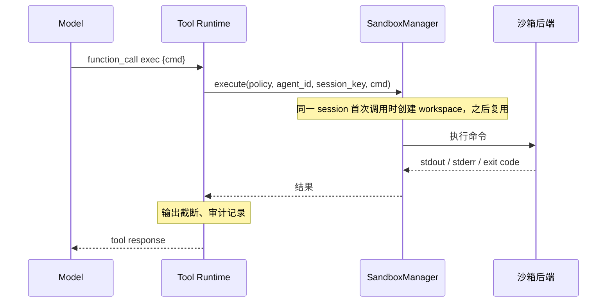
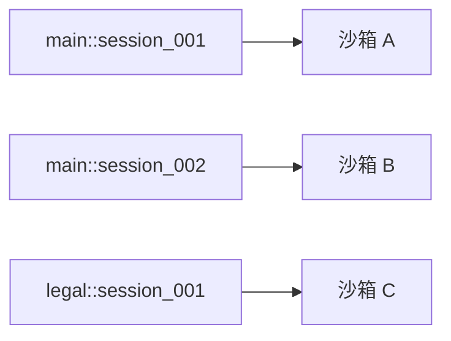

<!--
---
doc_kind: security
status: stable
tags: ["sandbox", "opensandbox", "isolation", "network", "command-execution", "codex-reference"]
summary: Sandbox 执行环境安全策略：策略-后端分离架构、OpenSandbox 集成方案、会话隔离、命令执行链路。
---
-->

# Sandbox 执行环境与安全策略

对应需求：`requirements.md#req-5-5`、`requirements.md#req-8`

## 1. 设计理念：沙箱内自由，沙箱外隔离

anyagent 的 Agent 安全模型不是"全面禁止"，而是**沙箱内给予充分自由，沙箱外严格隔离**：

- Agent **可以**在沙箱中执行任意命令（`curl`、`wget`、`pip install`、`python script.py`）
- Agent **可以**在沙箱中发起任意网络请求（获取网页源码、调用外部 API）
- Agent **可以**在沙箱中读写文件（创建/修改/删除沙箱内文件系统）
- Agent **不可以**访问宿主机文件系统、环境变量、凭证
- Agent **不可以**突破沙箱网络策略访问内部服务（anyagent server、credential store 等）

核心原则：**沙箱是 Agent 的"工作台"——在工作台上可以自由操作，但工作台是隔离的**。

## 2. 架构：策略-后端分离

参考 Codex 的成熟沙箱架构（策略层 `SandboxPolicy` + 平台后端层 `SandboxManager::transform()`），anyagent 采用**策略-后端分离**设计：

- **策略层（Protocol）**：定义沙箱策略模型，与平台/后端无关，放在 `anyagent.protocol.sandbox`
- **后端层（Server）**：可插拔的沙箱后端实现，放在 `anyagent.server.sandbox`



- 策略字段以 `packages/anyagent/src/anyagent/protocol/sandbox.py` 中的 `SandboxPolicy`、`NetworkSandboxPolicy`、`FileSystemSandboxPolicy`、`ResourceLimits` 为准。
- `external` 模式与 `local-unsafe` 走同一个本地执行后端，区别在于 `external` 依赖外层容器或 Pod 提供隔离；`disabled` 时不注册 `exec`。
- 路由逻辑见 `packages/anyagent/src/anyagent/server/sandbox/manager.py` 的 `SandboxManager.execute`。

### 2.1 与 Codex 架构的对比

| 维度 | Codex | anyagent |
|---|---|---|
| 策略定义 | `SandboxPolicy` enum (4 variants) | `SandboxPolicy` model (mode + 细分策略) |
| 平台后端 | macOS seatbelt / Linux bubblewrap+seccomp / Windows restricted token | OpenSandbox / External / LocalUnsafe |
| 隔离级别 | 进程级（OS-native 沙箱） | 容器级（Docker/gVisor/Kata/Firecracker） |
| 沙箱生命周期 | 命令级（每次命令独立隔离） | **会话级**（per-session 持久沙箱） |
| 状态持续性 | 无（命令间不共享状态） | 有（同 session 内文件系统/安装的包共享） |
| 命令改写 | `transform(CommandSpec → ExecRequest)` 拼接 helper | SDK API 调用（不改写命令） |
| ExternalSandbox | 跳过本地沙箱，信任外部隔离 | 同理：K8s Pod / Docker 即沙箱 |
| 凭证管理 | 不涉及 | Credential Vault 独立管理 |

### 2.2 为什么采用策略-后端分离

1. **Protocol 层可复用**：`SandboxPolicy` 放在 `anyagent.protocol` 中，all-in-one 与拆分部署消费同一套策略模型
2. **后端可替换**：本地开发用 `local-unsafe`，需要容器隔离时用 `opensandbox`，已运行在隔离容器或 Pod 内时用 `external`——agent loop 无感知
3. **配置驱动**：策略从 `agent.yaml` 解析，不硬编码在代码中
4. **与 Codex 的 `ExternalSandbox` 概念对齐**：当进程已在外部沙箱中运行时，跳过内部沙箱机制

## 3. Sandbox 后端：OpenSandbox 集成

### 3.1 为什么选择 OpenSandbox

anyagent 默认集成 [OpenSandbox](https://github.com/alibaba/OpenSandbox)（阿里巴巴开源）作为沙箱执行引擎：

| 特性 | OpenSandbox | 自建方案 |
|---|---|---|
| 容器隔离 | Docker + gVisor/Kata/Firecracker | 需自行实现 |
| 多语言支持 | Python/Java/JS/Go SDK | 需自行封装 |
| 命令执行 | 内置 `command_run` + 流式输出 | 需自行实现 |
| 文件操作 | 内置 `file_read/write/search/move` | 需自行实现 |
| 代码解释器 | 内置 Code Interpreter（Jupyter 内核） | 需自行集成 |
| 网络策略 | 内置 egress 控制（per-sandbox） | 需自行实现 |
| 生命周期管理 | `create/kill/renew/healthcheck` | 需自行实现 |
| K8s 扩展 | 原生支持 Kubernetes 调度 | 需自行编排 |

### 3.2 OpenSandbox 集成架构



后端实现见 `packages/anyagent/src/anyagent/server/sandbox/opensandbox_backend.py`。Agent 在容器内可以做什么、不能做什么见 [security-threat-model.md](security-threat-model.md#0-agent-能力边界总览)。

### 3.3 `external` 模式（K8s / Docker 部署）

借鉴 Codex 的 `SandboxPolicy::ExternalSandbox` 语义：**进程已在外部沙箱中运行，跳过内部沙箱机制**。

适用场景：
- 业务方在 K8s 中部署，Agent 运行在独立 Pod 内，Pod 本身即沙箱
- Docker Compose 部署，Agent 运行在隔离容器内
- CI/CD 环境中运行（容器即沙箱）

行为：
- 命令直接在当前进程环境中执行（`asyncio.create_subprocess_exec`）
- 不调用 OpenSandbox SDK
- 网络策略由外部 K8s NetworkPolicy / Docker 网络配置承担
- 文件系统隔离由容器本身承担

配置：

```yaml
# agent.yaml
sandbox:
  mode: "external"                # 信任外部隔离环境
  network:
    allow_internet: true
```

### 3.4 `local-unsafe` 模式（开发）

仅限本地开发环境，命令在宿主机直接执行，**无任何隔离**。

配置：

```yaml
# agent.yaml 或 环境变量 SANDBOX_MODE=local-unsafe
sandbox:
  mode: "local-unsafe"            # 明确标记风险
```

启用条件：
- 必须设置 `SANDBOX_MODE=local-unsafe` 环境变量 **或** `agent.yaml` 中显式声明
- 启动时打印 WARNING 日志
- 生产环境 lint 脚本应检测并拒绝此模式

## 4. 命令执行链路

### 4.1 统一命令入口：`exec` tool

Model 通过 `exec` tool 发起命令执行。anyagent 不将沙箱暴露为独立的工具命名空间（如 `sandbox.exec`/`sandbox.python`），而是将其作为 **Tool Runtime 内置的命令执行 handler**——沙箱是执行环境，不是 tool 抽象。



### 4.2 CLI Profile 与 `local-unsafe` 边界

CLI Profile 复用同一条命令执行安全边界，但目标是把“允许执行什么命令、继承哪些环境变量、如何注入凭证”从 prompt 约定提升为结构化配置。实现真源：

- `packages/anyagent/src/anyagent/tool_runtime/cli_profile_spec.py`
- `packages/anyagent/src/anyagent/tool_runtime/cli_env.py`
- `packages/anyagent/src/anyagent/tool_runtime/cli_profile.py`
- `packages/anyagent/src/anyagent/server/sandbox/backends.py`
- `packages/anyagent/src/anyagent/server/sandbox/manager.py`

当前安全口径：

- `local-unsafe` 与 `opensandbox` 都已跑通 CLI Profile 的 env/file 凭证注入契约；前者使用本地 `env_clear` + 临时文件物化，后者把 env 透传给 execd `/command`，并把 `file:*` target 通过 execd `/files/upload` 预先上传到命令 cwd。
- `LocalUnsafeBackend.execute(..., env=...)` 对 CLI Profile 使用 `env_clear` 语义：传入非 `None` 时只把该字典传给子进程，不继承宿主环境。
- 默认环境继承策略是 `inherit=core`，并对 `TOKEN|SECRET|PASSWORD|AUTH|KEY|CREDENTIAL|COOKIE` 之类变量做默认敏感过滤。
- `allow_command_prefixes` 是可选白名单；即使不开前缀限制，仍会拒绝 `bash/sh/zsh/pwsh/python/python3/node/perl/env/sudo` 以及 `-c/-lc` 这类解释器壳 token，避免 profile 退化成“任意再包一层 shell”。
- doctor 会对 exposed agent 上的 `local-unsafe` CLI profile 给 warning，提醒它只适用于可信本地开发，不应被当作生产隔离方案。

### 4.3 与 Codex exec_command 的对比

| 维度 | Codex `exec_command` | anyagent `exec` |
|---|---|---|
| 参数 | `{cmd, workdir, shell, tty, yield_time_ms, sandbox_permissions, ...}` | `{cmd, workdir, timeout}` (v0 精简) |
| shell 选择 | model 可指定 shell，handler 通过 `Shell::derive_exec_args()` 解析 | server 默认 shell（配置驱动），不暴露给 model |
| 沙箱选择 | `Orchestrator.run()` → `SandboxManager.select_initial()` → `transform()` | exec handler → `SandboxManager.execute` → 按 `mode` 选择后端 |
| 沙箱粒度 | 命令级（每次命令独立沙箱进程） | **会话级**（同 session 复用同一沙箱容器） |
| 审批流程 | `ExecApprovalRequirement` → user approve/reject | Tool Policy allow/deny（无交互式审批） |
| 权限请求 | model 可通过 `sandbox_permissions` / `additional_permissions` 请求提权 | v0 不支持运行时提权（由配置静态决定） |
| 交互续写 | `write_stdin` tool 配套 PTY 交互 | v0 不支持交互式（命令一次性执行） |

### 4.4 Tool 注册

`exec` tool 由 Tool Runtime 自动注册（当 `sandbox.mode != disabled` 时），agent loop 和 model 无需感知沙箱后端。工具定义见 `packages/anyagent/src/anyagent/server/sandbox/exec_handler.py` 的 `EXEC_TOOL`，注册入口是 `packages/anyagent/src/anyagent/tool_runtime/builtin_tools.py` 的 `register_sandbox_exec_tool`。对模型只暴露 `cmd`、`workdir`、`timeout` 三个参数。

注意：`exec` tool 的 `category` 是 `core`（而非 `sandbox`），因为命令执行是核心能力，沙箱是执行策略而非工具类型。`sandbox` 类别保留给未来可能的沙箱管理工具（如 `sandbox.snapshot`、`sandbox.reset`）。

## 5. 会话隔离（Per-Session Sandbox）

### 5.1 生命周期

每个 `session_partition_key`（`"{agent_id}::{session_key}"`）对应一个独立的沙箱实例：



生命周期管理：

1. **Lazy Creation**：首次 `exec` 调用时才创建沙箱（避免空闲资源浪费）
2. **Session 复用**：同 session 内的后续 `exec` 调用复用同一沙箱（文件系统状态持续）
3. **TTL 销毁**：沙箱 TTL 到期后自动销毁（默认 30 分钟）
4. **Session 结束清理**：session 正常结束或超时后，主动 kill 沙箱
5. **重连**：session 恢复时，若原沙箱仍存活可重新关联

### 5.2 状态持续性（Per-Session 的核心优势）

同一 session 内多次 `exec` 调用共享沙箱文件系统，支持有状态的工作流。例如用户说“帮我分析这份 CSV 数据”，agent 在同一个沙箱里依次执行：

1. `pip install pandas matplotlib`：安装依赖
2. `cat > data.csv << 'EOF' ...`：写入数据
3. `python analyze.py`：运行分析脚本
4. `cat result.json`：读取结果

第 1 步安装的包在第 3 步可用，第 2 步写入的文件在第 3 步可读。

这是 anyagent 相对于 Codex 的关键优势：Codex 的进程级沙箱每次命令独立隔离，无法支持此类有状态工作流。

### 5.3 SandboxManager

`SandboxManager`（`packages/anyagent/src/anyagent/server/sandbox/manager.py`）按 session 管理 workspace：执行命令时按需创建或恢复 workspace，并提供 checkpoint、hibernate、destroy 等生命周期操作。热冷分层与恢复流程见 [sandbox-session-filesystem-design.md](../architecture/runtime/sandbox-session-filesystem-design.md)。

## 6. 安全策略

### 6.1 启用闸门

| 条件 | 行为 |
|---|---|
| `sandbox.mode: opensandbox` + OpenSandbox Server 可用 | `exec` tool 注册到 manifest，正常可用 |
| `sandbox.mode: opensandbox` + OpenSandbox Server 不可用 | `exec` tool 不注册（manifest 中不出现），fail-fast |
| `sandbox.mode: external` | `exec` tool 注册，命令直接在当前环境执行 |
| `sandbox.mode: local-unsafe` | `exec` tool 注册，命令在宿主机直接执行（WARNING） |
| `sandbox.mode: disabled` 或未配置 | `exec` tool 不注册 |

### 6.2 网络策略（Egress Control）

| 方向 | 策略 | 说明 |
|---|---|---|
| 沙箱 → 外部互联网 | **默认允许** | Agent 可自由访问外部网站、API 等 |
| 沙箱 → anyagent server | **拒绝** | 防止 Agent 通过沙箱绕过安全边界 |
| 沙箱 → credential store | **拒绝** | 凭证不可从沙箱访问 |
| 沙箱 → 内部服务 (PG/Redis) | **拒绝** | 防止数据泄露 |
| 沙箱 → 其他沙箱 | **拒绝** | 沙箱间隔离 |

实现：
- `opensandbox` 模式：利用 OpenSandbox 的 egress controller 配置 per-sandbox 网络策略
- `external` 模式：由 K8s NetworkPolicy / Docker 网络配置承担
- `local-unsafe` 模式：无网络限制

### 6.3 资源限制

| 资源 | 默认限制 | 配置路径 |
|---|---|---|
| CPU | 1 core | `agent.yaml: sandbox.resources.cpu` |
| 内存 | 512 MiB | `agent.yaml: sandbox.resources.memory` |
| 磁盘 | 1 GiB | `agent.yaml: sandbox.resources.disk` |
| 单次命令超时 | 300s (5min) | `agent.yaml: sandbox.resources.timeout` |
| 输出截断 | 64 KiB stdout/stderr | `agent.yaml: sandbox.resources.output_max_bytes` |
| 沙箱存活 TTL | 1800s (30min) | `agent.yaml: sandbox.resources.ttl` |
| 并发沙箱上限 | 50 | `SANDBOX_MAX_CONCURRENT` env |

### 6.4 凭证隔离

- 沙箱容器**不挂载**宿主机环境变量
- 沙箱容器**不挂载**凭证文件/目录
- Agent 若需在沙箱中使用外部 API，应通过以下方式：
  1. 通过 anyagent 的 tool（如 `core.web_fetch`）代理请求（tool 级 credential 注入）
  2. 或由 ExecHandler 在执行前从 CredentialStore resolve 凭证，以临时环境变量注入到沙箱（仅本次执行生效，执行后清除）

### 6.5 审计

每次 `exec` 调用必须记录：

- `agent_id` / `session_key` / `response_id` / `tool_call_id`
- `sandbox_id` — 沙箱实例标识
- `sandbox_mode` — `opensandbox` / `external` / `local-unsafe`
- `command` — 执行的命令（摘要 + hash，默认不记录原文）
- `status` / `exit_code` / `duration_ms`
- `output_truncated` — 是否截断

## 7. Agent Pack 配置

### 7.1 agent.yaml 完整示例

```yaml
# agent.yaml
exposed: true
tools:
  requested_tool_names:
    - core.web_fetch
    - exec                        # 启用命令执行（由 sandbox 配置决定执行环境）
skills:
  default_selected: []
sandbox:
  mode: "opensandbox"             # opensandbox | external | local-unsafe | disabled
  image: "opensandbox/code-interpreter:v1.0.1"  # 沙箱容器镜像（opensandbox 模式）
  resources:
    cpu: "1"
    memory: "512Mi"
    disk: "1Gi"
    timeout: 300
    ttl: 1800
    output_max_bytes: 65536
  network:
    allow_internet: true
    deny_ranges:                  # 拒绝的内网 CIDR
      - "10.0.0.0/8"
      - "172.16.0.0/12"
      - "192.168.0.0/16"
      - "127.0.0.0/8"
multiagent:
  spawn_allow_agent_ids: ["main"]
```

### 7.2 最小配置

```yaml
# 最小配置：启用沙箱，其余使用默认值
exposed: true
tools:
  requested_tool_names:
    - exec
sandbox:
  mode: "opensandbox"
```

### 7.3 无沙箱配置

```yaml
# 不启用命令执行能力
exposed: true
tools:
  requested_tool_names:
    - core.web_fetch
# 未配置 sandbox → mode 默认 disabled → exec tool 不注册
```

## 8. 典型使用场景

### 8.1 网页源码获取

用户说“帮我获取 example.com 的网页源码”，agent 调用 `exec` 执行 `curl -s https://www.example.com`，命令在该 session 的沙箱中运行并返回 HTML。

### 8.2 数据分析（有状态工作流）

用户说“写个 Python 脚本分析这份 CSV 数据”，agent 在同一个 session 沙箱中依次执行：

1. `pip install pandas matplotlib`
2. `cat > /workspace/data.csv << 'EOF' ... EOF`
3. `cat > /workspace/analyze.py << 'EOF' ... EOF`
4. `cd /workspace && python analyze.py`
5. `cat /workspace/result.json`

### 8.3 项目构建与测试

用户说“clone 这个 GitHub 仓库并跑测试”，agent 在同一个 session 沙箱中依次执行：

1. `git clone https://github.com/example/repo.git /workspace/repo`
2. `cd /workspace/repo && pip install -r requirements.txt`
3. `cd /workspace/repo && python -m pytest -v`

## 9. 隔离等级

OpenSandbox 支持多种隔离等级，按需选择：

| 等级 | 运行时 | 隔离强度 | 启动延迟 | 适用场景 |
|---|---|---|---|---|
| 标准容器 | Docker (runc) | 中 | <500ms | 开发/测试 |
| gVisor | Docker (runsc) | 高 | <800ms | 生产推荐 |
| Kata Containers | Docker (kata) | 很高 | ~2s | 高安全要求 |
| Firecracker microVM | Firecracker | 最高 | ~1s | 金融/合规 |

生产环境推荐 gVisor：容器级成本，VM 级隔离。

## 10. 风险与缓解

### 10.1 冷启动延迟

首次 `exec` 调用需创建沙箱容器（~500ms-2s），后续调用复用同一容器。

缓解：
- per-session 复用大幅减少创建次数
- 可选 sandbox pool（预创建空闲容器）
- `ExternalSandbox` 模式无冷启动

### 10.2 长时间命令

`pip install` 等命令可能超过默认超时。

缓解：
- 可通过 `agent.yaml: sandbox.resources.timeout` 调大超时
- 未来 v2 支持流式 tool output（`exec` 返回 streaming delta）

### 10.3 并发资源压力

per-session sandbox 在高并发场景下可能创建大量容器。

缓解：
- `SANDBOX_MAX_CONCURRENT` 环境变量设置上限
- TTL 自动回收
- OpenSandbox K8s runtime 支持调度与资源配额
