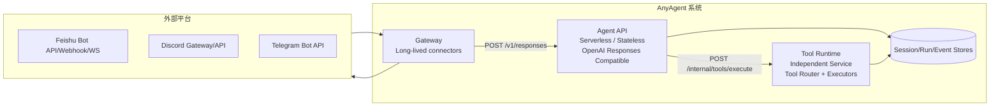
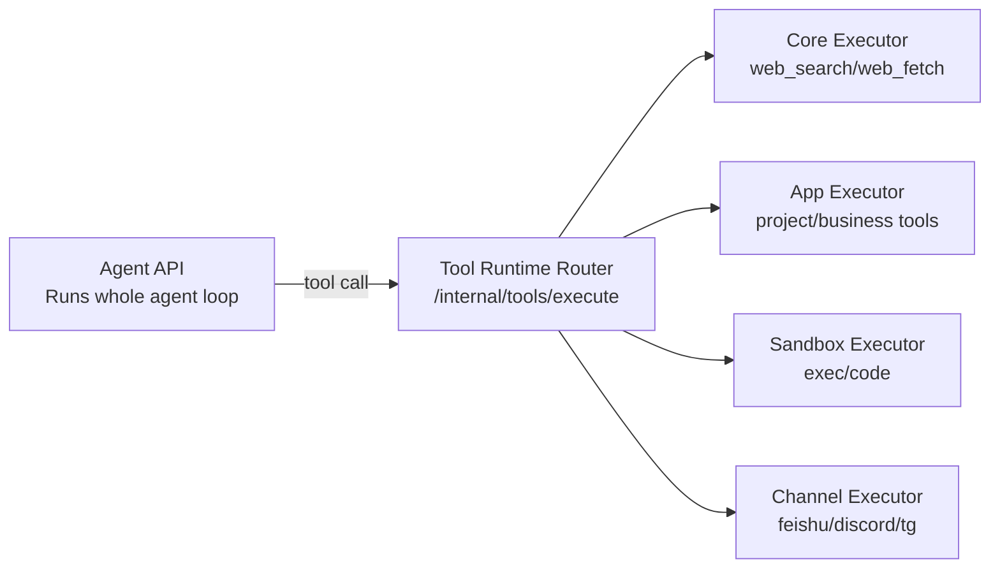

# AnyAgent 需求文档（v0）

## 0. 背景与目标

AnyAgent 是一个“可作为基础设施复用”的 Agent 服务体系，解决两个问题：

1. 对外提供 **OpenAI SDK Responses API 兼容** 的服务端接口（`POST /v1/responses` + SSE streaming），使任意客户端可以用 OpenAI 官方 SDK 方式接入，并获得端到端 agent loop 体验（含工具调用）。
2. 提供一个 **Gateway 组件**，用于接入飞书/Discord/Telegram 等平台机器人，把平台的可操作能力以“工具”注入到 agent loop 中（例如飞书：群联系人信息、云文档创建/修改等）。

### 0.1 交付形态（面向多项目复用的“SDK 优先”）

你的诉求是“多个业务项目复用同一套基础设施”，并且：

- 会长期维护多套专业领域技能（skills packs）
- 单个业务项目里可能需要同时运行多个 agent（不同 persona/权限/技能组合），并对外提供服务

因此，本项目不建议做成“强绑定某个业务”的一体化应用，而是建议按下面的方式交付：

- `Core SDKs`（可被任意业务项目依赖）
  - `agent-runtime`：Agent loop（模型流式、工具调用、回灌、重试/中断语义等）
  - `skills`：skills 目录规范、加载/解析、动态披露（Dynamic Disclosure）机制
  - `gateway-sdk`：平台插件 SDK（连接器生命周期、平台上下文抽象、channel tools 构建基础、事件回推）
  - `tool-runtime-sdk`：Tool Runtime 侧的工具注册与插件宿主 SDK（tool registry、`registerTool(...)`、路由注册、工具元数据与 schema 校验）
  - `protocol`：统一协议包（建议包名 `anyagent-protocol`），包含：
    - `responses/*`：对外 OpenAI Responses API 兼容层（请求/响应校验、SSE 事件映射的最小子集）
    - `tool_runtime/*`：对内 Tool Runtime 执行契约（execute/cancel/manifest/policy）与路由约定
    - `collab/*`：对内 Multi-Agent（spawn/send/wait/close/resume）工具的参数/返回结构
    - `common/*`：通用 ID/types（`AgentId/SessionKey/SessionPartitionKey`）、trace、error envelope 等
- `Reference Implementation`（可运行的参考部署）
  - 把 `Agent API + Gateway + Tool Runtime + Sandbox` 以“可读、可替换”的方式编排起来
  - 参考 OpenClaw 的做法：既提供 `/v1/responses` 兼容入口（AnyAgent 的 Agent API），也可提供 `/tools/invoke` 这类工具直调入口（AnyAgent 的 Tool Runtime，可选）
- `Project Template`（业务项目脚手架）
  - 提供一键拉起的部署样例（Docker/Compose/Helm 任选其一），但不要把业务规则写进模板
  - 业务项目只需要：
    - 放入自己的 `.agents/skills`（或从私有技能仓库同步）
    - 配置多个 `agent_id` 的 AgentSpec（见下文）
    - 挂载平台 connector（飞书/Discord/TG 等）

建议的仓库结构（示意，不绑定语言）：

```text
AnyAgent/
  packages/
    agent-runtime/
    protocol/                    # 单一协议包（anyagent-protocol）：responses/tool_runtime/collab/common
    gateway-sdk/                 # 平台插件 SDK（connectors + channel tools building blocks）
    skills/                      # skills loader + dynamic disclosure
    tool-runtime-sdk/            # Tool Runtime 工具注册与插件宿主 SDK（registerTool / registry / routes）
  apps/
    agent-api/                   # Reference: stateless /v1/responses hosting
    gateway/                     # Reference: feishu/discord/tg connectors + platform message rendering
    tool-runtime/                # Reference: Tool Runtime service (router + executors)
    sandbox-executor/            # Reference: sandbox executor（可选；v0 默认内置于 tool-runtime，后续如需隔离/扩缩容可独立拆分）
  templates/
    project-template/            # 业务项目脚手架（配置 + skills + 轻量扩展）
```

这个拆分的直接收益：

- 多业务共享底座时，核心契约（Responses API、工具协议、skills 结构、并发/幂等等）能保持稳定演进
- 业务项目只承担“配置 + skills + 少量工具扩展”，而不是 fork 整个服务
- 多 agent 能以配置/注册的方式扩展，而不需要复制一套服务进程

协议治理建议（v0 约束）：

- Wire 协议（HTTP JSON body、SSE event data、内部 RPC payload）必须有“单一真源”（OpenAPI/JSON Schema 任一即可）。
- TS/Python 的类型定义与校验尽量从 spec 生成或由 spec 驱动，避免 `Agent API`、`Gateway`、`Sandbox` 各自手写导致漂移。

## 1. 范围定义

### 1.1 In Scope（必须做到）

- Agent API（serverless/stateless）
  - OpenAI Responses API 兼容：`POST /v1/responses`
  - 支持 SSE streaming（增量事件 + `[DONE]` 结束符）
  - 在服务端完成完整 agent loop：模型流式输出、tool calls、tool execution、tool results 回灌、继续推理直到完成
  - 支持幂等（Idempotency），支持断线重连的事件补发（至少在我们自有 client/gateway 路径上可用）
- Gateway（长连接、可多实例）
  - 接入平台机器人：飞书/Discord/Telegram（可先定义接口与插件框架，平台实现可分期）
  - 做好会话映射（platform thread/channel -> AnyAgent session key）
  - 注入平台能力（capabilities -> context + tool visibility hints），并把平台消息/回调可靠地转发给 Agent API
  - 输出到平台（含平台支持的“流式效果”：打字/编辑消息/卡片更新等）
- Tool Runtime（独立服务、可横向扩展）
  - 承载工具执行：core/app/sandbox/channel tools 的路由、执行、取消、幂等、审计
  - 提供工具清单/可见性计算（manifest），供 Agent API 在 `/v1/responses` 中披露 tools

### 1.2 Out of Scope（本阶段明确不做）

- 端侧 UI（WebChat/桌面端）不是本阶段目标
- OpenAI ChatCompletions 兼容（`/v1/chat/completions`）不做
- OpenClaw 的全部能力（nodes/canvas/daemon/本地技能管理等）不做，但会借鉴其架构思想

## 2. 核心概念与术语

- `Agent API`：对外的 HTTP API（serverless），对接 OpenAI SDK Responses API，并负责执行 agent loop。
- `Gateway`：长连接服务，连接外部平台（飞书/Discord/TG），负责收消息/回消息、线程绑定、平台回调处理等“连接器职责”。
- `AgentId / AgentSpec`：用于区分“同一套服务里不同的 agent”。
  - `agent_id`：稳定标识（比如 `main`、`legal`、`sales`、`ops`）
  - `AgentSpec`：该 agent 的配置集合（系统提示、默认 skills allowlist、tool policy profile、模型策略、平台能力注入策略等）
- `Tool`：可被模型调用的函数型工具（function tool），例如 `feishu.doc.create`。
- `Tool Runtime`：工具执行服务（独立模块/服务）。Agent API 在 loop 中调用它执行工具。
- `Session`：会话上下文（消息历史、策略、工具可见性等）。会话内串行，跨会话并行。
- `Run/Response`：一次 `POST /v1/responses` 的执行实例，对应一个 `response_id`，产生事件流与最终输出。

租户字段预留：

- 所有持久化实体预留 `tenant_id` 字段（v0 默认单租户，可为空或固定值）。

## 3. 高层架构（组件边界）



关键原则：

- Gateway 负责“连接外部世界 + 会话/线程映射 + 平台消息交互渲染”。
- Agent API 负责“对外 API 兼容 + 执行完整 agent loop”。
- Tool Runtime 负责“工具清单/可见性 + 工具执行（core/app/sandbox/channel）+ 策略/幂等/取消/审计”。
- session/run/event 等状态外置到存储，支持横向扩展。

<a id="req-4"></a>
## 4. 外部接口：OpenAI Responses API 兼容（Agent API）

<a id="req-4-1"></a>
### 4.1 Endpoint

- `POST /v1/responses`
  - 请求体尽量兼容 OpenAI Responses API
  - `stream=true` 时返回 SSE（`Content-Type: text/event-stream`）

可选增强（v0 先写入需求但不承诺首发实现）：

- `GET /v1/responses/{response_id}`：用于回查最终结果/状态
- `POST /v1/responses/{response_id}/cancel`：用于中断正在执行的 response

<a id="req-4-2"></a>
### 4.2 鉴权

- `Authorization: Bearer <AGENT_API_KEY>`
- 支持 `Idempotency-Key` header（用于客户端/网关重试去重）

<a id="req-4-3"></a>
### 4.3 会话标识（Session Key）

因为 OpenAI Responses API 原生不强制 `session_id` 字段，AnyAgent v0 定义如下约定：

- 优先从请求的 `metadata.session_key`（或 `user`）里解析出 `session_key`。
- 同时支持从 `metadata.agent_id`（或 `model` 约定、HTTP header）解析出 `agent_id`，用于选择 AgentSpec（见 2 节）。
- Gateway 接入平台时必须提供稳定 session key，例如：
  - `session_key = "feishu:{chat_id}:{thread_id_or_root_msg_id}"`
  - `session_key = "discord:{guild_id}:{channel_id}:{thread_id_or_msg_id}"`
  - `session_key = "telegram:{chat_id}:{topic_id_or_msg_id}"`

如果请求未提供 session key：

- Agent API 生成一个临时会话（仅用于该次 response），但不保证跨请求延续上下文。

<a id="req-4-3-1"></a>
### 4.3.1 多 Agent（agent_id）选择与隔离（必须写死的规则）

为了让一个业务项目里“多个 agent 同时对外提供服务”可控且可扩展，AnyAgent v0 建议把 agent 的选择与隔离规则固定为：

- `agent_id` 的来源优先级（从高到低）：
  - `metadata.agent_id`
  -（可选）HTTP header：`x-agent-id`（用于 gateway 内部调用或受控客户端）
  -（可选）`model` 约定：`agent:<agent_id>`（仅当你希望用 model 字段做路由时）
  - 默认：`main`
- `session_key` 与 `agent_id` 的绑定：
  - 推荐把 `agent_id` 纳入会话分片键（避免不同 agent 意外共享同一个 session lock）
  - 约定：`session_partition_key = "{agent_id}::{session_key}"`
  - keyed serialization、幂等、事件序列都以 `session_partition_key` 为准

解释：

- 这样同一个平台 thread 即使被多个 agent 使用，也不会互相抢占同一把 session 锁
- 同一个 agent 内则仍然保持“会话内串行、跨会话并行”

<a id="req-4-4"></a>
### 4.4 Streaming 事件（SSE）

目标：OpenAI SDK 的 `.responses.create({ stream: true })` 可以直接消费。

事件格式遵循 OpenAI/“OpenResponses”风格：

- `event: <type>`
- `data: <json>`
- 最后 `data: [DONE]`

最小必须支持的 event types（v0）：

- `response.output_item.added`（输出项开始，比如 assistant message 或 function_call）
- `response.function_call_arguments.delta`（function_call arguments 增量）
- `response.output_item.done`（输出项完成）
- `response.completed`（整体完成，带 usage）

要求：

- `response_id` 在整个流中一致
- 事件顺序可重放（内部存 Event Store，便于断线补发）

<a id="req-4-5"></a>
### 4.5 Tools（OpenAI function tools）

- `tools` 字段：客户端/Gateway 可以在 request 中携带 tool definitions（OpenAI function tools）。
- Agent API 在执行 loop 时：
  1. 把 tools 作为模型可用工具集
  2. 解析模型输出中的 function_call
  3. 调用 Tool Runtime 执行
  4. 把 tool output 作为 `function_call_output` 回灌继续推理

tool_choice 策略（v0）：

- 支持 `auto | none | required | {type:function, function:{name}}`

安全约束（v0 强制）：

- Agent API **不信任** 外部请求直接提供的 `tools[]`（无论来自 OpenAI SDK 直连还是来自 Gateway）。
- Agent API 必须以 Tool Runtime 返回的 `manifest.tools[]` 作为“允许披露给模型的工具全集”。
  - 请求携带的 `tools[]` 只能作为“提示/期望集合”，最终必须经 Tool Runtime 过滤。
- 任何不在 Tool Runtime 工具注册表/manifest 中的工具名，都必须被忽略（或返回明确错误），禁止“客户端注入新工具名”。

<a id="req-5"></a>
## 5. 内部接口：Tool Runtime（独立服务）

Tool Runtime 是一个独立模块/服务（可多实例水平扩容），不由 Gateway 承载。

<a id="req-5-1"></a>
### 5.1 Tool Execute API（Agent API -> Tool Runtime）

为了保证 “serverless agent loop” 在一次请求内完成，Agent API 需要一个标准化工具执行接口。

- `POST /internal/tools/execute`
  - auth：mTLS 或签名 JWT（由部署配置决定）
  - body（建议）：
    - `tenant_id?`
    - `agent_id`
    - `session_key`
    - `response_id`
    - `tool_name`
    - `tool_call_id`
    - `arguments_json`（string 或 object）
    - `context`（平台上下文：sender、chat_id、权限、token 引用等）
  - response：
    - `status`（`completed|error|cancelled`）
    - `output`（string，兼容 `function_call_output.output`；当 `status=completed` 时必须存在）
    - `error?`（结构化错误；当 `status=error` 时必须存在）
    - `meta?`（执行元数据：耗时、截断标记、审计引用等）

约束：

- Tool Runtime 必须对工具执行做权限校验与策略校验（尤其是带外部写操作的 channel tools）
- Tool Runtime 需要缓存与限流（例如联系人/目录查询、平台 API 限速），避免被 tool call 放大流量
- Tool Runtime 的 keyed serialization / 幂等分片等内部逻辑，建议使用：
  - `session_partition_key = "{agent_id}::{session_key}"`

<a id="req-5-2"></a>
### 5.2 Tool Manifest（Tool Runtime -> Agent API）

由于 Tool Runtime 是独立服务，v0 推荐由 Tool Runtime 作为“工具可见性与清单”的权威来源：

- `POST /internal/tools/manifest`
  - 输入（request body）：`tenant_id?`, `agent_id`, `session_key`, `context`, `enabled_skills?`, `requested_tool_names?`, `requested_tools?`
    - `enabled_skills?`：可选。该次 run 选中的 skills（stable ids 或 paths）。主要用于审计与策略判定的上下文信号；v0 不要求 Tool Runtime 解析 skill 内容或从中推导工具依赖。
    - `requested_tool_names?`：可选。调用方“希望披露”的工具名集合（通常来自两部分：外部请求携带的 `tools[].function.name` + skill dependencies 推导出来的工具名）。
    - `requested_tools?`：可选。来自外部请求的 tool definitions（OpenAI function tools）。**v0 不把其 schema 当成权威**，仅用于审计/调试；最终 schema 必须以 Tool Runtime 注册表为准。
  - 输出：
    - `tools[]`：该会话当前允许披露给模型的工具集合（OpenAI function tool definitions）
    - `decisions?`：可选。对 `requested_tool_names/requested_tools` 的 allow/deny 解释（用于审计与调试）

Agent API 的行为建议：

- 对外请求无论是否携带 `tools[]`，Agent API 都应先向 Tool Runtime 拉取 manifest，然后再决定最终传给模型的 `tools[]`：
  - 若请求未携带 `tools[]`：以 `requested_tool_names` 为空，直接使用 manifest.tools（仍可受 `enabled_skills` 影响）
  - 若请求携带 `tools[]`：抽取 `tools[].function.name` 作为 `requested_tool_names`（并可将原始 `requested_tools` 原样传入用于审计），使用 Tool Runtime 返回的 `tools[]` 作为最终结果
  - 若本次 run 触发 skills 动态披露：Agent API 必须把 `enabled_skills` 与由 skill dependencies 推导出的 `requested_tool_names` 一并传给 Tool Runtime，再以其返回的 `tools[]` 作为最终可见集合（避免 Agent API 私自扩大工具暴露面）

说明：

- 这样能同时支持“直连 Agent API 的 OpenAI SDK client”和“经 Gateway 的平台机器人”两条入口。

<a id="req-5-2-1"></a>
### 5.2.1 Tool Registry 与热更新（控制面，可选）

动态披露（Dynamic Disclosure）解决的是“本次 run 披露哪些工具”，而不是“运行时注册/反注册工具”。

v0 推荐：

- Tool Runtime 在启动时加载：
  - core tools
  - app tools（业务项目自定义工具；通过 `tool-runtime-sdk` 在 tool-runtime 启动时注册）
  - sandbox tools
  - channel tools（平台插件在 Tool Runtime 侧注册 `feishu.*`/`discord.*`/`telegram.*` 等工具）
- skills 的选择只影响 `manifest` 的返回结果，不应触发频繁的工具注册/反注册（避免 registry 膨胀与缓存失效）

对业务项目而言，“写业务”主要体现在编写 `app.*` 工具与平台插件工具，因此 `tool-runtime-sdk` 至少需要提供稳定的注册入口（v0 约束）：

- `registerTool(tool)`：注册一个工具定义与执行逻辑（或 `registerToolFactory(...)` 延迟构建也可）
  - tool 定义必须包含：`name/description/parameters/category`（category：`core|app|sandbox|channel`）
  - `parameters` 必须按 5.7 的约束可直接映射为 OpenAI function tool schema（最终披露以 Tool Runtime registry 为准）
  - `name` 必须满足 5.6 命名规范，且建议：
    - AnyAgent 内置：`core.*`
    - 业务项目：`app.*`
    - 平台插件：`<channel>.*`（如 `feishu.*`）
    - 沙盒：`sandbox.*`
- `registerNamespaceRoute(prefix, executor_id)`（可选）：显式声明某个前缀由哪个 executor 处理（用于联邦路由与后续拆分）
- `listTools()/getTool(name)`（可选）：用于 manifest 构建、健康检查与调试（不作为外部协议）

约束（v0 建议）：

- AnyAgent 自带的 `core.*` 工具也应走同一套 `registerTool(...)` 注册路径（保证 Tool Runtime registry 是“单一真源”，避免 schema 漂移）
- 平台插件注册的 `<channel>.*` tools 与业务注册的 `app.*` tools 也遵循同一注册流程与校验标准（同一错误分层、同一审计字段）

如果确实需要“分钟级热更新工具包”（例如管理员热装平台插件、或远程 executor 动态加入/退出），建议走控制面（out-of-band）接口（v0 先定义，不强制首发实现）：

- `POST /internal/tools/register`
  - 用于注册/更新一组工具（带 `toolset_version`），以及其路由信息（executor id / namespace routes）
- `POST /internal/tools/heartbeat`
  - 用于 executor 存活上报与 TTL 管理，防止陈旧工具一直可见

约束：

- 仅允许受信任的内部服务调用（mTLS/签名 JWT）
- 任何通过 `register` 更新的工具集合都必须可审计、可回滚

<a id="req-5-3"></a>
### 5.3 工具分类与“联邦式 Tool Runtime”（核心讨论结论）

在真实 agent loop 里，工具通常来自 4 个来源，且执行特性不同：

1. `core` 内置工具（AnyAgent 自带）
   - 例：`core.web_search`、`core.web_fetch`
   - 特性：无平台依赖，偏 I/O 与配额控制，适合做成无状态服务或内置模块
2. `app` 业务工具（业务项目自定义）
   - 例：`app.crm.lookup_customer`、`app.kb.search`
   - 特性：与业务系统/数据强相关，通常需要项目侧实现与部署；必须纳入 Tool Runtime 的 policy/审计/幂等/取消语义
3. `sandbox` 类工具（隔离执行）
   - 例：`sandbox.exec`、`sandbox.python`（通过沙盒执行代码/命令）
   - 特性：高风险、高资源占用，需要强隔离（容器/VM/受限网络/文件系统策略）
4. `channel` 平台工具（由平台插件提供，并在 Tool Runtime 侧注册为 tools）
   - 例：`feishu.doc.create`、`feishu.directory.get_chat_members`
   - 特性：依赖平台 token、目录缓存、权限边界，适合放在 Tool Runtime 的 channel executor（独立扩缩容；Gateway 仅做连接器与消息回传）

因此 AnyAgent 不建议把 Tool Runtime 理解为“单一进程里的一个函数表”，而是采用 **联邦式 Tool Runtime（Tool Runtime Federation）**：

- Agent API 负责跑完整 agent loop（解析 tool call、等待工具结果、继续推理）。
- 工具执行由“Tool Runtime Router”统一对外暴露接口，并按 `tool_name` 路由到对应执行器（v0 固化为 **Tool Runtime 独立服务部署**，不嵌入 Gateway；executors 的“进程形态”可演进）：
  - core-executor（web/search/fetch）
  - app-executor（业务工具）
  - sandbox-executor（隔离执行；**v0 允许内置在 tool-runtime 内**，后续可独立拆分）
  - channel-executor（飞书/discord/tg 等插件工具）

v0 推荐落地（降低复杂度，先把契约跑通）：

- 只部署一个 `tool-runtime` 服务进程，对外暴露 `/internal/tools/*`（execute/manifest/cancel）
- 在 `tool-runtime` 进程内同时承载 router + core/app/sandbox/channel executors
- sandbox 的“隔离边界”仍然必须存在：即使内置在同一服务进程，也应通过容器/受限用户/受限网络与文件系统策略执行（见 5.5）；后续如需更强隔离或独立扩缩容，再拆成独立 `sandbox-executor` 服务

推荐的路由规则（v0 最小可用）：

- 先做“精确命中路由表”（用于系统保留工具名，例如 multi-agent 的 `spawn_agent` 等），再做前缀路由：
  - exact-match table（reserved names）
  - prefix routes（`core.*` / `app.*` / `sandbox.*` / `<channel>.*`）
- 前缀路由以 `tool_name` 前缀路由，例如：
  - `core.*` -> core-executor
  - `app.*` -> app-executor
  - `sandbox.*` -> sandbox-executor
  - `feishu.*` / `discord.*` / `telegram.*` -> channel-executor（Tool Runtime）

优点：

- 对 OpenAI Responses “function tool” 的外部契约更稳定：只依赖 `name`，不需要引入额外字段（避免 SDK 强类型冲突）
- 能让高风险/高耗资源工具（sandbox）独立扩缩容与隔离
- Gateway 专注连接器与消息交互（收消息/回消息/线程绑定/回调），不被 core/app/sandbox/channel 工具执行拖累



<a id="req-5-4"></a>
### 5.4 Tool Runtime 的执行语义（参考 pi-mono / openclaw 的共同点）

pi-mono (`@mariozechner/pi-agent-core`) 的抽象要点：

- 工具是 `AgentTool`：包含 `name/label/description/parameters`，并通过 `execute(toolCallId, params, signal?, onUpdate?)` 执行
- 支持：
  - `AbortSignal`（取消）
  - `onUpdate`（工具执行过程的增量更新事件）

openclaw 的抽象要点（Gateway 内执行）：

- 通过 `createOpenClawTools()` 组装 **core tools + plugin tools**（插件工具由 `registerTool(...)` 注入）
- 通过 `/tools/invoke` HTTP endpoint 暴露“工具远程调用”（有鉴权、tool policy/allowlist、输入错误映射 400/403/500）
- 对高风险工具（例如 `exec`）有更细的安全策略：host 选择（sandbox/gateway/node）、allowlist、安全等级/审批等

AnyAgent v0 的执行语义建议对齐它们的交集（实现上可逐步增强）：

- 必须：同步返回最终 `output`（string），以便写入 OpenAI Responses 的 `function_call_output.output`
- 必须：支持 `timeout_ms` / `deadline_ms`（避免 serverless 连接被长时间占用）
- 必须：支持取消（Agent API 在 run abort 时向 Tool Runtime 发出取消）
- 可选：支持 `onUpdate` 式的工具进度上报，但 **不强制映射到 OpenAI Responses SSE**（避免破坏 SDK 兼容）；可以作为 AnyAgent 内部事件流供 Gateway/UI 使用

<a id="req-5-5"></a>
### 5.5 Sandbox 工具（code execute / exec）的最小安全要求

因为 `sandbox.exec` 这类工具会执行任意代码/命令，v0 也必须明确最低安全线：

- 默认隔离执行：容器/VM/受限用户，限制网络访问与文件系统访问（策略化 allowlist）
- 输出限额：stdout/stderr 最大字节数，避免 OOM
- 超时：硬超时 kill
- 审计：记录执行的命令、工作目录、资源消耗、调用方会话与发起人
- 秘钥隔离：sandbox 侧禁止读取平台 token、AnyAgent API key 等敏感信息

（如果 v0 暂不做完整隔离，也必须在文档里明确风险与禁用默认策略。）

<a id="req-5-6"></a>
### 5.6 Tool 命名规范（必须统一，否则路由与权限无法收敛）

参考 openclaw 的 `createOpenClawTools()`（统一组装 core + plugin tools）与其工具调用入口（例如 `/tools/invoke`），AnyAgent 也必须把 tool name 当成“全系统主键”。

约束（v0 强制）：

- 默认命名：全小写，使用点号分隔命名空间：`<namespace>.<domain>.<action>`（推荐 2-4 段）
- 默认字符集：`[a-z0-9_.-]`，禁止空格与大写
- 名称一旦发布不可重命名（否则会影响模型 tool_choice、审计与回放）
- 必须声明工具归属类别（core/app/sandbox/channel），用于路由与默认 deny

保留名例外（v0 允许，用于 Codex 风格 multi-agent 工具）：

- 允许少量 snake_case 的系统保留工具名：`spawn_agent`, `send_input`, `wait`, `close_agent`, `resume_agent`
- Tool Runtime Router 必须对保留名走“精确命中路由表”，不得使用前缀模糊匹配

推荐命名：

- core：
  - `core.web_search`
  - `core.web_fetch`
- app（业务项目自定义）：
  - `app.crm.lookup_customer`
  - `app.kb.search`
- sandbox：
  - `sandbox.exec`（通用命令执行）
  - `sandbox.python`（可选：受限 python 运行）
- channel（平台前缀即命名空间）：
  - `feishu.directory.get_chat_members`
  - `feishu.doc.create`
  - `discord.message.send`
  - `telegram.message.send`

<a id="req-5-7"></a>
### 5.7 Tool Definition（出现在 `/v1/responses` 的 `tools[]`）的统一约定

AnyAgent 对外只做 OpenAI Responses API，因此工具定义必须能直接落在 OpenAI “function tool” 结构里：

- `type: "function"`
- `function.name: string`（满足 5.6 命名规范）
- `function.description?: string`
- `function.parameters?: object`（JSON Schema-like；建议 Draft-07 子集）

额外约束（v0 强制）：

- `parameters` 顶层必须是 `type: "object"`，并且 `additionalProperties=false`（避免 prompt injection 借口塞入未声明字段）
- `required` 必须显式给出（不依赖隐式）
- 对敏感字段（token、cookie、password）可在 schema 上标注 `x-secret=true`（可选；仅内部用于日志/审计脱敏；对外兼容时可忽略）

说明：这与 pi-mono 的 `AgentTool.parameters`（TypeBox 结构最终也是一个 JSON schema 对象）是一致的；与 openclaw 的工具参数校验路径也一致。

<a id="req-5-8"></a>
### 5.8 `/internal/tools/execute` 请求体与响应体（字段级契约）

<a id="req-5-8-1"></a>
#### 5.8.1 Request（Agent API -> Tool Runtime Router）

```json
{
  "tenant_id": "t_default",
  "agent_id": "main",
  "session_key": "feishu:oc_123:om_456",
  "response_id": "resp_...",
  "tool_call_id": "call_...",
  "tool_name": "feishu.doc.create",
  "arguments_json": "{\"title\":\"Spec\",\"folder_id\":\"fld...\"}",
  "deadline_ms": 30000,
  "context": { "trace": { "trace_id": "..." }, "channel": { "provider": "feishu" } }
}
```

字段说明（v0）：

- `tenant_id`：预留字段（v0 可固定值或为空）
- `agent_id`：用于选择 AgentSpec 与策略（也参与会话分片键计算）
- `session_key`：会话主键（与 agent_id 共同决定会话分片键与权限上下文）
- `response_id`：本次 responses run id（用于审计与事件关联）
- `tool_call_id`：来自模型的 function call id（用于幂等与回放）
- `tool_name`：工具名（全系统主键）
- `arguments_json`：可以是 string（JSON）或 object（已解析）。Tool Runtime 必须以 object 形态校验与执行。
- `deadline_ms`：从 Tool Runtime 视角的剩余预算（硬超时），由 Agent API 计算并传入
- `context`：标准化上下文（见 5.9）

<a id="req-5-8-2"></a>
#### 5.8.2 Response（Tool Runtime -> Agent API）

```json
{
  "status": "completed",
  "output": "{\"doc_id\":\"doccn...\"}",
  "meta": {
    "duration_ms": 532,
    "output_truncated": false,
    "audit_ref": "aud_..."
  }
}
```

错误时：

```json
{
  "status": "error",
  "error": {
    "type": "tool_input_error",
    "code": "missing_required_field",
    "message": "folder_id required",
    "retryable": false
  },
  "meta": { "duration_ms": 12, "audit_ref": "aud_..." }
}
```

约束（v0 强制）：

- Tool Runtime 必须返回结构化错误（避免 Agent API 只能靠字符串猜测）
- `output` 最大长度要限制（例如 64KB）；超限必须截断并在 `meta.output_truncated=true` 标记
- 对大结果（例如文件内容、二进制）必须走对象存储并返回引用（`output` 返回一个 URL/ref JSON 字符串）

<a id="req-5-9"></a>
### 5.9 `context` 标准结构（平台无关 + 平台扩展）

设计目标：

- Agent API 不应拿到平台明文 token（减少泄漏面）
- Tool Runtime（尤其 channel executors）能基于上下文做权限判定、目录缓存、线程路由

v0 标准结构（建议）：

```json
{
  "trace": {
    "trace_id": "tr_...",
    "span_id": "sp_..."
  },
  "requester": {
    "id": "u_123",
    "display_name": "Alice",
    "is_owner": false
  },
  "channel": {
    "provider": "feishu",
    "account_id": "acc_default",
    "chat_id": "oc_123",
    "thread_id": "om_456",
    "message_id": "omsg_789"
  },
  "auth_ref": {
    "kind": "secret_ref",
    "ref": "sec_feishu_acc_default"
  },
  "policy": {
    "allow_tools": ["feishu.*", "core.*"],
    "deny_tools": ["sandbox.*"]
  },
  "locale": {
    "timezone": "Asia/Shanghai",
    "lang": "zh-CN"
  }
}
```

说明：

- `channel.provider` 是路由与审计关键字段（建议枚举：`feishu|discord|telegram|web`）
- `auth_ref` 必须是引用（Tool Runtime 自己去 secrets store 取 token）；禁止把 token 放入 `context`
- `policy` 是“粗粒度提示”，真正的 allow/deny 必须在 Tool Runtime 再校验（不信任调用方）

平台扩展字段：

- 放在 `channel.ext` 下，避免污染顶层并保证跨平台兼容

<a id="req-5-10"></a>
### 5.10 工具权限与策略（对齐 openclaw 的“tool policy”思想）

openclaw 在 `/tools/invoke` 里会做一套 tool policy/allowlist pipeline，保证：

- 默认 deny 一批高风险工具
- 根据 session/profile/provider/channel/account 等维度继承策略

AnyAgent v0 也必须具备最小策略线：

- 默认 deny：`sandbox.*`（除非显式开启）
- 默认 allow：`core.web_search/core.web_fetch`（也应可被关闭）
- channel tools 的 allow/deny 由 Tool Runtime 的策略与工具元数据决定（并在具体 executor 侧做 defense-in-depth 校验）

<a id="req-5-11"></a>
### 5.11 幂等与去重（tool execute 级别）

为应对：

- Agent API 重试调用 Tool Runtime
- Gateway/Webhook 触发重复 tool call（极端情况）

Tool Runtime 必须实现幂等：

- 幂等键建议：`idempotency_key = "{response_id}:{tool_call_id}"`
- 若同一键重复到达：
  - 若已完成：返回完全相同的 `status/output/error`
  - 若执行中：返回 `status=error` 且 `retryable=true`（或返回明确的 “in_progress” 语义，后续可扩展）

<a id="req-5-12"></a>
### 5.12 取消（abort）语义（tool 级别）

pi-mono 的工具执行支持 `AbortSignal`；AnyAgent 需要把它落在服务化接口上：

- `POST /internal/tools/cancel`
  - body：`{ tenant_id?, agent_id, session_key, response_id, tool_call_id }`
  - Tool Runtime 必须 best-effort 停止执行（尤其是 sandbox exec）
  - 取消不是强一致：允许返回 “not_found/already_completed”

Agent API 的行为建议：

- run 被 abort 后，优先发送 tool cancel，再停止继续推理

<a id="req-5-13"></a>
### 5.13 可观测性与审计（tool 执行必须可追踪）

所有 tool execute 必须产出结构化日志与审计记录，最少字段：

- `trace_id`, `tenant_id`, `agent_id`, `session_key`, `session_partition_key`, `response_id`, `tool_call_id`, `tool_name`
- 执行耗时、状态、是否截断
- 外部写操作（例如飞书文档修改）必须记录目标资源 id（doc_id 等）

并且：

- 日志必须对 `arguments_json` 与 `output` 做脱敏与限长（参考 openclaw 的 ToolInputError/ToolAuthorizationError 分层做法）

<a id="req-6"></a>
## 6. Gateway：平台接入与消息交互（参考 OpenClaw）

<a id="req-6-1"></a>
### 6.1 插件化要求

由于 Tool Runtime 是独立服务，平台“连接器职责”和“工具职责”需要分别落在 Gateway 与 Tool Runtime：

- Gateway：注册 channel connector、webhook 路由、消息回传渲染（把 SSE 映射为平台的打字/编辑消息/卡片更新等）
- Tool Runtime：注册 tools（含 `feishu.*`/`discord.*`/`telegram.*` 等 channel tools），并负责工具执行、权限/策略、审计与幂等

因此 v0 建议采用“同一份平台插件，可在两个进程中分别加载”的插件体系（参考 OpenClaw 的扩展模型）：

- `plugin.json` 描述插件 id、支持的 channels、配置 schema
- `register(api)` 生命周期：按宿主能力注册 connector 或 tools（允许同一插件在不同宿主只注册其中一类）

插件需要支持（最小）：

- `registerChannel(connector)`
- `registerTool(tool | toolFactory)`
- `registerWebhookRoute`（平台回调/卡片点击等）

补充说明（面向“SDK 写业务”）：

- 业务项目如果只需要自定义业务工具（`app.*`），不必实现完整平台插件；直接在 tool-runtime 启动时通过 `tool-runtime-sdk.registerTool(...)` 注册即可。
- 平台插件（如飞书）则建议同一份代码同时实现两侧注册：
  - 在 Gateway 侧：`registerChannel(...)` / `registerWebhookRoute(...)`
  - 在 Tool Runtime 侧：`registerTool(...)` 注册 `<channel>.*` tools

<a id="req-6-2"></a>
### 6.2 平台能力注入示例（飞书）

目标能力（示例，不限于此）：

- `feishu.directory.get_chat_members(chat_id)`
- `feishu.doc.create(title, folder_id, content...)`
- `feishu.doc.patch(doc_id, ops...)`
- `feishu.drive.upload(file)`
- `feishu.perm.grant(doc_id, user_id, role)`

实现形态：

- 作为 tools 注册到 Tool Runtime（独立服务）
- Tool Runtime 执行时使用飞书 token/tenant 配置与当前会话上下文

输出形态：

- 对飞书支持消息编辑/卡片更新时，Gateway 可将 agent streaming delta 映射为“持续更新卡片/消息”
- 降级策略：不支持则聚合后一次性发送

<a id="req-6-3"></a>
### 6.3 会话/线程绑定策略

Gateway 必须保证：

- 同一个平台 thread 映射到同一个 `session_key`
- 会话内串行（避免同一 thread 并发写上下文导致乱序）
- 多 agent 场景下还必须保证：
  - 同一个平台 thread + 同一个 `agent_id` 映射到同一个 `session_partition_key`
  - 推荐 `session_partition_key = "{agent_id}::{session_key}"`（见 4.3.1）

<a id="req-6-4"></a>
### 6.4 多 Agent 的路由（agent_id mapping）

同一个业务项目里可能同时提供多个 agent（不同 persona/权限/skills），Gateway 需要把“平台消息”路由到正确的 `agent_id`。

v0 允许多种策略并存，但必须做到“可解释、可审计”：

- `Static Bot Mapping`：按 bot 实例/应用配置固定 `agent_id`
  - 例：飞书机器人 A 永远走 `agent_id=ops`，机器人 B 走 `agent_id=legal`
- `Channel Mapping`：按群/频道配置 `agent_id`
  - 例：`feishu:chat_id=oc_123 -> agent_id=sales`
- `Message Hint`：从用户消息中解析显式 hint（最小建议）
  - 例：`@legal ...` 或 `/agent legal ...` 或 `$agent:legal ...`
- `Thread Binding`：对某个 thread 进行一次性绑定（后续同 thread 自动复用）
  - 类似 OpenClaw 的 thread-bound sessions 思路（但我们 v0 不必实现全部细节）

无论采用哪种策略，Gateway 调用 Agent API 时都必须在 `metadata.agent_id` 里显式带上最终的 `agent_id`。

<a id="req-7"></a>
## 7. 并发与可靠性要求（服务侧）

- **会话内串行、会话间并行**：同一 `session_partition_key` 的 runs 需要串行化（keyed serialization）。
- **幂等**：支持 `Idempotency-Key` 去重，避免 webhook 重试触发重复回复。
- **backpressure**：对 SSE/WebSocket 推送慢消费者要有断开/丢弃策略，避免拖垮系统。
- **draining**：支持部署滚动升级时拒绝新请求但让进行中任务收敛。
- **断线恢复**：至少 Gateway 侧要能基于 Event Store 做补发（last_seq/游标）。

并发模型的术语解释与落地实现细节（锁、队列分片、事件补发时序、abort 传播等）不在本节展开，统一见：

- `/Users/ticoag/Documents/myws/clawers/AnyAgent/docs/stateless-agent-service-architecture.md`

<a id="req-8"></a>
## 8. 安全与合规（必须写清）

- 密钥管理：平台 token、AnyAgent API key、内部调用签名密钥不得落日志
- SSRF 防护：如果支持 `input_file`/`input_image` URL，必须有 allowlist/重定向限制/超时限制
- 权限边界：平台工具必须检查“当前请求上下文是否允许执行该动作”（群、用户、文档权限等）
- 审计：Tool execution 与外部写操作必须记录审计事件（最少：谁、在什么会话、调用了什么 tool、影响目标）

<a id="req-9"></a>
## 9. 测试与验收标准（v0）

<a id="req-9-1"></a>
### 9.1 Responses API 兼容性验收

- 使用 OpenAI 官方 SDK（TS/Python 任一）配置 `base_url` 指向 AnyAgent Agent API
- 能跑通：
  - 非流式 `POST /v1/responses`
  - 流式 `stream=true`，事件顺序正确，能读到最终 `response.completed`，并以 `[DONE]` 结束
  - 触发一次 function tool call，并在服务端执行工具后继续推理产出最终回答

<a id="req-9-2"></a>
### 9.2 Gateway 端到端验收

- 飞书/Discord/TG 任一平台先打通一个：
  - 入站消息 -> Gateway -> Agent API -> 生成回复 -> 出站回平台
  - 至少注入 1 个平台工具（例如飞书：获取群成员列表），并在对话中实际触发调用

## 10. 分期（建议）

- Phase 0（文档与契约）
  - 固化 `/v1/responses` 的 schema、SSE event types、tool runtime execute 契约
  - 固化 Gateway 插件接口（registerChannel/registerTool）
- Phase 1（最小可用链路）
  - Agent API：完成 responses + streaming + tool loop
  - Gateway：完成一个平台 connector（推荐飞书）+ 一个工具 + 基本会话映射
- Phase 2（扩展与稳定）
  - 增强权限与审计、补发与幂等、更多平台与工具、压测与指标

## 11. 参考实现（仅用于设计借鉴）

- OpenClaw 的 Responses endpoint 与 schema（用于理解事件类型、SSE 形态）
- OpenClaw 的插件与 channel/tools 注册方式（用于 Gateway 插件体系）

<a id="req-12"></a>
## 12. AgentRuntime：Skills 加载与动态披露（参考 Codex）

本节定义 AnyAgent 的 `AgentRuntime` 在 agent loop 中如何加载与使用 skills，并且满足“动态披露”：

- skills 不应被默认注入给模型
- skills 相关的 tools 也不应默认对模型可见
- 只有当技能被“选中/触发”时，才会注入技能指令并披露其依赖的工具（最小暴露面）

这套机制参考 `~/Documents/myws/ags/codex` 的做法（Codex skills）：

- 技能通过 `SKILL.md`（YAML frontmatter + body）定义
- 可选 `agents/openai.yaml` 提供更结构化的 interface/dependencies/policy/permissions
- skills 按 scope（Repo/User/System/Admin）从多层 roots 加载，并允许通过配置禁用某些 skill paths
- skills 的“注入”是按需发生（显式 mention/选择），而非全量注入

<a id="req-12-1"></a>
### 12.1 Skill 包结构（AnyAgent v0 建议对齐 Codex）

每个 skill 是一个目录，至少包含：

- `SKILL.md`
  - 顶部 YAML frontmatter（由 `---` 分隔）
  - 必填字段：`name`, `description`
  - 可选：`metadata.short-description`
  - body：技能指令正文（prompt/instructions）

可选元数据文件：

- `agents/openai.yaml`（可扩展为未来多 agent/profile）
  - `interface`：UI 展示（display_name、icon、brand_color、default_prompt…）
  - `dependencies.tools[]`：技能依赖的工具（见 12.4）
  - `policy.allow_implicit_invocation`：是否允许隐式触发
  - `permissions`：权限档案（网络、文件系统、macOS seatbelt 扩展等）

约束（v0）：

- `SKILL.md` 是唯一必需文件；`agents/openai.yaml` 解析失败必须 fail-open（忽略元数据但仍可加载 SKILL.md）
- `name/description` 有长度上限（建议：name <= 64，description <= 1024）

<a id="req-12-2"></a>
### 12.2 Skill Roots 与 Scope（Repo/User/System/Admin）

AnyAgent 需要定义 skills 搜索路径（roots），并在加载时标注 scope，用于优先级与治理：

- `Repo` scope：工作区内技能（每个 agent workspace / repo）
  - 建议路径：`<workspace_dir>/.agents/skills/**/SKILL.md`
  - 说明：`.agents/skills` 是通用约定，便于多种 agent/gateway 共享同一技能目录结构
- `User` scope：用户级技能（部署机或控制平面）
  - 建议路径：`~/.agents/skills/**/SKILL.md`
- `System` scope：系统内置技能（镜像随服务发布）
  - 建议路径：`/opt/agents/skills/**/SKILL.md`（或容器内路径）
- `Admin` scope：管理员下发技能（多租户未来扩展）
  - 建议路径：`<tenant_shared_dir>/skills/**/SKILL.md`

去重与优先级：

- 同一个 `path_to_skills_md` 只加载一次
- 同名技能允许存在多个来源，但对 UI 展示与选择必须提供稳定 key（见 12.6）

<a id="req-12-3"></a>
### 12.3 Skills Enable/Disable（动态披露前提）

参考 Codex 的做法（基于 path 的 enable/disable），AnyAgent v0 也要支持禁用 skills：

- 禁用粒度：以 `SKILL.md` 的绝对路径为 key（或其 canonicalized 路径）
- 配置来源：
  - `User` 配置层（全局禁用某些技能）
  - `SessionFlags`（会话级动态禁用/启用，优先级高于 User）

必要原因：

- 安全：某些 skill 可能隐含高权限的工具依赖（例如 sandbox 写权限）
- 合规：某些环境不允许某些技能（例如网络访问）

<a id="req-12-4"></a>
### 12.4 Skill Dependencies：工具依赖与运行时要求

Codex 的 skill metadata 支持声明 `dependencies.tools[]`，字段包含：

- `type`（kind）
- `value`
- `transport`（例如 mcp/app/…）
- `command/url`（启动或连接信息）

AnyAgent v0 建议保留兼容形态，并映射到我们在第 5 节定义的 Tool Runtime Federation：

- `dependencies.tools[]` 主要用于：
  1. 让 Gateway/UI 在披露技能前知道“该技能会用到哪些工具”
  2. 在技能被选中时，向 Tool Runtime 请求 `manifest`，由其返回本次 run 允许披露的 `tools[]`（动态披露）
  3. 在技能被选中时，确保相应 Tool Runtime executor 可用（否则 fail fast 给出可读错误）

建议映射规则（v0）：

- `transport = "core"`：映射到 `core.*` 工具集合
- `transport = "app"`：映射到 `app.*` 工具集合（业务项目自定义工具）
- `transport = "sandbox"`：映射到 `sandbox.*` 工具集合
- `transport = "channel"`：映射到 channel tools（例如 `feishu.*`），由 Tool Runtime 的 channel executor 承载
- `transport = "mcp"`：未来扩展（工具由 MCP server 提供；与 Codex 的 mcp:// 类似）

<a id="req-12-5"></a>
### 12.5 Skill Permissions：影响 Sandbox 与 Tool Policy

Codex 会把 `permissions` 编译成一个“权限档案”（包含 sandbox policy / network / fs read/write roots）。

AnyAgent v0 的要求：

- skills 可以声明权限档案（至少网络与文件系统读写）
- 当 skill 被选中时：
  - 允许它扩大或收缩 `sandbox.*` 工具的权限边界（例如允许写某些目录）
  - 但必须遵守“更高层策略”的上限（tenant/global deny 优先生效）

换句话说：

- skill permissions 只能在“被允许运行”的范围内做细化，不得越权打开被全局禁用的能力

<a id="req-12-6"></a>
### 12.6 动态披露（Dynamic Disclosure）机制：什么时候把 skill 注入与披露给模型

<a id="req-12-6-1"></a>
#### 12.6.1 选择技能（Skill Selection）

参考 Codex 的显式 mention/选择机制，AnyAgent v0 定义以下技能选择来源（按优先级）：

1. 显式选择（结构化）
   - 调用方（Gateway 或 OpenAI SDK 直连 client）调用 `/v1/responses` 时，在 `metadata` 中携带 `skills`（JSON string）
   - 例：`metadata.skills = "[\"babysit-pr\", \"skill://.../SKILL.md\"]"`
2. 文本 mention（非结构化）
   - 从 user message 中解析 `$skill-name` token
   - 仅当命中“唯一且 enabled”的 skill 才选择；歧义则不自动选择（避免错注入）
3. 隐式触发（可选，v0 先定义不强制实现）
   - 仅当 `policy.allow_implicit_invocation=true` 时才允许
   - 典型用例：按工作目录/项目类型自动启用 repo skill（需谨慎）

<a id="req-12-6-2"></a>
#### 12.6.2 注入技能指令（Skill Injection）

当 skill 被选中时，AgentRuntime 必须把 skill 的 `SKILL.md` 正文注入到该次 run 的上下文中：

- 注入位置：在用户消息之前，以 `developer` 或 `system` 角色注入（建议 `developer`）
- 注入内容：
  - skill name/path（用于审计）
  - skill body（SKILL.md frontmatter 之后的正文）

注意：

- skill 注入必须是 per-run 的，不得污染其他 session 的默认 system prompt
- 注入失败（读文件失败）应产出 warning，但不应 crash 整个 run（fail-open）

<a id="req-12-6-3"></a>
#### 12.6.3 披露工具（Tool Disclosure）

当 skill 被选中时，AgentRuntime 必须把“希望披露的工具名集合”（由 skill dependencies 推导 + 外部请求工具名）提交给 Tool Runtime 的 `manifest`，由 Tool Runtime 返回最终可见的 `tools[]`：

- 工具来源并集：
  - 基础工具（core 最小集合，如 `core.web_search/core.web_fetch`，可被策略关闭）
  - channel 工具（来自平台连接上下文，例如飞书工具，仅在飞书会话中加入）
  - skill dependencies 工具（仅当 skill 被选中）
- 最终可见集合必须由 Tool Runtime 的 policy/registry 决定（Agent API 不得私自扩大工具暴露面）

<a id="req-12-7"></a>
### 12.7 内部 API：skills/list（给 Gateway/UI 动态披露用）

为了让 Gateway 能做“动态披露”（比如在飞书里提示可用 skills、或在控制台列出可选 skills），AnyAgent v0 建议提供内部接口：

- `GET /internal/skills/list?session_key=...`
  - 返回 `skills[]`：包含 `name/description/short_description/interface/dependencies/scope/path/enabled`
  - 返回 `disabled_paths[]` 与 `errors[]`（加载失败原因，类似 Codex）

注意：

- 这是内部接口，不要求 OpenAI SDK 兼容
- `path` 是否返回绝对路径要谨慎：对多租户建议只返回 `skill_id`，路径仅用于 server 内部

<a id="req-12-8"></a>
### 12.8 与第 5 节 Tool Runtime 的交互关系（必须一致）

总结一下三者关系：

- Skill 决定：
  - 额外注入哪些指令（prompt）
  - 额外披露哪些工具（tools）
  - 可能扩展 sandbox 权限（在全局上限内）
- Tool Runtime 负责：
  - 实际执行工具（core/app/sandbox/channel）
  - 二次校验权限与策略（不信任 Agent API/Gateway 的输入）
- AgentRuntime 负责：
  - 解析技能选择
  - 组装本次 run 的上下文（prompt/messages）
  - 基于技能依赖与外部请求，计算 `requested_tool_names`，并调用 Tool Runtime 的 `manifest` 获取最终 `tools[]`
  - 跑完整 agent loop

<a id="req-13"></a>
## 13. Multi-Agent（Codex 风格 Collab Agents）

本节定义 AnyAgent 的多智能体能力，目标是“更像 Codex”：通过一组系统工具让主 agent 在一次 run 中创建、驱动、等待多个子 agent，并把子 agent 作为独立会话/线程进行治理。

<a id="req-13-1"></a>
### 13.1 目标与非目标

目标（v0）：

- 子 agent 是独立 `thread_id`（或等价实体），有独立状态机
- 主 agent 通过 function tools 调用编排接口：`spawn_agent/send_input/wait/close_agent/resume_agent`
- 有深度限制、最大线程数限制，避免递归与资源耗尽
- 可观测：对外暴露子 agent 状态快照（至少给 Gateway/UI 与审计使用）

非目标（v0）：

- 不承诺跨数据中心的强一致“分布式 actor”语义
- 不承诺任意复杂的多智能体协商协议（先实现可用的编排原语）

<a id="req-13-2"></a>
### 13.2 核心实体

- `Parent Thread`：触发 spawn 的主会话/线程（对应一个 `session_key` 与 `thread_id`）
- `Child Thread (SubAgent)`：被 spawn 的子会话/线程（独立 `thread_id`）
- `SessionSource`：标注 thread 的来源，用于审计与策略
  - `cli/web/gateway/...`
  - `subagent.thread_spawn`（由主 thread spawn）
  - `subagent.review/compact/other`（可选：未来扩展）

<a id="req-13-3"></a>
### 13.3 系统工具（对外暴露给模型的 function tools）

以下工具名为系统保留名（见 5.6 的例外条款），其参数以 JSON Schema 定义并由 AgentRuntime/AgentControl 强校验。

1. `spawn_agent`
  - 作用：创建一个新的 child thread，并可选地立刻投递一条输入
  - args（建议）：
    - `message?: string`
    - `items?: array`（富输入，未来扩展，v0 可留空）
    - `agent_type?: string`（角色/配置预设，如 `explorer/worker` 等，和我们的 AgentRuntime preset 对齐）
    - `fork_context?: boolean`（是否复制父上下文；v0 默认 false，避免泄漏与成本）
  - returns：
    - `agent_id: string`（child thread id）
    - `nickname?: string`（可选 UI 名称）

2. `send_input`
  - 作用：向已有 child thread 投递输入
  - args：
    - `id: string`（child thread id）
    - `message?: string`
    - `items?: array`
    - `interrupt?: boolean`（是否中断 child 当前任务）
  - returns：
    - `submission_id: string`

3. `wait`
  - 作用：等待一个或多个 child thread 到达终态或超时，并返回状态快照
  - args（建议）：
    - `ids: string[]`
    - `timeout_ms?: number`（v0 建议最小 10s，默认 30s，最大 1h，避免 tight polling）
  - returns：
    - `agents_states: object`（map: id -> `{status, message?}`）
    - `timed_out: boolean`

4. `close_agent`
  - 作用：关闭/回收 child thread（释放资源）
  - args：
    - `id: string`
  - returns：
    - `ok: boolean`

5. `resume_agent`
  - 作用：从持久化记录恢复一个 child thread（用于宕机/迁移恢复）
  - args：
    - `id: string`（thread id）
  - returns：
    - `ok: boolean`

<a id="req-13-4"></a>
### 13.4 治理与限制（必须有）

- `max_depth`：子 agent spawn 深度限制
  - child 的 depth = parent.depth + 1
  - 超过则拒绝（返回模型可读错误：depth limit reached）
- `max_threads`：每个 parent 或每个 tenant 的最大 child threads 数
  - spawn 前必须 reserve slot，失败则返回资源不足错误
- `timeouts`：
  - `wait.timeout_ms` 有最小值，避免 tight polling
  - `child run` 的最大运行时间（run_timeout_seconds）需可配置

<a id="req-13-5"></a>
### 13.5 子 agent 与 tool/skills 的隔离策略（关键）

默认隔离（v0 强制，除非显式开启 fork）：

- child thread 默认不继承父的完整消息历史（`fork_context=false`）
- child thread 的 tools 需要重新计算：
  - 默认只给最小 core 工具（或按策略给）
  - 不自动披露父 thread 的平台能力工具（避免跨线程权限泄漏）
- child thread 的 skills 需要重新选择：
  - 允许显式指定 skills（通过 spawn args 或 metadata）
  - 不自动继承父已启用 skills

说明：

- 这与第 12 节的“skills 动态披露”一致：不默认注入，不默认披露依赖工具

<a id="req-13-6"></a>
### 13.6 事件与审计（建议对齐 Codex 的 event 形态）

为了让 Gateway/UI 可展示“子 agent 在做什么”，AnyAgent v0 建议对内产生以下事件（不要求对外 OpenAI SDK 兼容）：

- `collab_agent_spawn_begin`
- `collab_agent_spawn_end`（含 child thread id 与状态）
- `collab_agent_interaction_begin`
- `collab_agent_interaction_end`
- `collab_waiting_begin`
- `collab_waiting_end`
- `collab_close_begin`
- `collab_close_end`
- `collab_resume_begin`
- `collab_resume_end`

审计要求：

- 每次 spawn/send_input/wait/close/resume 都要写审计记录
- 必须包含：
  - parent_thread_id, child_thread_id
  - session_key（父与子）
  - depth
  - 工具名与 call_id
  - 结果状态（completed/errored/not_found 等）

<a id="req-13-7"></a>
### 13.7 与 `/v1/responses` 的关系（兼容性注意）

对外仍然只暴露 `/v1/responses`。

- multi-agent 的编排工具会以 function tools 的形式出现在 `tools[]` 中
- 其 `function_call_output.output` 建议返回 JSON string（如 `{ "agent_id": "...", "nickname": "..." }`）
- 不建议把 collab 事件映射为 OpenAI Responses SSE 的自定义 event（避免 SDK 不兼容）
  - 对外：只输出标准 OpenAI Responses stream events
  - 对内（Gateway/UI）：订阅 AnyAgent 内部事件流（Event Store/Bus）

<a id="req-13-8"></a>
### 13.8 内部服务：AgentControl（执行与管理 child threads）

为了让 Agent API 保持 serverless/stateless，多智能体需要一个内部控制面组件（可以与 Agent API 同部署，但逻辑上建议分层）：

- `AgentControl` 负责：
  - spawn/close/resume child threads
  - 管理 child thread 的状态机与资源配额（max_threads）
  - 提供 wait/status 订阅（watcher）
- `Agent API` 负责：
  - 在 agent loop 中执行 `spawn_agent/send_input/wait/close_agent/resume_agent` 工具调用
  - 把工具结果回灌给模型继续推理
